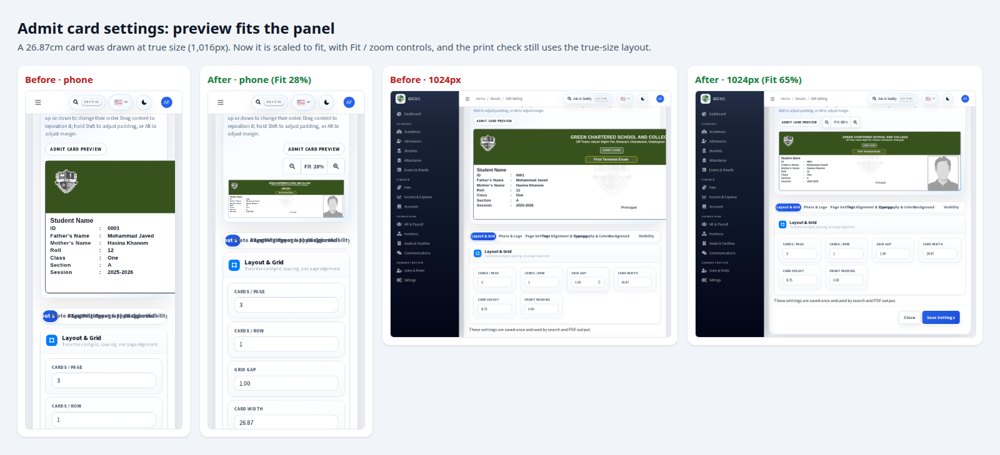
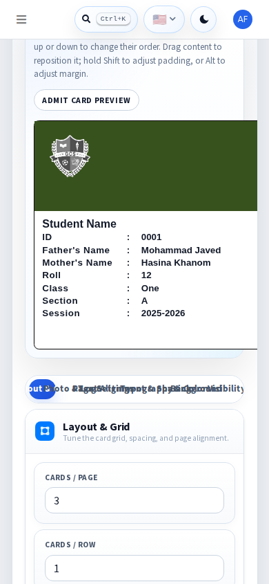
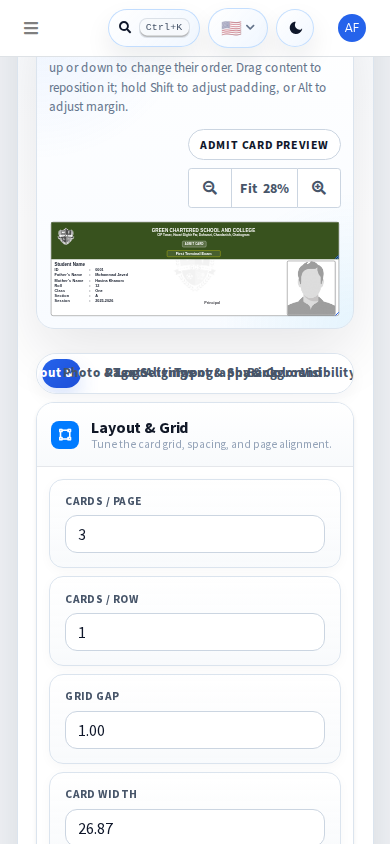
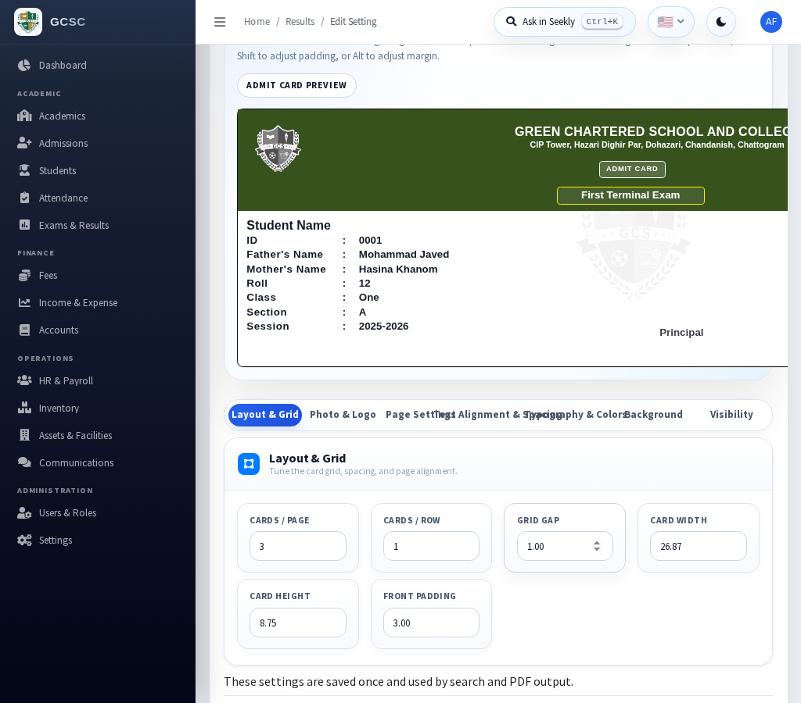
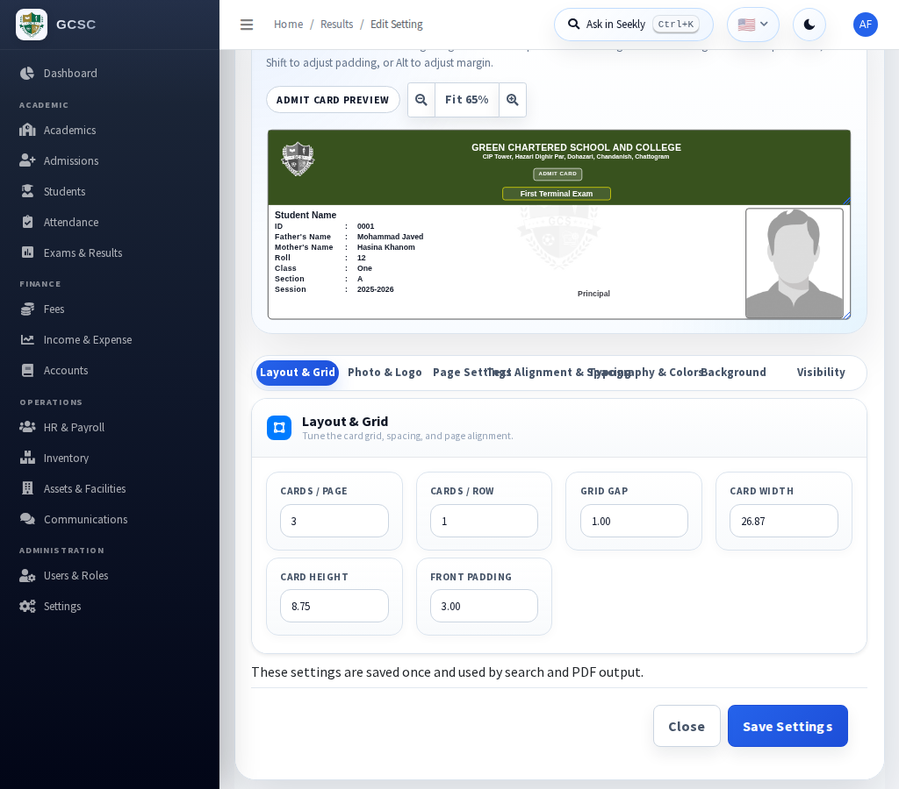
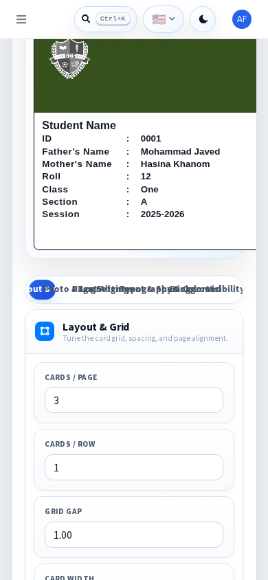
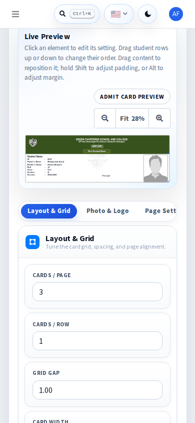
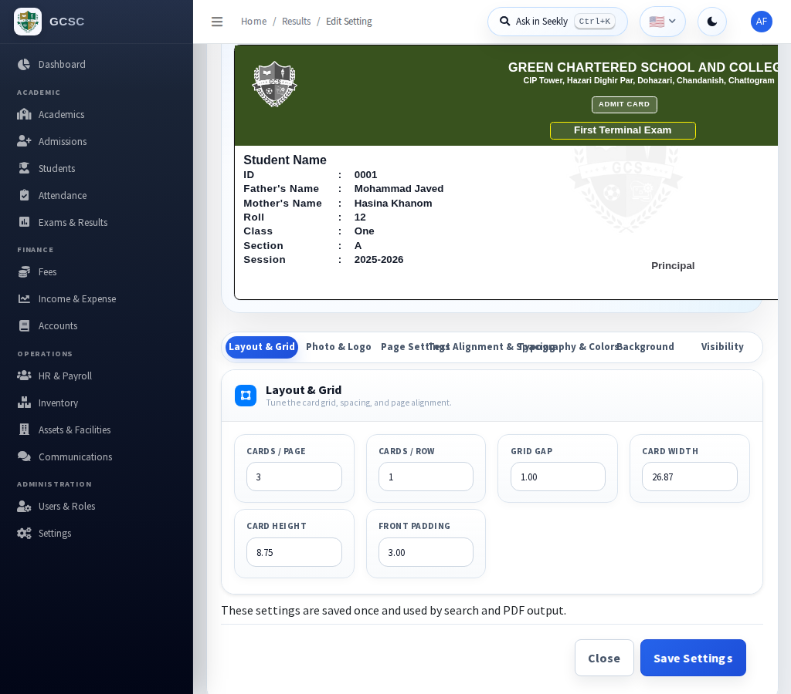
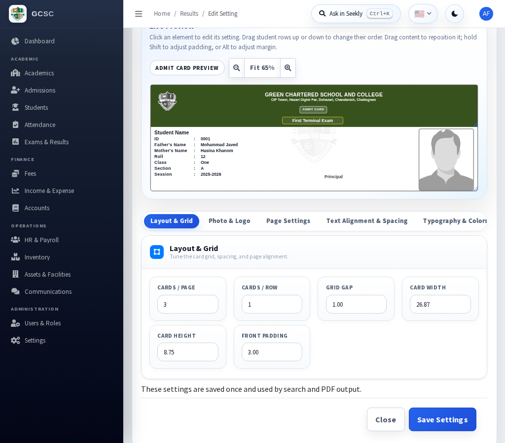

# Changelog: Admit card settings preview

**Date:** 2026-11-23 · **Branch:** `fix/admit-preview-fit` (stacked on `fix/mobile-modals`)

This is the follow-up left open in the mobile modals changelog. The admit / seat card settings preview scrolled sideways inside its panel, on phones and also on tablets and laptops. This PR also fixes the overlapping section tabs in the same modal. The branch is stacked on `fix/mobile-modals`, so all earlier changelogs and screenshots are here too. Once #103 to #111 and #114 are merged, this PR's diff is this commit only.



## How it was checked

`results/admit-seat-cards/settings` was opened with a temporary Super Admin (deleted afterwards) at 390, 768, 1024 and 1440px. The modal was also opened from the main Admit cards page. The saved card on the test install is 26.87 × 8.75cm.

| Check | Before | After |
|---|---|---|
| Preview width at 390px (panel 318px) | 1,016px, scrolls sideways | **288px** (Fit 28%), no scroll |
| Preview width at 768 / 1024px | 1,016px, scrolls sideways | **658 / 664px** (Fit 65%), no scroll |
| Preview at 1440px | true size | true size (unchanged: Fit never enlarges) |
| False "Print warning" while scaled | n/a (the first attempt, with CSS `zoom`, showed one) | **none**: element positions identical to true size |
| Real print problem still warns while scaled | yes | **yes** |
| Dragging an element 20 screen px at 28% | n/a | moves it **18.6mm** (= 20px at true size ÷ 0.28) |
| Card size handle at 28% | n/a | resizes by the true-size amount |
| Section tab labels overflowing their tab | 7 of 7 at 390px, 2 at 1024px, 1 at 1440px | **0**: the tab bar scrolls instead |
| JavaScript errors | 0 | 0 |
| `php artisan test` | 31 failed on `dev` | 31 failed, the same 31 |

---

## 1 · The preview fits its panel, with Fit / zoom controls

**Problem.** The preview draws the card at its real print size: centimetres in, centimetres out. A 9.4cm card is about 355px wide, which fits most panels. A wider card does not: the test install's 26.87cm card is 1,016px. It overflowed the preview panel on every screen narrower than about 1,100px, and on a phone it showed only a third of the card.

**Fix.** The same Fit control the ID card settings already have:
- **Fit** (the default) shrinks the card to the panel width. It never enlarges, so a card that already fits stays at true size. The button shows the scale, for example "Fit 28%".
- **− / +** step through 25% to 200%. Clicking the percentage goes back to Fit.
- Fit recalculates when the panel resizes, when the card size settings change and when the modal opens.

**Why `transform` and not `zoom`.** The ID card preview uses CSS `zoom`. On the admit card that caused false print warnings: `zoom` lays the card out again at the smaller size, the text snaps to whole pixels, and the header grows (130px → 142px in card units at 28%). That pushed the photo and signature past the bottom edge, and the print check flagged them. `transform: scale()` only shrinks the drawing, so the layout, and therefore the print check, is exactly the true-size one. The script gives the wrapper the scaled size so the panel doesn't keep the full-size gap.

```css
.card-preview-zoom--scale > .admit-card {
    transform: scale(var(--preview-zoom, 1));
    transform-origin: top left;
}
```

```js
const naturalWidth = card.offsetWidth;   // true-size layout box; the transform doesn't change it
const fit = Math.max(0.2, Math.min(1, (available - 4) / naturalWidth));
const zoom = manualPreviewZoom ?? fit;
admitSeatLivePreview.style.setProperty('--preview-zoom', String(zoom));
holder.style.width  = `${naturalWidth * zoom}px`;
holder.style.height = `${card.offsetHeight * zoom}px`;
```

**Editing on the scaled card.**
- **Dragging and resizing elements** already converted pixels to millimetres using the card's on-screen width, so they work at any zoom.
- **The card's own size handle** used raw pixels. It now divides by the zoom, so dragging it 20px at 28% changes the card by about 1.9cm, the same as 71px at true size.

| Before | After |
|---|---|
|  |  |
|  |  |

---

## 2 · Section tabs no longer overlap

**Problem.** Each settings tab (Layout & Grid, Photo & Logo, Page Settings, Text Alignment & Spacing, Typography & Colors, Background, Visibility) could shrink to any width (`flex: 1 1 0; min-width: 0`), but its label can't wrap. On narrow screens the labels ran into each other and became unreadable. At 1024px "Text Alignment & Spacing" ran into "Typography & Colors".

**Fix.** Tabs share any spare width but never shrink below their label (`flex: 1 0 auto`). The tab bar already scrolls sideways, so on a phone you swipe it.

| Before | After |
|---|---|
|  |  |
|  |  |

---

## Files changed

- `resources/views/pages/card-settings/_live-preview.blade.php`: Fit / zoom controls in the preview header (admit and seat cards only), the scale wrapper around the card, and their styles
- `resources/views/pages/admit-seat-cards/index.blade.php`: the zoom script, the card size handle corrected for zoom, and the tab sizing

The ID card preview shares `_live-preview.blade.php`. Its markup and zoom are unchanged, because the new controls and wrapper only render for admit and seat cards.

## Notes

- At low zoom the card's corner size handle is small on screen (4px at 28%). Zoom in with **+** to use it, or type the width and height in Layout & Grid.

## Deploying

- No build step: the changes are in Blade views only.
