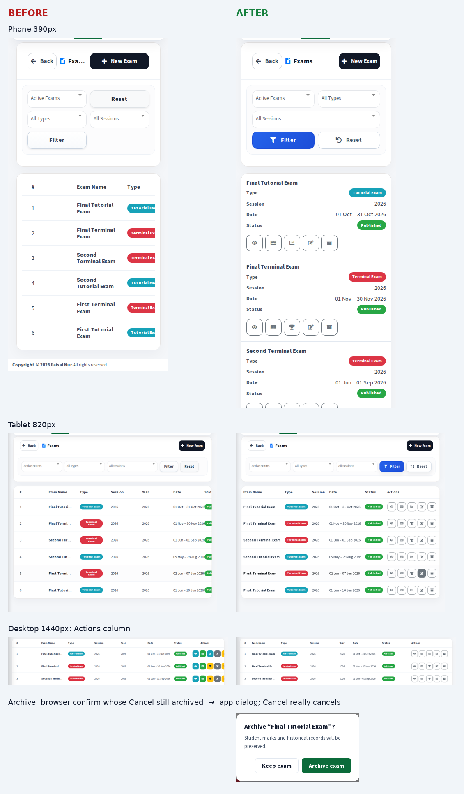
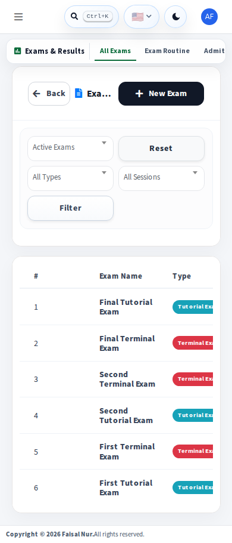
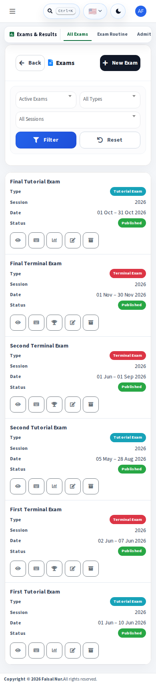
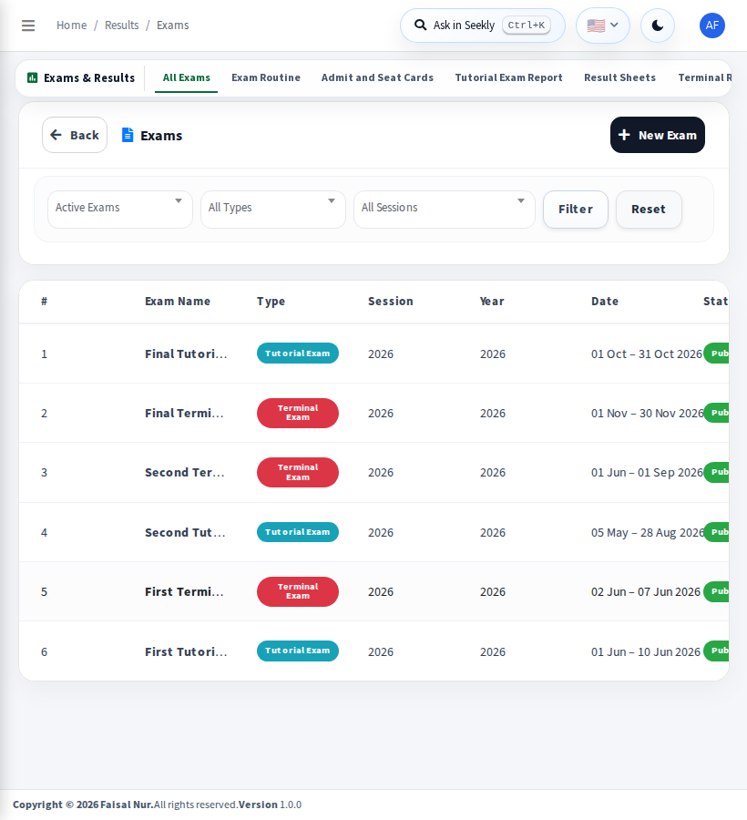
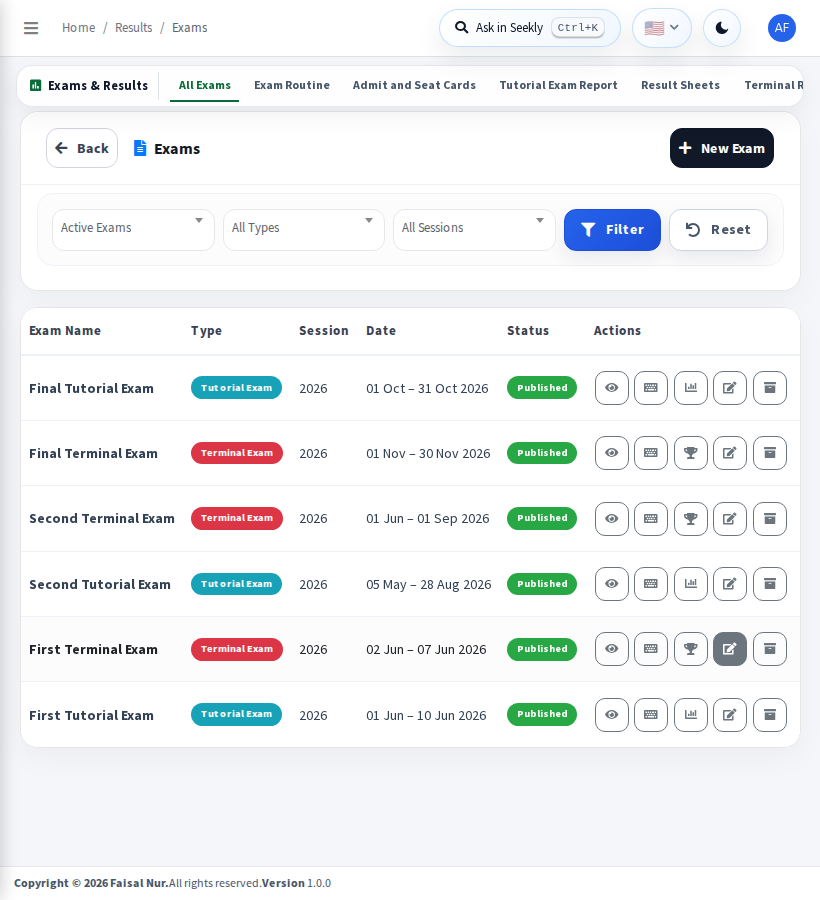
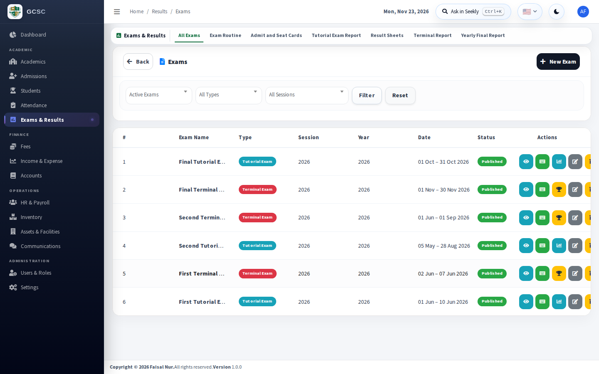
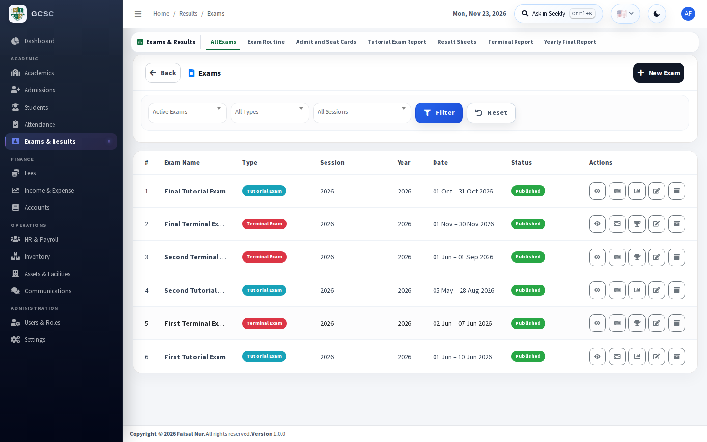

# Changelog: Exams page (`/exams`)

**Date:** 2026-11-23 · **Branch:** `fix/exams-page` (stacked on `fix/mobile-padding`)

The exam list (Exams & Results → All Exams) was hard to use on every screen size, and its Archive/Delete buttons could not be cancelled. This was reported from a phone screenshot after the mobile-padding fix. The branch is stacked on `fix/mobile-padding`, so all earlier changelogs and screenshots are here too. Once #103 to #108 are merged, this PR's diff is this commit only.



| # | Problem | Status |
|---|---|---|
| 1 | **Cancel on Archive/Delete still archived or deleted the exam** | Fixed |
| 2 | Phone: 980px table scrolled sideways, exam name and actions out of view | Fixed: one card per exam |
| 3 | Tablet and laptop with the sidebar open: Actions column hidden off the right edge | Fixed: table fits its box |
| 4 | Desktop: "#" column 130px wide while the fifth action button was cut off | Fixed |
| 5 | Phone header title cut to "Exa…"; filter grid out of order | Fixed |
| 6 | Action buttons in five colours | One calm outline style; only Delete is red |

## How it was verified

The checks ran against the local app with a temporary Super Admin, which was deleted afterwards.

| Check | Before | After |
|---|---|---|
| Cancel on Archive: request sent? (POSTs blocked by the test, so nothing was archived) | **yes**, `POST /exams/8` | **no** |
| Confirm on Archive: request sent? | — | yes, `POST /exams/8` |
| Exam 8 status after the tests | published | published (unchanged) |
| Table scrolls sideways inside its box: 390, 768, 820, 900px; 992, 1024, 1100, 1280, 1440px with the sidebar open and collapsed | scrolls at every width | **fits at every width** |
| Phone 390px | 980px table in a 364px box | 364px cards, content 25px from the screen edge |
| `php artisan test` | 31 failed on `dev` | 31 failed, the same 31 |

---

## 1 · Archive and Delete could not be cancelled

**Problem.** The Archive/Delete and Restore buttons sit outside their hidden forms and point at them with `form="delete-exam-…"`. Their inline handler called `this.closest('form').requestSubmit()`, but `closest('form')` is `null` for a button outside its form. Nothing ever called `preventDefault()`. So when the user pressed **Cancel** in the browser's confirm box, the click went ahead and submitted the form anyway. Pressing OK only worked because of the same default submit, after a script error.

**Fix.** The buttons are now plain submit buttons with `data-confirm`, handled by the app's shared confirm dialog from F-29. The dialog stops the click, and only **Archive exam** / **Delete exam** re-clicks the button. The dialog names the exam.

```blade
{{-- before --}}
<button class="btn btn-xs {{ $requiresArchive ? 'btn-warning' : 'btn-danger' }} exam-action-btn" …
    onclick="if(confirm('{{ $requiresArchive ? 'Archive this exam? …' : 'Delete this draft exam? …' }}')){this.closest('form').requestSubmit()}"
    form="delete-exam-{{ $exam->id }}">

{{-- after --}}
<button type="submit" class="btn btn-xs {{ $requiresArchive ? 'btn-outline-secondary' : 'btn-outline-danger' }} exam-action-btn" …
    data-confirm="{{ $requiresArchive ? __('Archive “:name”?', ['name' => $exam->name]) : __('Delete draft exam “:name”?', ['name' => $exam->name]) }}"
    data-confirm-text="{{ $requiresArchive ? __('Student marks and historical records will be preserved.') : __('This cannot be undone.') }}"
    data-confirm-action="{{ $requiresArchive ? __('Archive exam') : __('Delete exam') }}"
    data-confirm-cancel="{{ __('Keep exam') }}"
    @if ($requiresArchive) data-confirm-tone="primary" @endif
    form="delete-exam-{{ $exam->id }}">
```

Restore gets the same treatment: "Restore “…” as a draft?", with *Restore exam* / *Cancel*.


---

## 2 · Phone: one card per exam

**Problem.** The table had `min-width: 980px`, so on a phone it scrolled sideways inside a 364px box. The exam name was off to one side, the Published badge ran into the buttons, and the actions were out of view.

**Fix.** Below 768px the table uses the shared stacked layout from F-23 (`.ds-table--stack`): the exam name as the card title, then labelled Type / Session / Date / Status rows, then the action buttons at 40px.
- **Spacing:** the extra `container-fluid` padding, card-body padding and row padding are trimmed, so cards line up with the page edges like the Student Directory (content 25px from the screen edge).
- **Header:** the grid gives New Exam only the width it needs, so the title shows in full.
- **Filters:** Status | Type, then Session across the full width, then **Filter** (primary) | Reset. Before, Reset sat beside Status and Filter was alone on the third row.

```blade
{{-- after --}}
<table class="table table-hover table-sm mb-0 exam-table ds-table--stack">
…
<td class="ds-hide-sm">{{ $loop->iteration }}</td>
<td class="exam-name-cell ds-stack-title"><strong>{{ $exam->name }}</strong></td>
<td class="exam-type-cell" data-label="{{ __('Type') }}">…</td>
<td class="exam-session-cell" data-label="{{ __('Session') }}">…</td>
…
<td class="exam-actions-cell ds-stack-actions">…</td>
```

| Before | After |
|---|---|
|  |  |

---

## 3 · Tablet and laptop: the table fits its box

**Problem.** Between 768 and about 1100px, the 980px minimum pushed Status and Actions off the right edge. At 992–1024px with the sidebar open, the box is only 701–733px, so viewport breakpoints alone couldn't fix it.

**Fix.** The table wrapper is a CSS container (`container: exam-list / inline-size`), so the rules follow the table's own width, not the screen's:
- **Box under 1000px:**
  - Auto table layout, and the "#" column is hidden.
  - Exam names and dates can wrap, and badges stay on one line.
  - Cell side padding drops from 16 + 24px (a global table rule) to 8 + 8px.
  - Action buttons are 32px.
- **Box under 820px:** Year is hidden too, because the Date column already includes it ("01 Oct – 31 Oct 2026").
- **Filters, 768–1099px:** the selects shrink, so Filter and Reset stay on the same row.

```css
.exam-table-responsive { container: exam-list / inline-size; }

@container exam-list (max-width: 999px) {
    .exam-table { min-width: 0; table-layout: auto; }
    .exam-table th, .exam-table td { padding-left: 0.5rem !important; padding-right: 0.5rem !important; }
    …
}

@container exam-list (max-width: 819px) {
    .exam-table th:nth-child(5), .exam-table td.exam-year-cell { display: none !important; }
}
```

| Before | After |
|---|---|
|  |  |

---

## 4 · Desktop: column widths

**Problem.** `table-layout: fixed` split the width evenly. "#" got about 130px, while the Actions column was narrower than its five buttons, so the last button was cut off and exam names were truncated early.

**Fix.** Fixed widths for the small columns: "#" 48px, Year 72px, Actions 236px. The rest goes to the name, type, session, date and status columns.

| Before | After |
|---|---|
|  |  |

---

## 5 · Calmer action buttons

View, Enter Marks, Terminal Result / Preview, Edit, Archive and Restore were teal, green, yellow, grey and yellow filled buttons. They are now one neutral outline style, matching the calm palette from F-22. Only **Delete**, on draft exams, is red (`btn-outline-danger`). The icons, tooltips and `aria-label`s are unchanged.

---

## Files changed

- `resources/views/pages/exams/index.blade.php`: markup and page styles
- `lang/bn.json`: 11 new strings (dialog titles, details and buttons, plus "Year")

## Deploying

- No build step, migrations or config changes for this PR alone. The Blade view and the translations take effect on deploy.
