# Changelog: Forms on mobile

**Date:** 2026-11-23 · **Branch:** `fix/mobile-forms` (stacked on `fix/mobile-tables`)

A phone-width check of every admin form, following the mobile tables fix. The branch is stacked on `fix/mobile-tables`, so all earlier changelogs and screenshots are here too. Once #103 to #110 are merged, this PR's diff is this commit only.

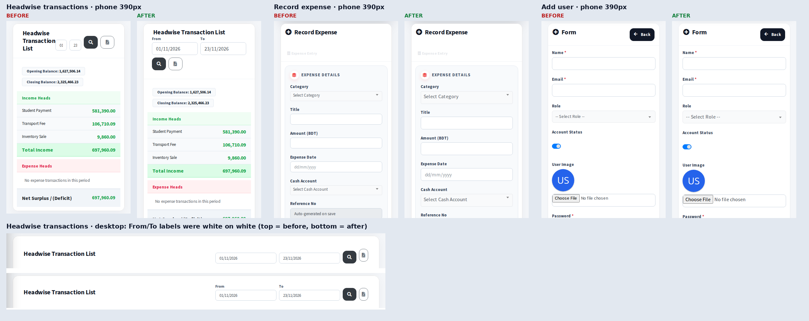

## What was found

Every audited admin screen (315) was opened at 390px with a temporary Super Admin, which was deleted afterwards. 177 screens have form fields: 1,072 visible inputs, selects and textareas, plus their buttons.

| Problem | Before: fields (screens) | After |
|---|---|---|
| **Text under 16px** (12.5–14.7px). iOS Safari zooms the page in when such a field is tapped and doesn't zoom back out. | **685** (156) | **0** |
| **Fields under 36px tall** (`form-control-sm` = 31–34px) | **264** (38) | **0** |
| **Form buttons under 36px tall** (`btn-sm`/`btn-xs` = 25–30px) | **44** (14) | **0** |
| **Squeezed fields:** Headwise transactions dates were 37px wide, showing "01" and "23" | 2 (1) | **0**, now 144px |
| **Invisible labels:** inline `color:#FFF` on a header that's no longer dark, on desktop too | 3 views | **0** |
| Fields overflowing their card, or sideways page scroll | 0 | 0 |
| `php artisan test` | 31 failed on `dev` | 31 failed, the same 31 |

Not changed: the School settings colour-code fields (110px, holding a 7-character hex code) and the Certificates layout designer's two-column settings sidebar. Both are dense by design and work at their current size.

---

## 1 · 16px text, 40px fields and buttons on phones

Applied once, in `admin.css`, below 768px. Tablet and desktop are unchanged.

```css
@media (max-width: 767.98px) {
    input:not([type=checkbox]):not([type=radio]):not([type=range]):not([type=color]):not([type=file]),
    select, textarea, .form-control, .custom-select,
    .select2-container .select2-selection__rendered,
    .select2-container .select2-search__field {
        font-size: 16px !important;   /* stops iOS zoom-on-tap */
    }

    .content-wrapper .form-control:not(textarea),
    .content-wrapper .custom-select { min-height: 40px; }

    .content-wrapper .select2-container--default .select2-selection--single { min-height: 40px; display: flex; align-items: center; }
    .content-wrapper .select2-container--default .select2-selection--multiple { min-height: 40px; }

    .content-wrapper form .btn,
    .content-wrapper form button:not(.close):not(.select2-selection__choice__remove) { min-height: 40px; }
}
```

The attendance page has its own compact phone layout, which set its filters to 34px. Those are raised to 40px to match (`resources/views/pages/attendance/index.blade.php`).

| Before | After |
|---|---|
| 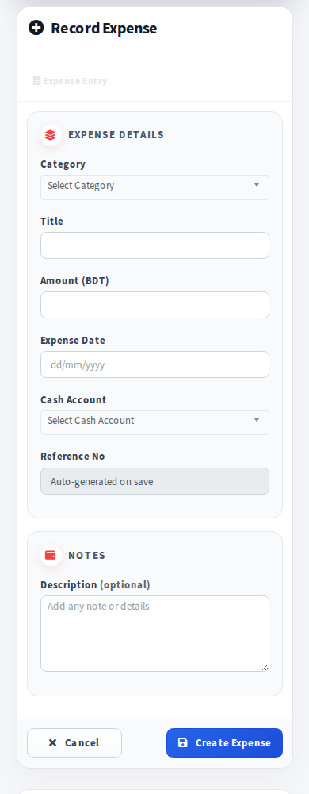 | 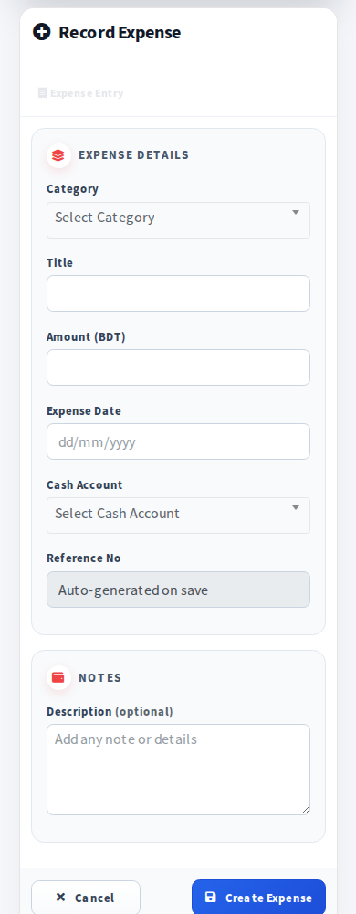 |
| 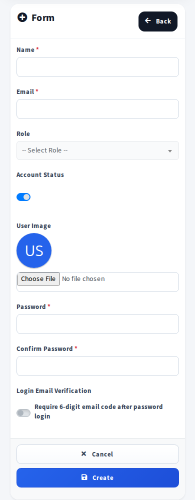 | 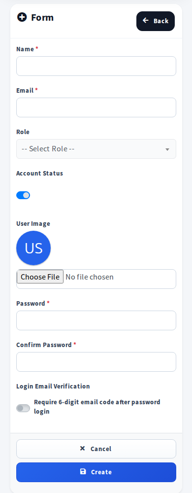 |
| 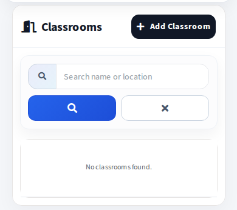 | 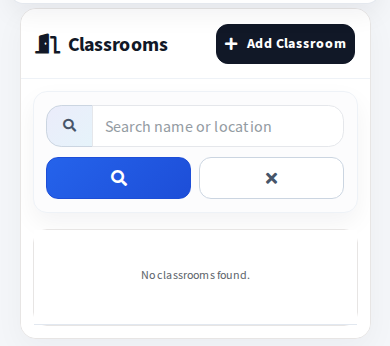 |

---

## 2 · Filters in a card header (Headwise transactions, Budget allocations)

**Problem.** Three views put their filter inside the card header, next to the title:
- **Squeezed on phones:** on Headwise transactions the two date fields shrank to 37px ("01", "23").
- **Invisible labels:** "From", "To" and "Year" had an inline `color:#FFF`. Since the P2 restyle made card headers light, those labels were white on white, on desktop too.

**Fix.**
- **Classes:** the header gets `ds-header-filter` and its controls `ds-header-filter__controls`.
- **Labels:** they use a muted colour (`.ds-header-filter__label`).
- **Buttons:** they align with the bottom of the fields; the inline `margin-top: 10px` that pushed the PDF button out of line is overridden.
- **Phone layout:** the filter wraps below the title and uses the full width. Fields go two per row, buttons after.

```blade
{{-- before --}}
<div class="card-header shadow p-0 flex justify-between items-center">
    …
    <div class="flex gap-2 pr-3 py-2 items-center justify-center ml-auto">
        <form method="GET" class="flex gap-2 items-end">
            <div>
                <label for="reports-headwise-transactions-from" style="font-size:12px;color:#FFF">From</label>

{{-- after --}}
<div class="card-header shadow p-0 flex justify-between items-center ds-header-filter">
    …
    <div class="flex gap-2 pr-3 py-2 items-center justify-center ml-auto ds-header-filter__controls">
        <form method="GET" class="flex gap-2 items-end">
            <div>
                <label for="reports-headwise-transactions-from" class="ds-header-filter__label">From</label>
```

**Files changed**
- `resources/views/pages/reports/headwise-transactions.blade.php`
- `resources/views/pages/budget-allocations/index.blade.php`
- `resources/views/pages/budget-allocations/report.blade.php`
- `resources/css/admin.css`: `.ds-header-filter` rules

| Before | After |
|---|---|
| 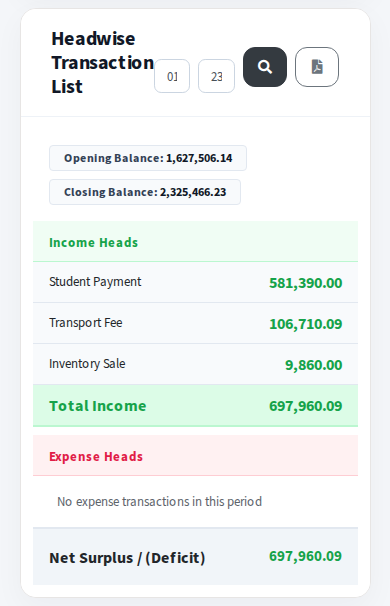 | 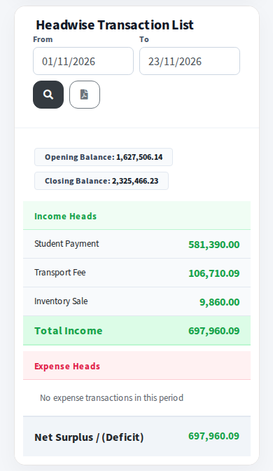 |
| 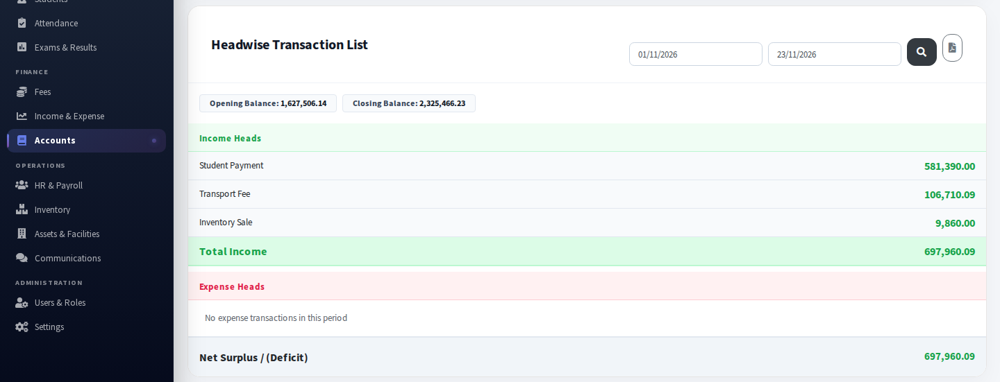 | 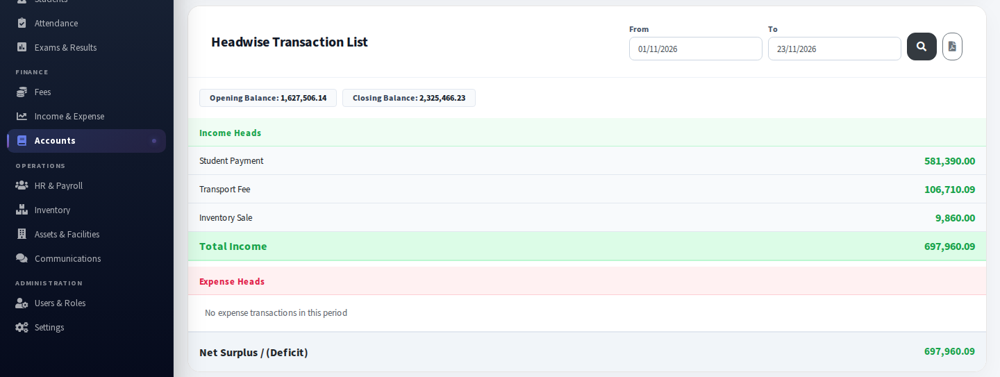 |

Budget allocations on a phone, after:

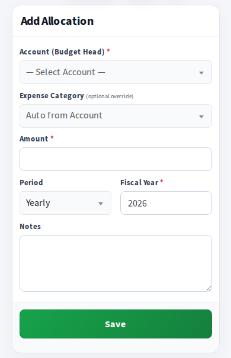

---

## Deploying

- Run `npm run build`, because `admin.css` changed. No migrations or config changes.
