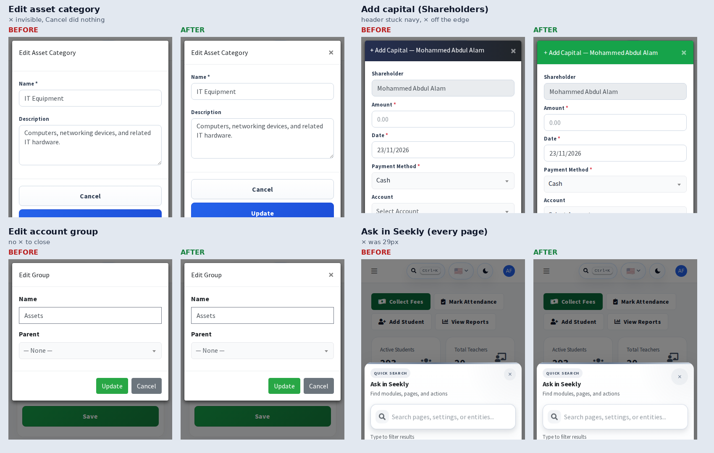
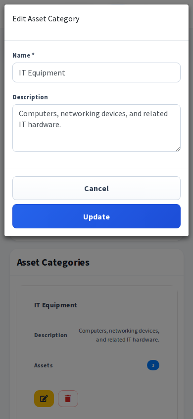
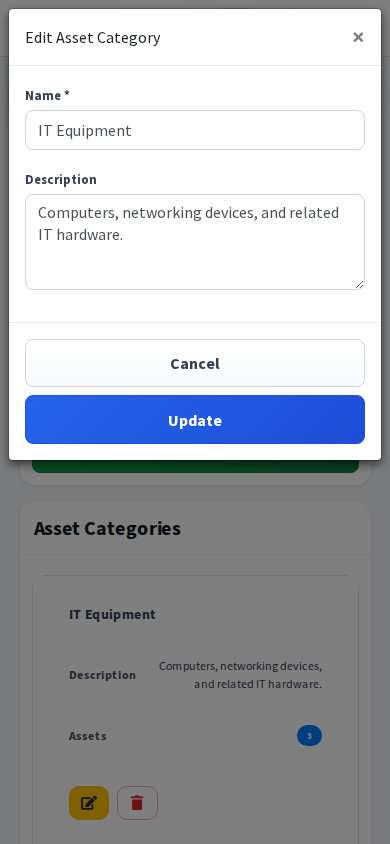
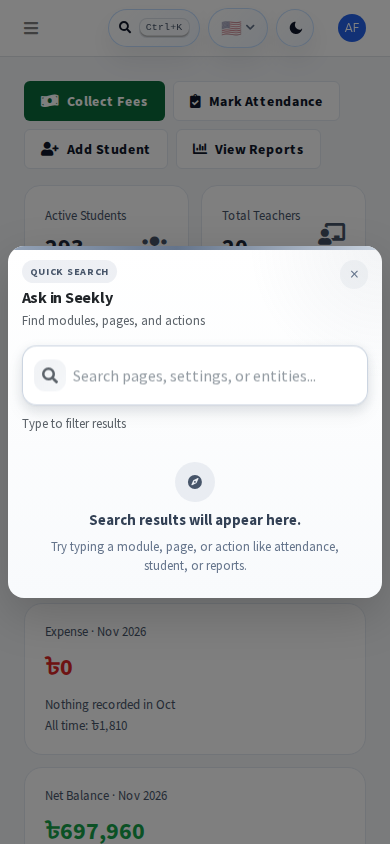
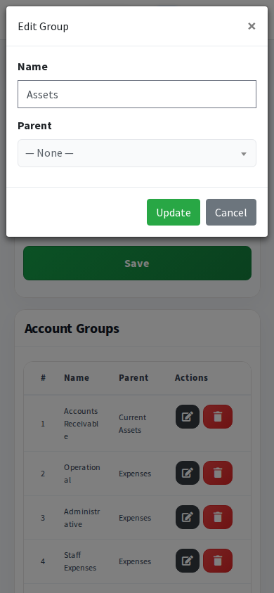
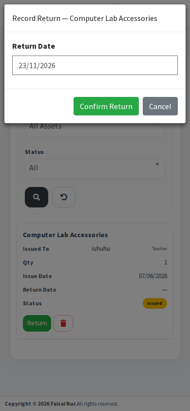
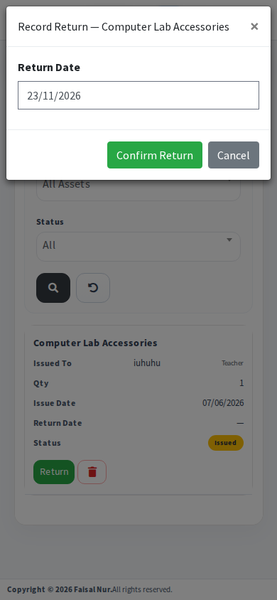
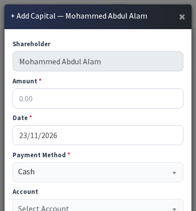
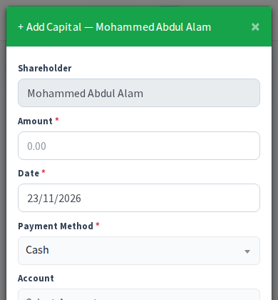

# Changelog: Modals on mobile

**Date:** 2026-11-23 · **Branch:** `fix/mobile-modals` (stacked on `fix/mobile-forms`)

A phone-width check of every admin modal (pop-up dialog), following the mobile forms fix. The branch is stacked on `fix/mobile-forms`, so all earlier changelogs and screenshots are here too. Once #103 to #111 are merged, this PR's diff is this commit only.



## How it was checked

Every audited admin screen (315) was opened at 390×844 with a temporary Super Admin, which was deleted afterwards. Every Bootstrap modal on each screen was opened and measured: **423 modals on 308 screens**, including the site-wide search and the shared confirm dialog.

| Check | Before | After |
|---|---|---|
| **Edit asset category:** × and Cancel close the dialog | **no** (Bootstrap 5 markup) | **yes** |
| Close (×) buttons smaller than 40×40px | 308 (the search modal, on every page: 29px) | **0** |
| Modals with no way to close except Cancel / tapping outside | 22 | **3**, all with their own close: confirm dialog (Cancel), ID card settings ×2 ("Back to cards") |
| Add capital / Withdraw header colour | always navy; × 3px off the edge, sideways scroll | **green / red**, × inside |
| Modals that scroll sideways | 3 | **2**: Admit card settings preview, see follow-ups |
| Fields that zoom on tap / fields or buttons under 36px | 0 (fixed by #111) | 0 |
| Dialog margins on a phone | 8px each side | unchanged (fine) |
| `php artisan test` | 31 failed on `dev` | 31 failed, the same 31 |

---

## 1 · Bootstrap 5 markup in a Bootstrap 4 app (Edit asset category, 5 alerts)

**Problem.** The app runs **Bootstrap 4.6.1**. Six views used Bootstrap 5 markup, which Bootstrap 4 ignores:
- **Edit asset category modal:** the header × was `class="btn-close" data-bs-dismiss="modal"`. Bootstrap 4 has no `btn-close` style, so it rendered **0px wide and empty**. Neither the × nor **Cancel** (`data-bs-dismiss`) closed the dialog. The only way out was tapping the backdrop or pressing Esc, and phones have no Esc key.
- **Five success alerts** (asset categories, assets, asset purchases, inventory purchases, transports): an invisible × that did nothing.

**Fix.** Bootstrap 4 markup: `class="close" data-dismiss="modal|alert"` with a visible `×` and an `aria-label`. The modal is opened with `$('#editModal').modal('show')` instead of `new bootstrap.Modal(...)`.

```blade
{{-- before --}}
<button type="button" class="btn-close" data-bs-dismiss="modal"></button>
…
<button type="button" class="btn btn-secondary" data-bs-dismiss="modal">Cancel</button>
…
new bootstrap.Modal(document.getElementById('editModal')).show();

{{-- after --}}
<button type="button" class="close" data-dismiss="modal" aria-label="{{ __('Close') }}"><span aria-hidden="true">&times;</span></button>
…
<button type="button" class="btn btn-secondary" data-dismiss="modal">Cancel</button>
…
$('#editModal').modal('show');
```

Verified in the browser: before, the × measured 0×40px with no glyph, and Cancel and × left the dialog open. After, the × is 45×56px and Cancel closes the dialog. No `data-bs-*` or `btn-close` markup is left in the views.

| Before | After |
|---|---|
|  |  |

---

## 2 · Close buttons: 40×40px tap target

The search modal ("Ask in Seekly", on every page) had a 29×29px ×. On phones, modal-header close buttons and the search close get at least 40×40px (`admin.css`). Other modals' × buttons were already 45×56px.

| Before | After |
|---|---|
|  |  |

---

## 3 · A × on modals that only had Cancel (Account groups, Asset issues)

The Edit group modals (one per group, 17 on the page) and Record return had no header ×, only a Cancel button at the bottom of the form. They now have a standard header × like every other modal.

| Before | After |
|---|---|
|  |  |
|  |  |

---

## 4 · Add capital / Withdraw header (Shareholders)

**Problem.** The modal header also carried `card-header`, so it picked up the card-header navy gradient and spacing:
- **Colour:** the script's green (capital) or red (withdraw) background never showed.
- **×:** it sat 3px outside the dialog, so the dialog scrolled sideways on phones.

**Fix.** The header is a plain `modal-header`. The script's green/red now applies, and the × is white on it.

```blade
{{-- before --}}
<div class="modal-header card-header" id="txnModalHeader">
    <h5 class="modal-title" id="txnModalTitle">Add Transaction</h5>
    <button type="button" class="close text-white" data-dismiss="modal"><span>&times;</span></button>

{{-- after --}}
<div class="modal-header" id="txnModalHeader">
    <h5 class="modal-title" id="txnModalTitle">Add Transaction</h5>
    <button type="button" class="close" data-dismiss="modal" aria-label="{{ __('Close') }}"><span aria-hidden="true">&times;</span></button>
```

| Before | After |
|---|---|
|  |  |

---

## Files changed

- `resources/views/pages/assets/categories/index.blade.php`: modal and alert to Bootstrap 4
- `resources/views/pages/assets/assets/index.blade.php`, `pages/assets/purchases/index.blade.php`, `pages/inventory/purchases/create.blade.php`, `transports/index.blade.php`: alert × to Bootstrap 4
- `resources/views/pages/account-groups/index.blade.php`, `pages/asset-issues/index.blade.php`: header ×
- `resources/views/pages/shareholders/index.blade.php`: transaction modal header
- `resources/css/admin.css`: 40×40 close buttons on phones

## Follow-ups (not in this PR)

- **Admit card settings preview** (`results/admit-seat-cards/settings`): the live preview is about 1,016px wide and scrolls sideways inside the modal on a phone. I tried scaling it to fit. The card's size depends on its container and on the page's own preview scripts, and scaling made the print safe-area check show false warnings. It needs a fit control built into the preview, like the ID card settings' "Fit" zoom. It's a desktop-oriented designer tool, so this was left as is.

## Deploying

- Run `npm run build`, because `admin.css` changed.
