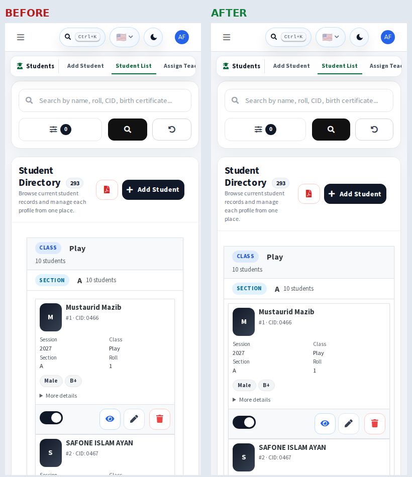

# Changelog: Mobile side padding

**Date:** 2026-11-22 · **Branch:** `fix/mobile-padding` (stacked on `fix/stretched-buttons`)

On a phone, the Student Directory wasted side space and wasn't centred. Each student card started 60px from the left edge and ended 52px from the right, leaving 278 of 390px for content. The cause was four layers of padding stacked up. Separately, every admin page sat off-centre: 12px gutter on the left, 4px on the right. This was reported from a screenshot after the stretched-buttons fix. The branch is stacked on `fix/stretched-buttons`, so all earlier changelogs and screenshots are here too. Once #103 to #107 are merged, this PR's diff is this commit only.



## How it was verified

The checks ran against the local app with a temporary Super Admin, which was deleted afterwards.

| Check | Before | After |
|---|---|---|
| Page container gutter, left / right (dashboard, students, add subject, employees, collect fees, trial balance; 390 and 1440px) | 12 / **4** | **12 / 12** |
| Student Directory at 390px: class box from the edges, left / right | 43 / 35 | **25 / 25**, level with the card title |
| Student Directory at 390px: student card from the edges, left / right | 60 / 52 | **34 / 34** |
| Student card width at 390px | 278px | **322px** (+44px) |
| Every admin screen at 390 and 1440px: pages that newly scroll sideways, stretched buttons | — | none new (`admission` at 390px still overflows by 5px, as before) |
| `php artisan test` | 31 failed on `dev` | 31 failed, the same 31 |

---

## Cause 1 · The page wrapper overflowed by 8px (all admin pages)

**Problem.** `layouts/master.blade.php` wraps every page in `<div class="container-fluid m-1">`. Bootstrap gives `.container-fluid` `width: 100%`, and `m-1` adds a 4px margin on each side. The box was 8px wider than its parent and overflowed on the right, eating the right-hand page padding. Content sat 12px from the left edge and 4px from the right.

**Files changed**
- `resources/css/admin.css`

```css
/* after (new rule) */
.content-wrapper > .content > .container-fluid.m-1 {
    width: auto;
}
```

With `width: auto`, the block fills its parent minus the margins, so both sides get the same gutter. The layout markup is unchanged.

---

## Cause 2 · Stacked padding in the Student Directory mobile list

**Problem.** Below 768px the student list is cards grouped by class and section. Four nested boxes each added their own side padding:

| Layer | Before | After |
|---|---|---|
| Card body (`px-0`, overridden to 13.6px by `public/backend_style.css`) | 13.6px | **0** |
| Mobile list wrapper (`px-3`) | 16px | **12px**, the one gutter inside the card, matching the card header |
| Class group box (1px border) | 1px | 1px |
| Section student list (`p-3`) | 16px | **8px** |

**Files changed**
- `resources/views/pages/students/table.blade.php`: hook classes `students-card-body`, `students-mobile-list` and `students-mobile-section` on the three wrappers
- `resources/views/pages/students/index.blade.php`: phone-only rules (max-width 767.98px)

```css
/* after — inside @media (max-width: 767.98px) */
.content-wrapper .students-directory .card .card-body.students-card-body {
    padding-left: 0 !important;
    padding-right: 0 !important;
}

.students-directory .students-mobile-list {
    padding-left: 0.75rem !important;
    padding-right: 0.75rem !important;
}

.students-directory .students-mobile-section {
    padding: 0.5rem !important;
}
```

The card-body selector needs five parts: `public/backend_style.css` (not part of the Vite build) sets `.content-wrapper .card .card-body.px-0 { padding: 0.85rem !important }`, and only a more specific selector overrides it. Tablet and desktop are unchanged, since there the table view is shown instead of the cards.

| Before | After |
|---|---|
|  |  |

---

## Deploying

- Run `npm run build`, because `admin.css` changed. No migrations or config changes.
