# Changelog: Dropdowns and date pickers on mobile

**Date:** 2026-11-23 · **Branch:** `fix/mobile-pickers` (based on `dev`)

A phone-width check of every dropdown and date picker in the admin, following the mobile modals and admit card preview fixes. #103 to #120 are merged into `dev`, so this branch is based on `dev` directly and its diff is this change only.

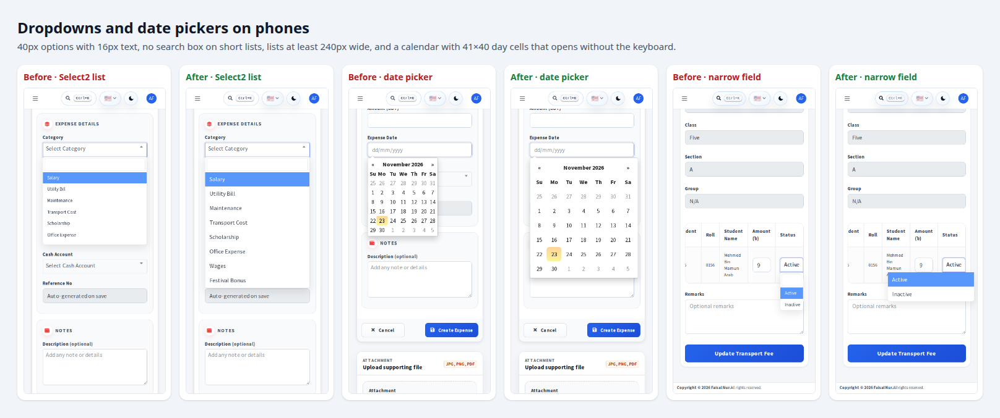

## How it was checked

Every audited admin screen (315) was opened at 390×844 with a temporary Super Admin, which was deleted afterwards. On each screen, and inside up to three modals per screen, the script opened every kind of picker and measured it:
- **Select2:** up to 4 lists per screen.
- **bootstrap-datepicker:** up to 2 fields.
- **Native inputs:** date and time.
- **Menus:** Bootstrap dropdown menus.
- **Tom Select:** none were visible on any screen.

The keyboard behaviour was then checked by tapping in a touch-emulated phone.

| Check | Before | After |
|---|---|---|
| Select2 options under 40px tall | **309** of 356 lists (32px rows) | **0** |
| Select2 option text under 16px | **319** (13px) | **0** |
| Search box on a short list (under 8 options) | **243** | **0** (lists of 8+ keep it) |
| Select2 lists narrower than 200px (two-column forms: 56–192px) | **43** | **0**, at least 240px and kept on screen |
| Calendar day cells | **20×26px** (80 calendars on 54 screens) | **41×40px** |
| Tapping a date field opens the keyboard over the calendar | **all 80** | **none** (`inputmode="none"` on touch) |
| Calendar opening past the bottom of the screen | n/a | **0**: the field scrolls up so the calendar fits |
| Menu items under 40px (language 38, More actions 32, editor Style 27) | 4 menus | **0** |
| Editor Paragraph menu clipped by the editor box | 2 screens | **0** |
| Native date / time / month inputs | 9, all 40px and 16px (from #111) | unchanged |
| Tablet and desktop | n/a | unchanged (all rules are phone-only, under 768px) |
| `php artisan test` | 489 passed on `dev` | 489 passed |

Two sweep flags were checked by hand and are not problems: the participants list in **New conversation** (correct when opened from the Inbox drawer's New chat button) and the ID card settings **Page size / Orientation** lists (they stay attached to their field when the page scrolls).

---

## 1 · Select2 lists: 40px rows, 16px text, no search box on short lists

**Problem.**
- **Small rows:** options were 32px tall with 13px text. That's hard to hit with a finger, and the text was smaller than the field it came from (16px since #111).
- **Search box on short lists:** every list had one, even "Active / Inactive". It used a row, and tapping it opened the keyboard.

**Fix.**
- **Rows:** 40px, with 16px text, on phones (`admin.css`).
- **Search box:** on phones, single-choice lists with fewer than 8 options don't get one (`minimumResultsForSearch: 8` in the shared Select2 setup, `layouts/master.blade.php`). Longer lists and multi-selects keep it.

The 16px needed a slightly more specific selector: an inline style in `layouts/partials/_head.blade.php` sets options to `0.82rem` and loads after `admin.css`.

| Before | After |
|---|---|
| 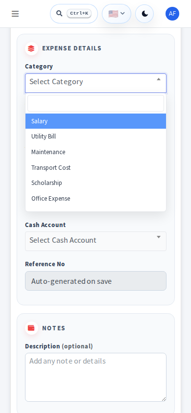 | 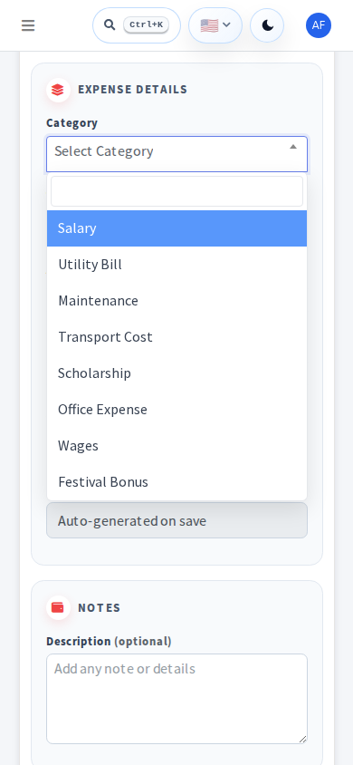 |
| 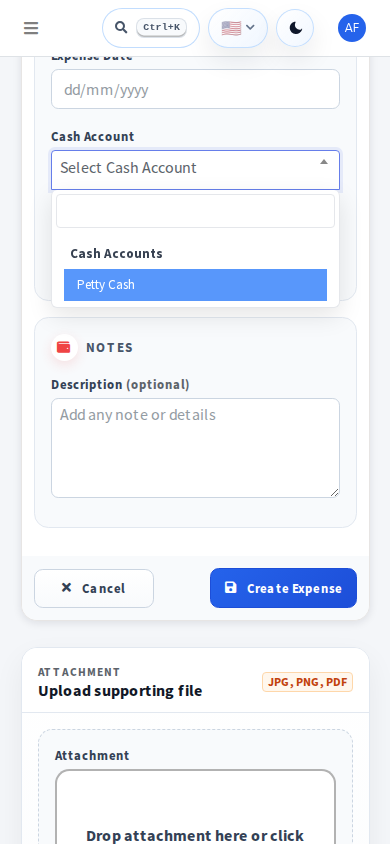 | 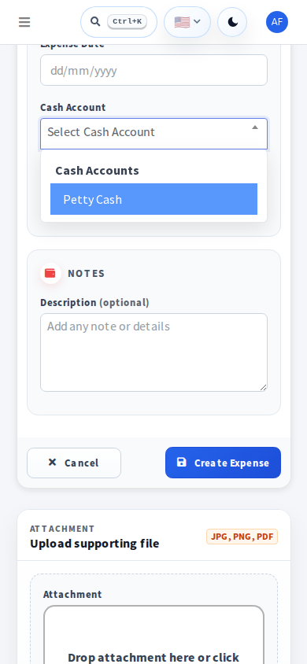 |

## 2 · Lists from narrow fields are at least 240px wide

**Problem.** A Select2 list is as wide as its field. In two-column forms that's narrow: Transport fee status 64px, Certificate zoom 56px, the asset picker in purchases 105px, and the ID card settings 133px. With 16px text the options would wrap into stacks of short lines.

**Fix.** On phones the list is at least 240px wide. Select2 lines it up with the field's left edge, so a list from a field on the right would run off the screen. A small handler on `select2:open` slides it left to stay 8px inside the edge.

| Before | After |
|---|---|
| 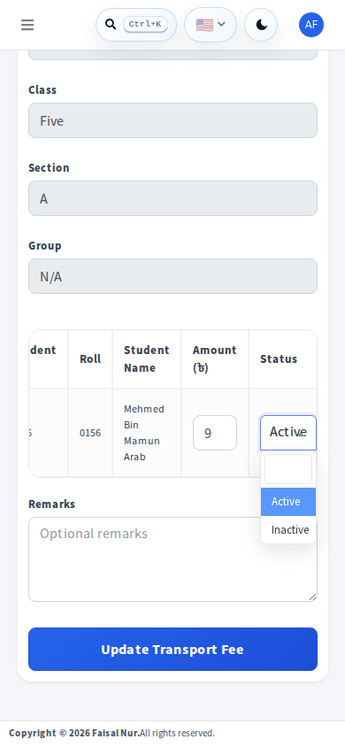 | 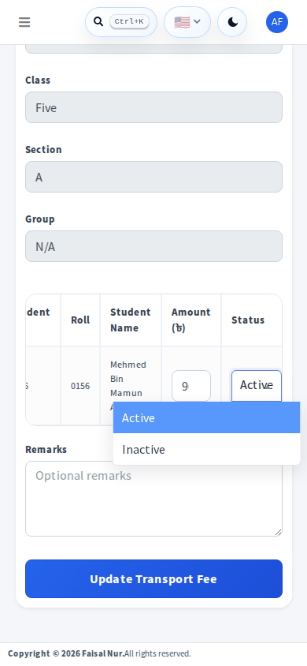 |

## 3 · Date picker: tappable days, no keyboard on top

**Problem.**
- **Tiny calendar:** bootstrap-datepicker drew a 195px calendar with 20×26px day cells.
- **Keyboard on top:** the date field is a text box, so tapping it on a phone opened the keyboard, which covered the calendar.

**Fix.**
- **Size:** on phones the calendar is 300px wide, with 41×40px day cells, and month and year cells 48px tall.
- **Keyboard:** on touch, a date field gets `inputmode="none"` just before it's focused, so the keyboard stays closed. A hardware keyboard can still type a date. This is done on `touchstart` for any field with a datepicker, so it also covers datepickers that pages create themselves.
- **Fitting on screen:** the bigger calendar could open past the bottom of the screen for a field low on the page (by 3–54px on 5 screens). On phones the field now scrolls up just enough for the whole calendar to show.

| Before | After |
|---|---|
| 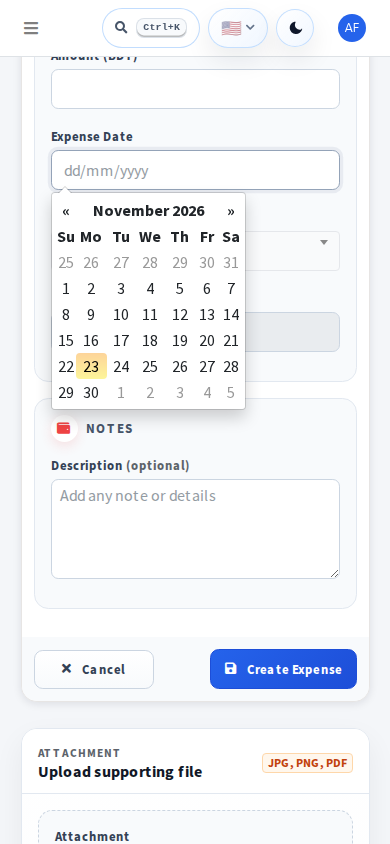 | 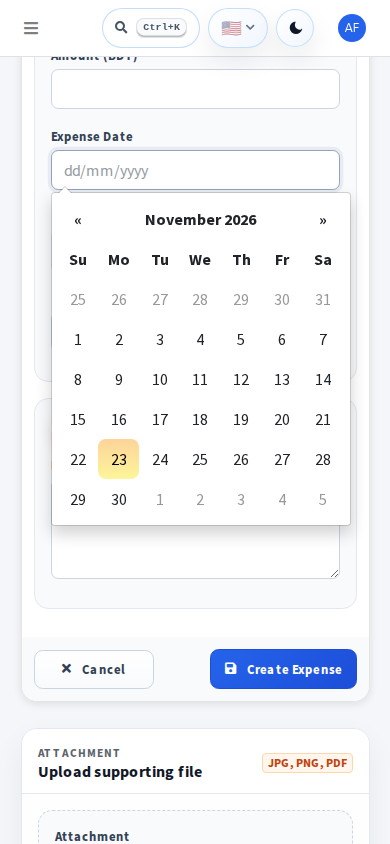 |

## 4 · Menus: 40px items, editor menus not clipped

- **Menu items:** Bootstrap dropdown menus (the language menu, More actions, More and the editor's menus) have 40px items on phones.
- **Rich-text editor (Summernote):** the editor box is also a `.card`, and its `overflow: hidden` cut off the right edge of the Paragraph (alignment) menu. It's visible on phones now. The editor's menus are capped at 280px and scroll inside, so the taller Style menu (9 headings) doesn't run past its section.

| Before | After |
|---|---|
| 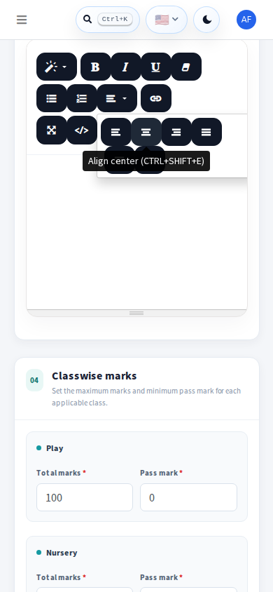 | 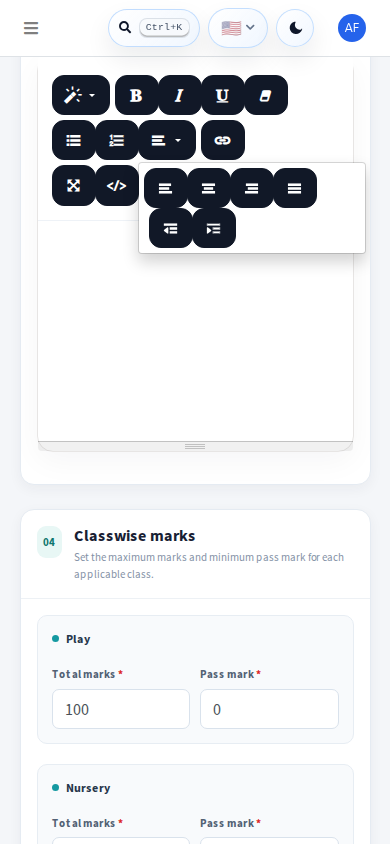 |

---

## Files changed

- `resources/css/admin.css`: the phone block for Select2, the datepicker, menus and the editor
- `resources/views/layouts/master.blade.php`: no search box on short lists, keeping lists on screen, `inputmode="none"` on touch, and scrolling the calendar into view

## Follow-ups (not in this PR)

- **Public admission form** (`/admission`): it uses the website layout, not the admin one, so its date of birth calendar still has 20×26px cells. It also has the 5px sideways overflow noted in the tables changelog.

## Deploying

- Run `npm run build`, because `admin.css` changed.
