# Changelog: Tables on mobile

**Date:** 2026-11-23 · **Branch:** `fix/mobile-tables` (stacked on `fix/exams-page`)

On a phone, almost every admin table scrolled sideways and showed only a slice of its columns. Free studentships showed 17% of its width, Subjects 24%, Users 33%. Even a 3-column trial balance didn't fit. This follows the Exams page fix. The branch is stacked on `fix/exams-page`, so all earlier changelogs and screenshots are here too. Once #103 to #109 are merged, this PR's diff is this commit only.

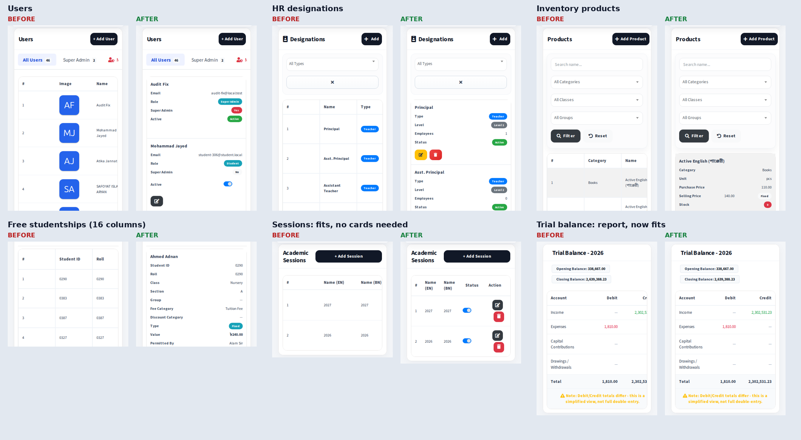

## How it was verified

Every audited admin screen (315) was opened at 390px with a temporary Super Admin, which was deleted afterwards. 155 of them have at least one table. A table counts as **scrolling** if it is wider than its box.

| Screens with tables (155) | Before | After |
|---|---|---|
| Table scrolls sideways | **93** | **15** (reports and form tables, kept on purpose, see below) |
| Table shown as one card per row | 5 | **71** |
| Table fits as a normal table | 57 | **69** |
| Page itself scrolls sideways | 1 (`admission`, 5px) | 1 (same, unrelated) |
| `php artisan test` | 31 failed on `dev` | 31 failed, the same 31 |

Tablet and desktop are unchanged: both changes apply only below 768px.

---

## Cause · Every column was at least 120px wide

`public/assets/css/backend_style.css` gave every table header cell `min-width: 120px` on phones. A phone's table box is about 323px, so any table with three or more columns was too wide: 3 columns came to 360px, 5 to 600px, 10 to 1200px.

```css
/* before — backend_style.css, @media (max-width: 767.98px) */
.content-wrapper table.table thead th {
    white-space: normal;
    min-width: 120px;
}

/* after */
.content-wrapper table.table thead th {
    white-space: normal;
}
```

Without the floor, columns size to their content, and 12 screens' tables now fit as they are: Sessions, Groups, Professions, Account groups, Notices, Trial balance, Cash book, Day book and others.

---

## Fix · Wide tables become cards automatically

Tables that are still wider than the screen get the same stacked-card layout that Classes, Employees and Exams already use. There are about 90 table views, so instead of editing each one, a small shared script (`<x-mobile-table-stack />`, included in the master layout next to the confirm dialog) applies it on phones:

- **Labels:** each cell gets `data-label="<its column header>"`, shown on the left of each line.
- **Title:** the **Name** column becomes the card title and is shown first. The Bangla-name column is skipped; if there's no name column, the first other column is used.
- **Hidden columns:** `#` / SL / No index columns and Photo / Image columns.
- **Actions:** an **Action(s)** column becomes the card's button row.
- **Only when needed:** a table is turned into cards only if it is actually wider than its box. It switches back when the screen widens (rotation, resize).

**Left as scrolling tables on purpose:**
- **Reports with totals or merged cells:** tables with a `<tfoot>`, `colspan`/`rowspan` or a multi-row header, such as Transactions, Detailed trial balance, Salary sheet and Cash summary. Cards would break their columns of figures.
- **Tables with form fields in the rows:** marks entry, opening stock, leave balances, transport fees and asset purchase forms.
- **Already handled:** tables that already use `.ds-table--stack`, or have their own phone view.
- **Opt-out:** any table marked `data-no-stack`.

Card styles (`admin.css`): compact 2px rows (a global rule padded every cell 0.8rem), 12px card padding, title first via `order: -1`, and long values wrap.

**Files changed**
- `public/assets/css/backend_style.css`: the 120px floor removed
- `resources/views/components/mobile-table-stack.blade.php`: new, the phone card script
- `resources/views/layouts/master.blade.php`: includes `<x-mobile-table-stack />` for signed-in pages
- `resources/css/admin.css`: card styles for `table[data-auto-stack]`

| Before | After |
|---|---|
| 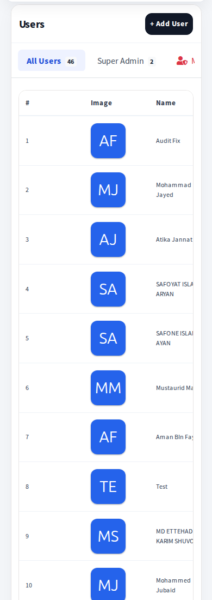 | 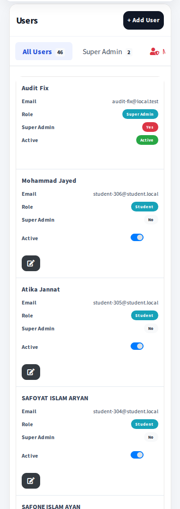 |
| 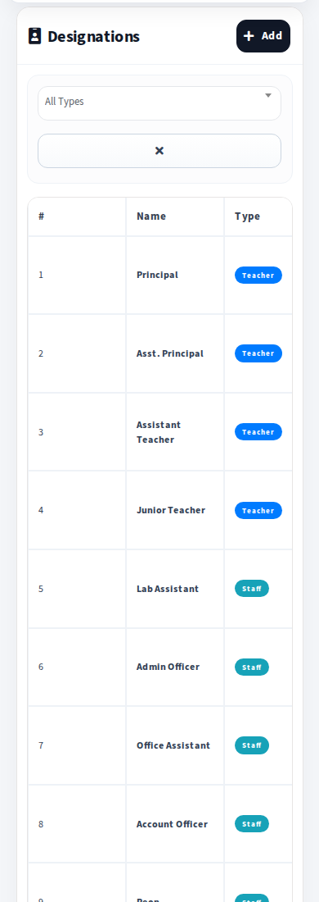 | 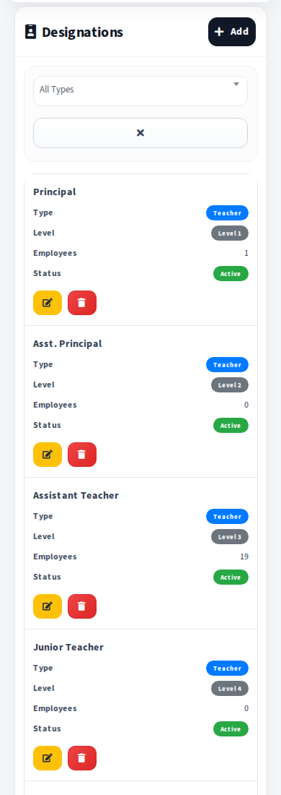 |
| 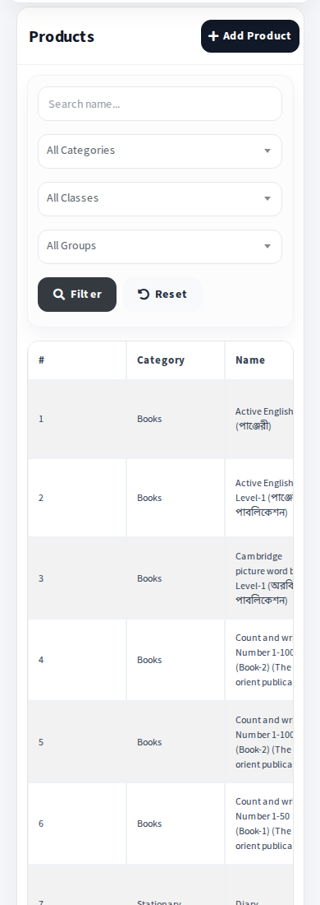 | 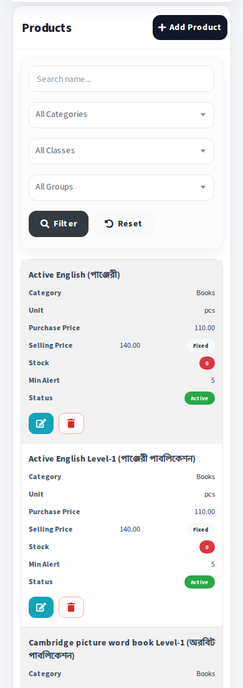 |
| 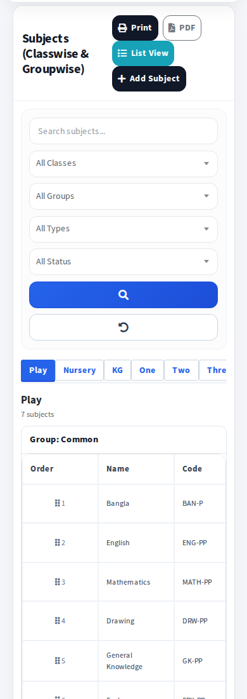 | 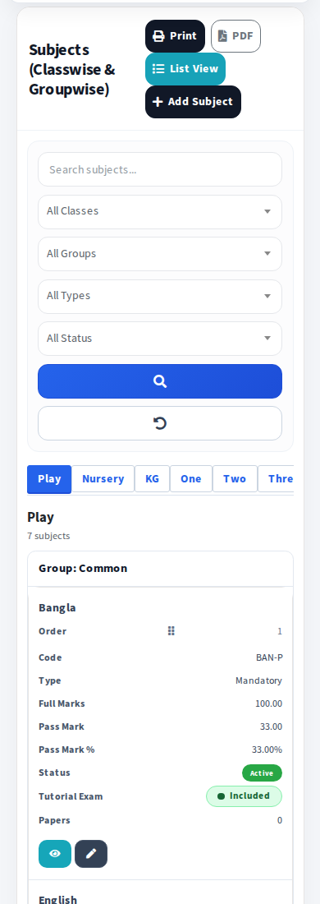 |
| 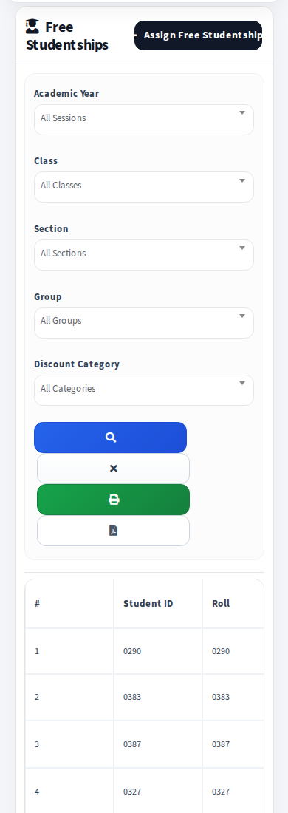 | 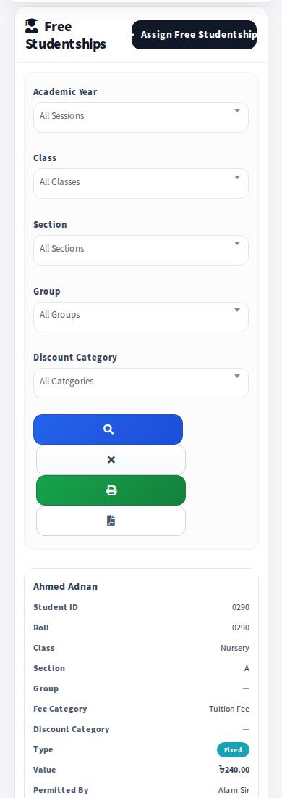 |
| 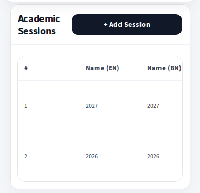 | 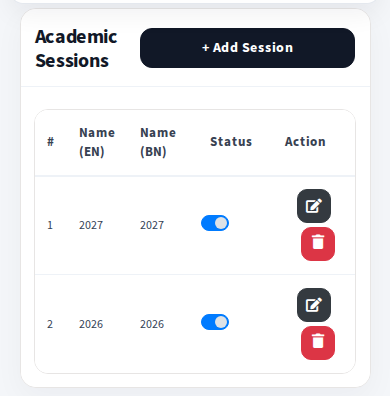 |
| 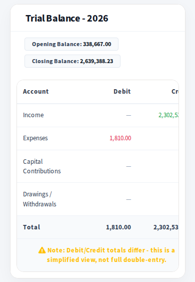 | 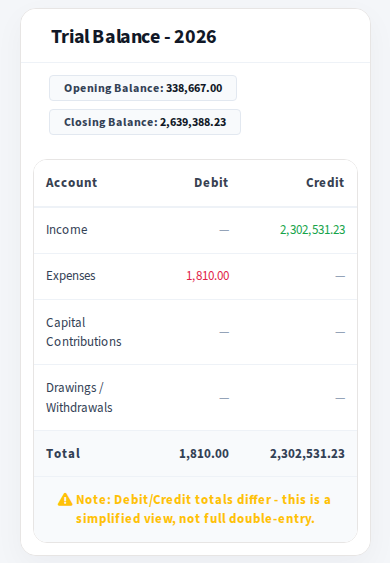 |
| 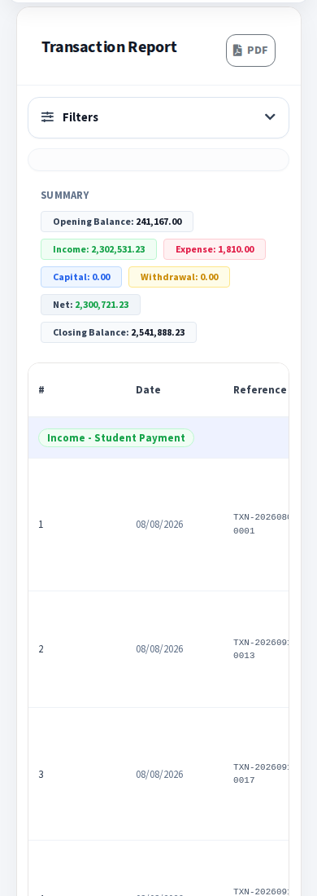 | 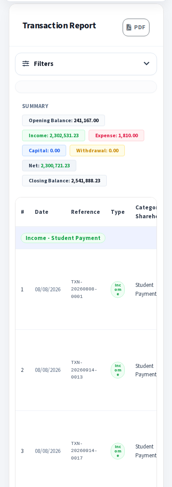 |

Transactions (last row) is a report with a totals footer, so it still scrolls, but it's now 789px wide instead of 1,200px.

<details>
<summary>Screens changed (78)</summary>

**Now cards (66):** `accounting-periods` · `accounts-list` · `admissions/admit-cards` · `admissions/applications` · `admissions/approved` · `admissions/converted` · `admissions/exams/1/details` · `admissions/results` · `asset-categories` · `asset-issues` · `asset-purchases` · `asset-stock` · `bank-accounts` · `buildings` · `certificates` · `class-schedules` · `classrooms` · `district/list` · `division/list` · `educational-qualifications` · `expense-categories` · `expenses` · `facility-bookings` · `fee-sets` · `fee-sets/1/edit` · `fees/payment-requests` · `free-studentships` · `hand-cash` · `hr/departments` · `hr/designations` · `hr/leave` · `hr/payroll` · `hr/reports/hierarchy` · `hr/salary-structures` · `id-card-templates` · `income-categories` · `incomes` · `inventory/categories` · `inventory/products` · `inventory/purchases` · `inventory/reports/stock` · `inventory/sales/hub` · `inventory/suppliers` · `ledger` · `manage-assets` · `mobile-banking-accounts` · `permission-categories` · `permissions` · `police-station/list` · `post-office/list` · `reports/chart-of-accounts` · `reports/supplier-dues` · `roles` · `rooms` · `routines` · `scholarships` · `sections` · `shareholder-transactions` · `shareholders` · `students/birthdays` · `students/checked-out` · `students/history/1` · `subjects` · `subjects/classwise` · `teacher-section-assignments` · `users`

**Now fit as a table (12):** `account-groups` · `communication/notices` · `fees/category-pay` · `groups` · `hr/dashboard` · `inventory/reports/low-stock` · `notice` · `professions` · `reports/cash-book` · `reports/day-book` · `reports/trial-balance` · `sessions`

**Still scroll (15), reports or form tables:** `asset-purchases/1` · `asset-purchases/create` · `hr/employees/1` · `hr/leave/balances` · `hr/reports/salary-sheet` · `inventory/opening-stock` · `journal-entries/1` · `reports/cash-summary` · `reports/details-trial-balance` · `result/progress-report/template-settings` · `shareholders/contribution` · `transactions` · `transport` · `transports` · `transports/edit/3`

</details>

## Notes for developers

- **Rows added by JavaScript** (AJAX lists): call `window.dsStackTables()` after inserting rows, so new rows get labels on phones.
- **Opt-out:** add `data-no-stack` to a `<table>` to keep it as a scrolling table.

## Deploying

- Run `npm run build`, because `admin.css` changed. `backend_style.css` is a static file and deploys as is.
