# Changelog: P0 fixes (F-01 to F-08)

**Date:** 2026-11-22 · **Branch:** `fix/p0-F01-F08` (from `dev` @ `57b78d52`)

These fixes cover the eight P0 findings from the UI audit (`audit/UI-SPEC.md`, kept locally and gitignored). Each section lists the problem, the root cause, the code change (before → after), and screenshots taken at the same viewport before and after the fix.

| ID | Problem | Status |
|---|---|---|
| [F-01](#f-01--public-website-renders-with-no-styling) | Public website renders with no styling | Fixed |
| [F-02](#f-02--accounts-pages-crash-500) | Receipt & Payment and Journal Entries crash (500) | Fixed |
| [F-03](#f-03--public-result-check-crashes-500) | Public result check crashes (500) | Fixed |
| [F-04](#f-04--employee-payment-and-documents-pages-crash-500) | Employee Payment and Documents pages crash (500) | Fixed |
| [F-05](#f-05--remaining-linked-500s) | Permission edit, fee edit Back/Cancel, Assign Subjects crash (500) | Fixed |
| [F-06](#f-06--progress-report-grades-a-student-with-no-marks-as-f-position-1) | Progress report gives a student with no marks F and Position #1 | Fixed |
| [F-07](#f-07--student-login-lands-on-a-bare-403-with-no-way-out) | Student login lands on a bare 403 with no way out | Fixed |
| [F-08](#f-08--new-chat-cant-be-tapped-on-phones) | "New chat" can't be tapped on phones | Fixed |

## How it was verified

All checks were run against the local app (`http://school.local`) with a temporary Super Admin and a temporary Student-role user. Both were deleted afterwards.

| Check | Result |
|---|---|
| `GET /website/home`, `/website/about`, `/website/result` (guest) | 200 · `.site-header` is `position: fixed` · header logo is 64px tall (was 440px) |
| `GET /reports/receipt-payment`, `/journal-entries` | 200 |
| `GET /hr/employees/1/payment` | 302 → `/hr/employees/1/edit#paymentMethod` → 200 |
| `GET /hr/employees/1/documents` | 200 |
| `GET /permissions/1/edit` | 200 |
| `GET /fees/3978/edit` → **Back** | 200 (`/students/253`) |
| `GET /fees` (dead route) | 404 (was 500) |
| `GET /student-subjects/1/assign` | 200 |
| Progress report, Play-A, Final Terminal | 4 students with no marks: 0 positions and 0 grades shown, "No marks have been entered" notice on each card |
| Chat at 390×844 | `elementFromPoint(button centre)` is the button · the modal opens · the hero button is also tappable once the drawer is closed |
| Student-role login, 390 and 1440 | Custom 403 page with a visible **Log out** button · logging out returns to `/login` |
| `php artisan test` | 456 passed, 31 failed. The same 31 tests fail on `dev` without these changes, so this branch adds no failures. |

---

## F-01 · Public website renders with no styling

**Problem.** Every public page (`/website/*`) rendered as raw HTML: a 440px crest, default blue underlined links, no header or layout.

**Root cause.** The website layout loads only `resources/css/website.css`, and that file had no Tailwind directives. None of the utility classes used in the templates (`fixed top-0 bg-white/95 backdrop-blur-lg …`) were compiled.

**Files changed**
- `resources/css/website.css`

```css
/* before: the file started with plain CSS */
html,
body {
    max-width: 100%;
```

```css
/* after */
@tailwind base;
@tailwind components;
@tailwind utilities;

html,
body {
    max-width: 100%;
```

> **Deploy note:** `public/build/` is gitignored, so this needs `npm run build` on deploy. Two stale build files (`public/build/manifest.json`, `public/build/assets/website-5gAqzfJk.css`) are still tracked from before the ignore rule. They were deliberately left out of this change.

| Before (1440) | After (1440) |
|---|---|
| 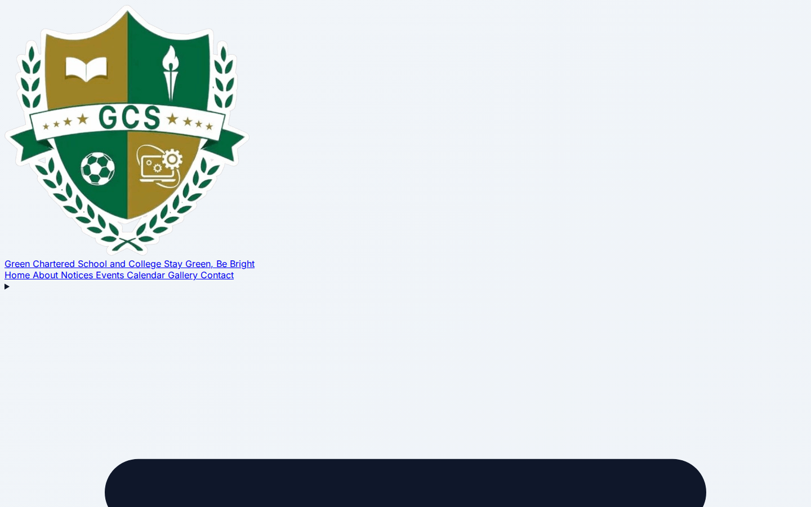 | 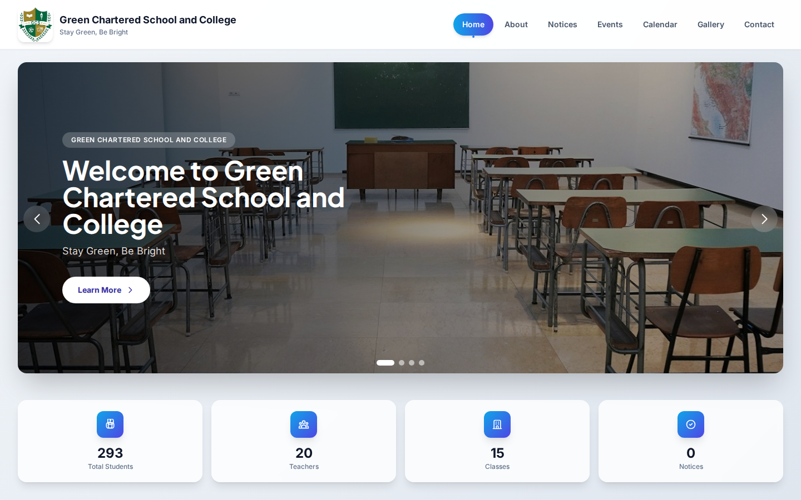 |

| Before (390) | After (390) |
|---|---|
| 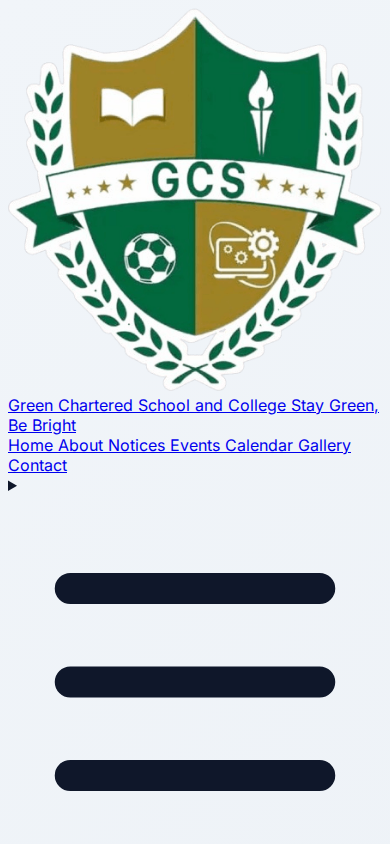 | 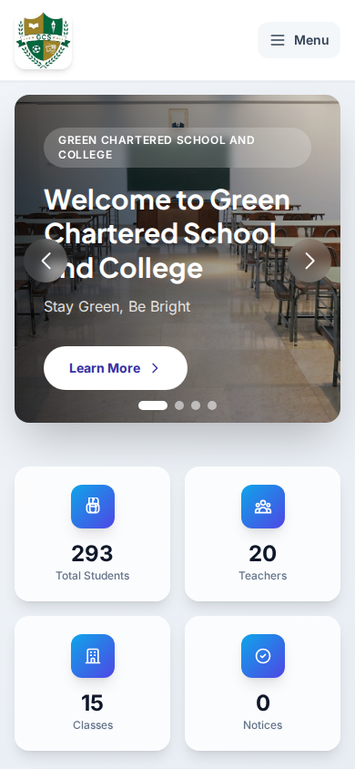 |

---

## F-02 · Accounts pages crash (500)

### Receipt & Payment

**Problem.** "Receipt & Payment" on the Accounts hub returned a 500 (`SQLSTATE[42S22] Unknown column 'inventory_received_amount'`).

**Root cause.** `inventory_received_amount` is a model accessor on `Payment` (sale paid amount + valid due items), not a database column. The opening-balance helper passed it to SQL `SUM()`.

**Files changed**
- `app/Http/Controllers/ReportsController.php` (`inventoryReceiptTotalBefore()`)

```php
// before
return (float) Payment::whereDate('payment_date', '<', $date->toDateString())
    ->where(function ($q) { /* ... */ })
    ->sum('inventory_received_amount');
```

```php
// after
return (float) Payment::with([
        'inventorySale',
        'inventoryDueItems.inventorySaleItem.inventoryItem.category',
    ])
    ->whereDate('payment_date', '<', $date->toDateString())
    ->where(function ($q) { /* ... */ })
    ->get()
    ->sum(fn (Payment $payment) => $payment->inventory_received_amount);
```

This uses the same accessor the report body already uses for the period rows, so the opening balance and the rows now add up the same way.

### Journal Entries

**Problem.** `/journal-entries`, the target of Back/Cancel on the journal-entry pages, returned a 500: `Route [journal-entries.create] not defined`.

**Root cause.** The "New Entry" button links to a route that was never defined. `JournalEntryController` has only `index`, `show` and `destroy`.

**Files changed**
- `resources/views/pages/journal-entries/index.blade.php`

```blade
{{-- before --}}
<a href="{{ route('journal-entries.create') }}" class="btn btn-light btn-sm">
```

```blade
{{-- after: the button only shows once a create route exists --}}
@if(Route::has('journal-entries.create'))
    <a href="{{ route('journal-entries.create') }}" class="btn btn-light btn-sm">
        <i class="fas fa-plus mr-1"></i> New Entry
    </a>
@endif
```

| Before | After |
|---|---|
| 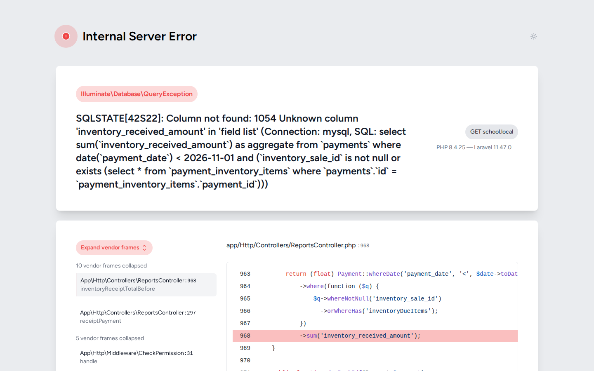 | 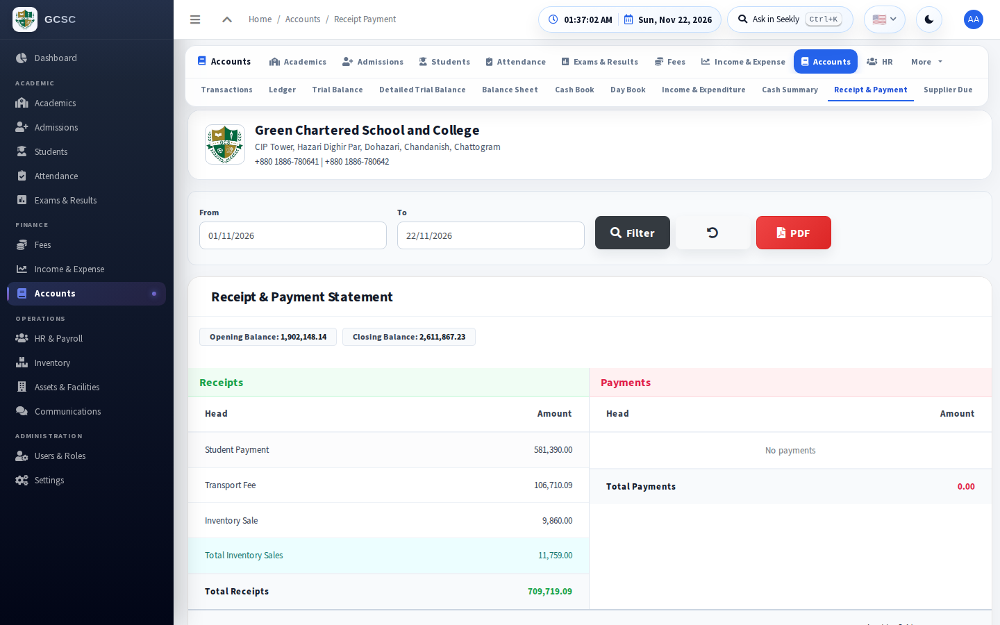 |
| 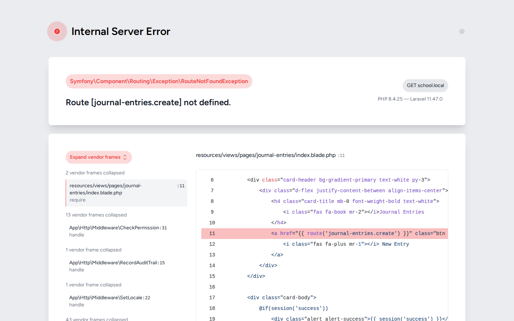 | 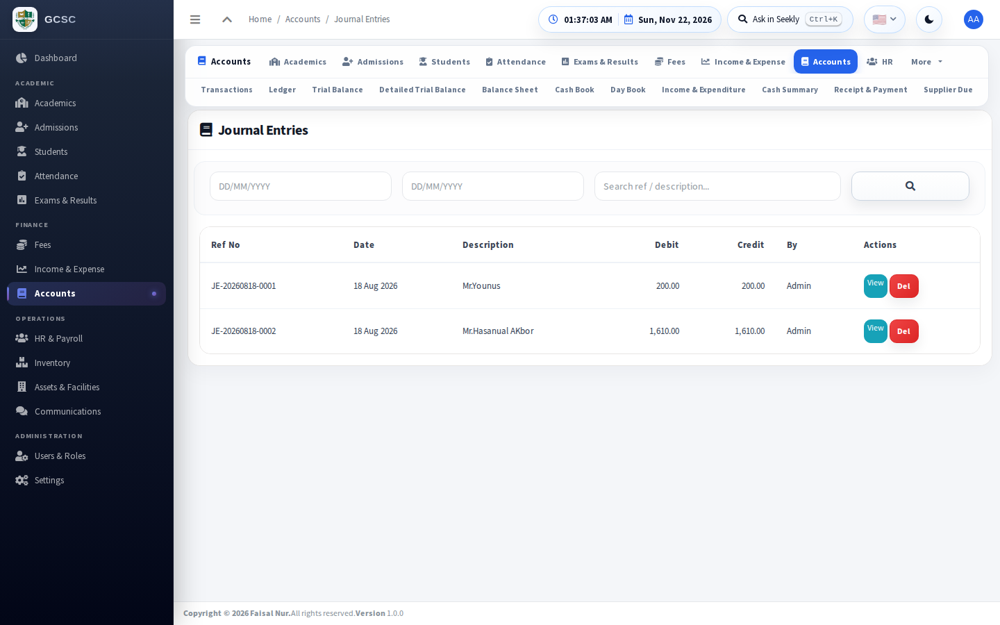 |

---

## F-03 · Public result check crashes (500)

**Problem.** `/website/result` (the "Check another result" button) returned a 500.

**Root cause.** The query filtered on `academic_sessions.is_active` and sorted by `name`. Neither column exists. The table has `status`, `name_en` and `name_bn`, and the rest of the app uses `status = 1`. The view also printed the non-existent `$session->name`.

**Files changed**
- `app/Http/Controllers/Website/PublicWebsiteController.php`
- `resources/views/website/pages/result-check.blade.php`

```php
// before
$sessions = AcademicSession::query()->where('is_active', true)->orderBy('name')->get();
// after
$sessions = AcademicSession::query()->where('status', 1)->orderByDesc('name_en')->get();
```

```blade
{{-- before --}}  <option value="{{ $session->id }}">{{ $session->name }}</option>
{{-- after  --}}  <option value="{{ $session->id }}">{{ $session->name_en }}</option>
```

| Before | After |
|---|---|
| 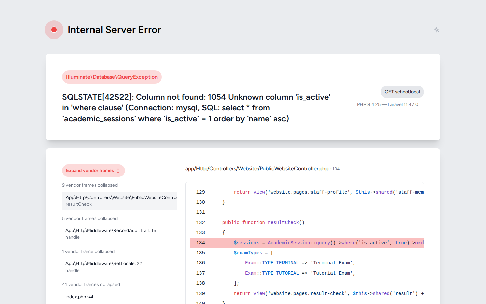 | 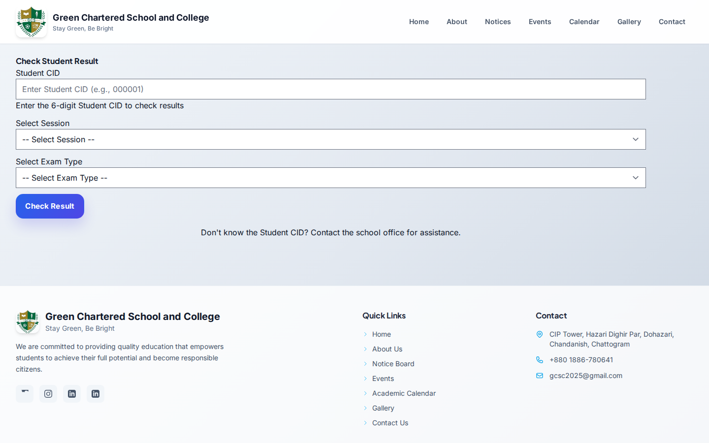 |

---

## F-04 · Employee Payment and Documents pages crash (500)

**Problem.** `/hr/employees/{id}/payment` and `/hr/employees/{id}/documents` failed with `View [hr.employees.partials.payment-form]` / `[hr.employees.partials.documents] not found`.

**Root cause.** Both controllers return views that don't exist.
- Payment details are already edited in the main employee form (Employment Information: method, bank and wallet fields), so a separate page would duplicate it.
- Documents has a working backend (model, upload, delete routes) but no page and no link to it.

**Files changed**
- `app/Http/Controllers/HR/PaymentInformationController.php`: redirects to the edit form's payment field
- `app/Http/Controllers/HR/EmployeeDocumentController.php`: points at the new view
- `resources/views/hr/employees/documents.blade.php` (**new**): upload form (type + file, matching the existing validation) and a list with view/delete
- `resources/views/hr/employees/show.blade.php`: adds a **Documents** button to the profile header

```php
// before (PaymentInformationController::createOrEdit)
$info = $employee->paymentInformation;
return view('hr.employees.partials.payment-form', compact('employee', 'info'));

// after
return redirect()->to(route('hr.employees.edit', $employee) . '#paymentMethod');
```

```php
// before (EmployeeDocumentController::index)
return view('hr.employees.partials.documents', compact('employee', 'documents'));
// after
return view('hr.employees.documents', compact('employee', 'documents'));
```

| Before | After |
|---|---|
| 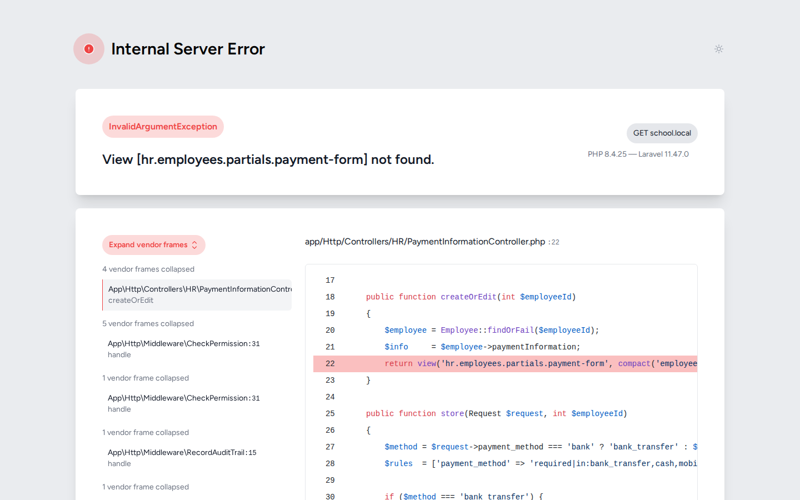 | 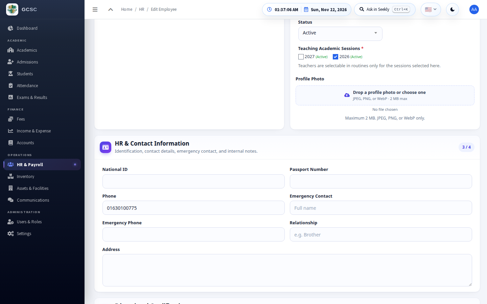 |
| 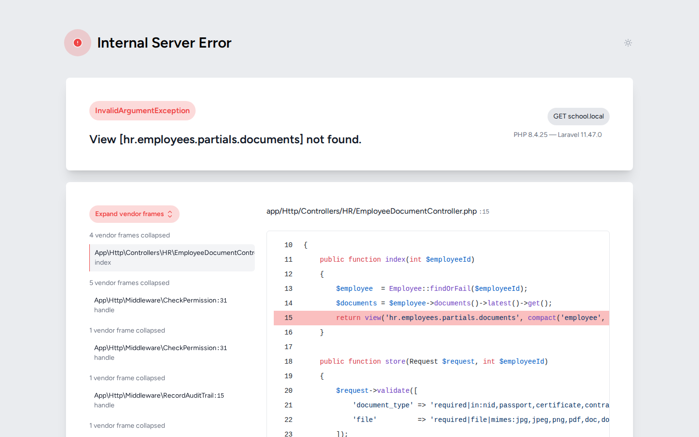 | 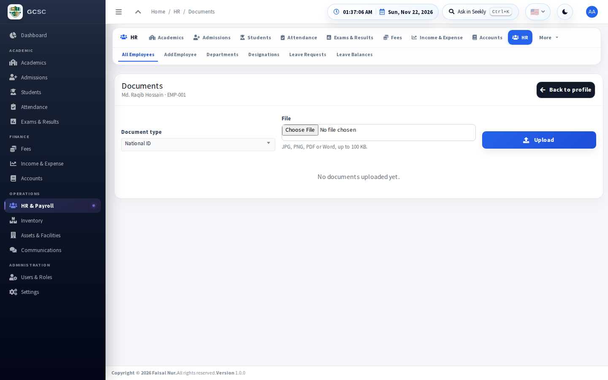 |

New entry point on the employee profile:

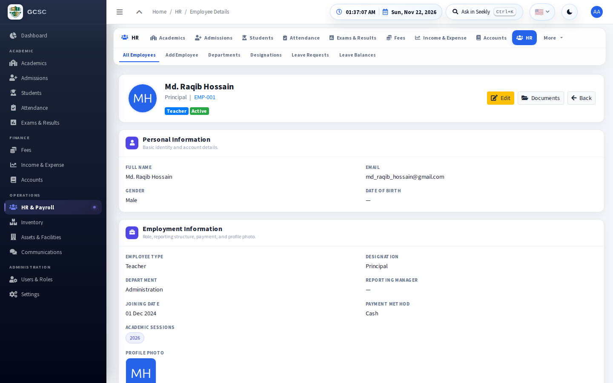

---

## F-05 · Remaining linked 500s

### Permission edit

**Problem.** The Edit button on the permissions list returned a 500: `Missing required parameter for [Route: permissions.update]`.

**Root cause.** The routes used `{id}` but the controller type-hints `Permission $permission`. Implicit model binding matches by parameter name, so Laravel injected an **empty** `Permission`, and `$permission->id` was `null`. The same mismatch meant **Delete silently did nothing**: it "deleted" the empty model and still showed a success message. Update had the same problem.

**Files changed**
- `routes/web.php`

```php
// before
Route::get('/permissions/{id}/edit',    [PermissionController::class, 'edit'])->name('permissions.edit');
Route::post('/permissions/{id}/update', [PermissionController::class, 'update'])->name('permissions.update');
Route::delete('/permissions/{id}',      [PermissionController::class, 'destroy'])->name('permissions.destroy');

// after
Route::get('/permissions/{permission}/edit',    [PermissionController::class, 'edit'])->name('permissions.edit');
Route::post('/permissions/{permission}/update', [PermissionController::class, 'update'])->name('permissions.update');
Route::delete('/permissions/{permission}',      [PermissionController::class, 'destroy'])->name('permissions.destroy');
```

URLs are unchanged (`/permissions/1/edit`), so existing links keep working.

### Fee edit: Back / Cancel

**Problem.** Back and Cancel on the fee edit page returned a 500: `Call to undefined method FeeController::index()`.

**Root cause.** `fees.index`, `fees.create` and `fees.store` were registered against methods `FeeController` doesn't have. Fees are per student: the edit page is opened from the student profile, and `update()` already redirects back there.

**Files changed**
- `resources/views/pages/fees/edit.blade.php`
- `routes/web.php`: removes the three dead routes (nothing else referenced them; `/fees` now returns 404 instead of 500)

```blade
{{-- before --}}  <a href="{{ route('fees.index') }}" ...>
{{-- after  --}}  <a href="{{ route('students.show', $fee->student_id) }}" ...>
```

### Assign Subjects

**Problem.** `/student-subjects/1/assign` returned a 500: `Attempt to read property "name" on null`.

**Root cause.** The audit spec guessed "student has no academic record". The real cause is different: **active class-subject assignments still point at subjects that were soft-deleted** (subjects 246 and 273, across classes 1, 2 and 4–8). `$assignment->subject` is `null` for those rows.

**Files changed**
- `app/Http/Controllers/StudentSubjectController.php`: adds `->whereHas('subject')` to the three assignment queries (assign page, save, bulk assign). Bulk assign no longer gives students deleted subjects.

```php
// before
$assignments = SubjectClassAssignment::where('school_class_id', $classId)
    ->where('is_active', true)
    ->where(/* group */)

// after
$assignments = SubjectClassAssignment::where('school_class_id', $classId)
    ->where('is_active', true)
    ->whereHas('subject')   // skips soft-deleted subjects
    ->where(/* group */)
```

> **Follow-up (data):** 8 active `subject_class_assignments` rows (ids 556, 567, 597, 610, 624, 638, 653, 791) reference soft-deleted subjects. They're now ignored, but they should be deactivated, or deleting a subject should deactivate its assignments.

| Before | After |
|---|---|
| 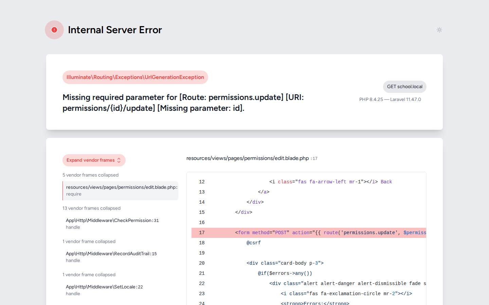 | 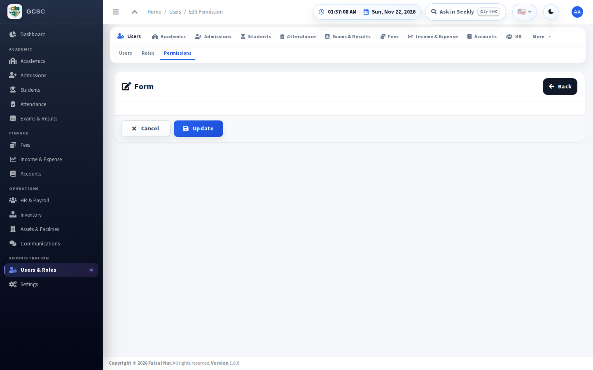 |
| 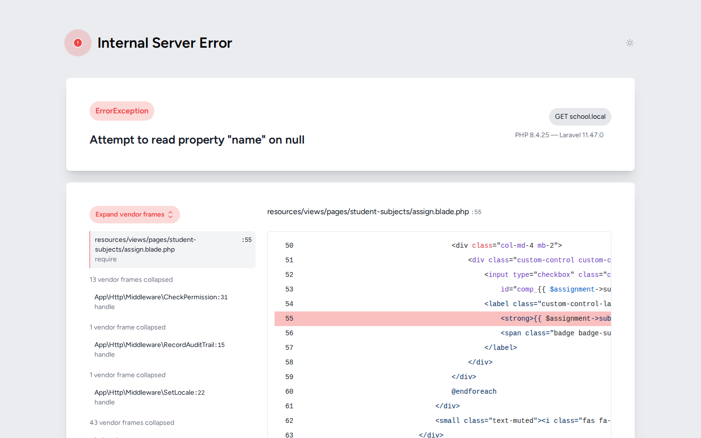 | 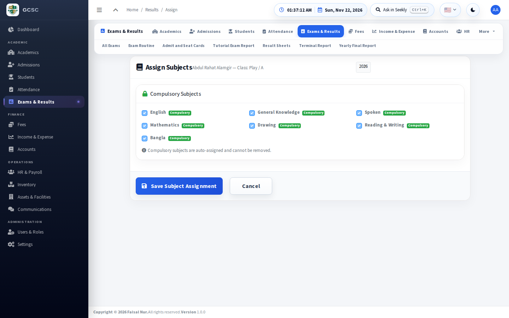 |

Fee edit page (the Back link now goes to the student's profile):

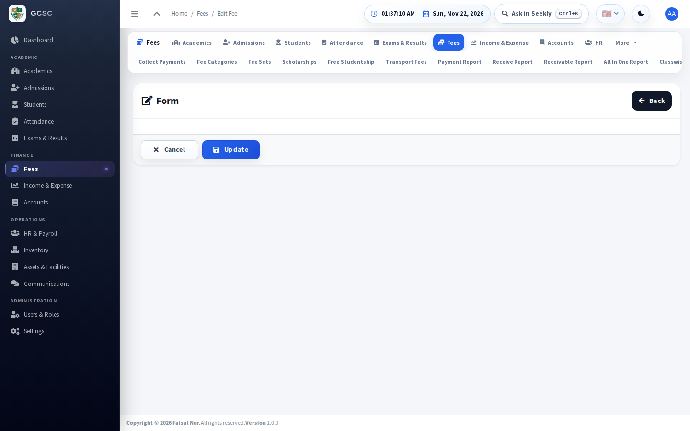

---

## F-06 · Progress report grades a student with no marks as F, Position #1

**Problem.** For a student with no marks in the selected exam, the report showed an empty subject table plus *Total 0 · 0.00% · GPA 0.00 · **F***, ***Position #1***, and the remark "Need to be improved". This report can be printed or emailed to parents.

**Root cause.** Summary, remarks and comments were always computed and shown. The ranking service ranked every row, including rows with no subjects, so an empty report still got a position.

**Files changed**
- `app/Http/Controllers/ProgressReportController.php`
  - `buildStudentData()` returns `has_marks` (false when there are no subject rows).
  - `rankProgressReports()` ranks only students with marks. Students without marks get `rank = null` and status "No marks", are listed after the ranked students, and no longer push anyone's position down.
  - `sendEmail()` refuses to email a report with no marks (422 / flash error).
  - `sendEmail()` also passes `subject_ids` (see below).
- `resources/views/pages/progress-report/results.blade.php` (Classic and Modern designs)
- `resources/views/pages/progress-report/print.blade.php` (PDF)
  - When `! $hasMarks`: no summary, grade, GPA, remarks or position. A "No marks have been entered for this exam yet." notice is shown in their place, and the attendance line is kept.

```php
// before (rankProgressReports)
$rows = app(ResultRankingService::class)->rank($rows, /* metrics */, /* id */);
return collect($rows);

// after
[$withMarks, $withoutMarks] = $rows->partition(fn (array $row) => $row['has_marks'] ?? true);
$rows = app(ResultRankingService::class)->rank($withMarks->values()->all(), /* metrics */, /* id */);
return collect($rows)->values()->concat($withoutMarks->values());
```

```blade
{{-- before (print.blade.php) --}}
@if ($templateSettings->show_summary)
    ...summary table...
@endif
@if ($templateSettings->show_remarks || !is_null($rank))

{{-- after --}}
@if (! $hasMarks)
    <div class="progress-no-marks" ...>No marks have been entered for this exam yet.</div>
@elseif ($templateSettings->show_summary)
    ...summary table...
@endif
@if ($hasMarks && ($templateSettings->show_remarks || !is_null($rank)))
```

**Related bug fixed here.** `sendEmail()` never set `$filters['subject_ids']`. `buildStudentData()` keeps only marks whose subject is in that list, so **every emailed report was empty and graded F**. It now uses the same subject selection as the on-screen report. Without this fix, the new no-marks check would have blocked every email. (The per-student email button is currently commented out in the results view, so this path isn't reachable from the UI today.)

| Before | After |
|---|---|
| 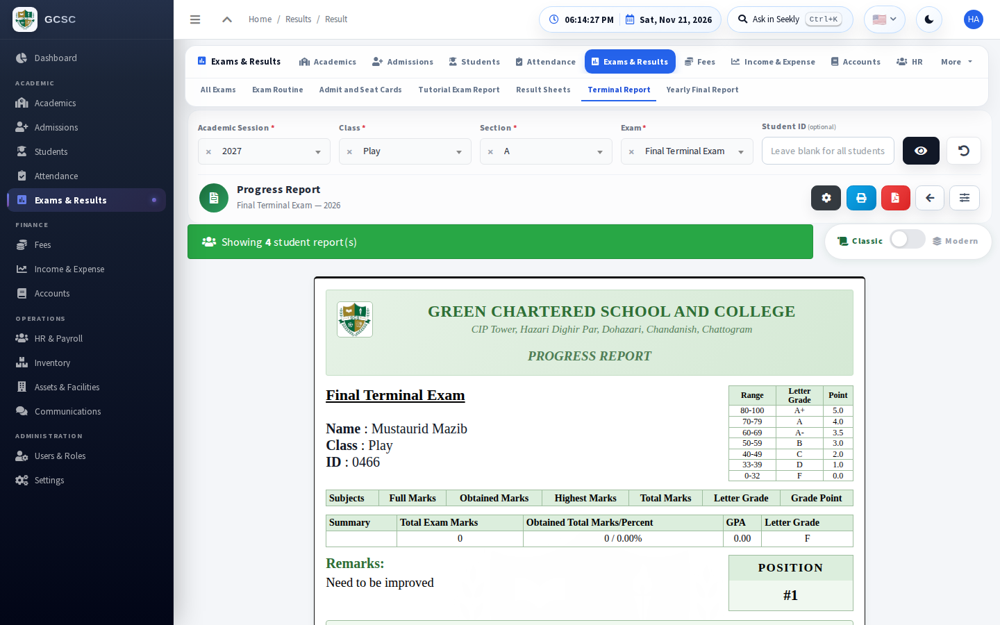 | 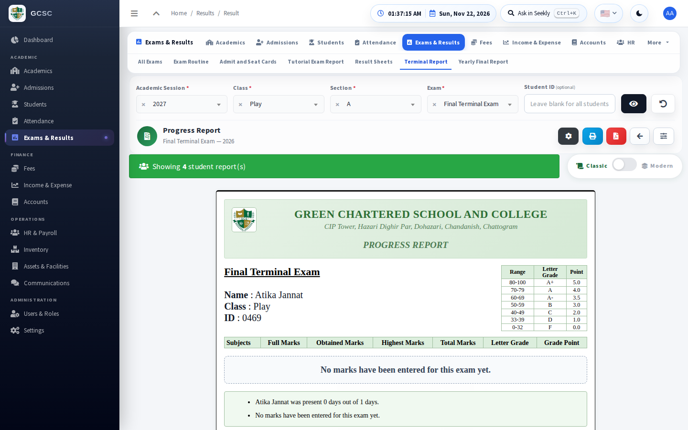 |

Close-up of a no-marks card after the fix (no grade, GPA, remarks or position):

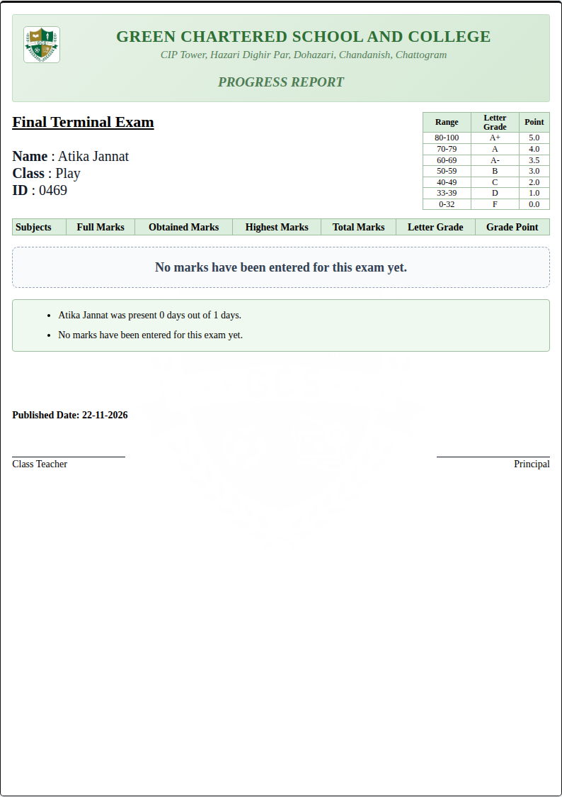

---

## F-07 · Student login lands on a bare 403 with no way out

**Problem.** A Student-role user who signed in was sent to `/dashboard` and saw Laravel's default "403 | UNAUTHORIZED." page: no navigation, no explanation, no logout. They stayed stuck signed in.

**Root cause.** The app had no `resources/views/errors/403.blade.php`, so the framework's default page was used. Student accounts have no web-portal permissions.

**Files changed**
- `resources/views/errors/403.blade.php` (**new**, self-contained with inline CSS so it renders even if layout assets fail; light and dark):
  - Student role: "Student accounts can't use the web portal" with a pointer to the mobile app
  - Other roles: "You don't have access to this page", naming the path they tried
  - "Signed in as … · Role"
  - **Go to dashboard** (only if the user has `view_dashboard`) and a **Log out** button (POST `/logout`, CSRF)
  - Guests get a **Sign in** link

This applies to every 403 in the app, not just the dashboard.

| Before (390) | After (390) |
|---|---|
| 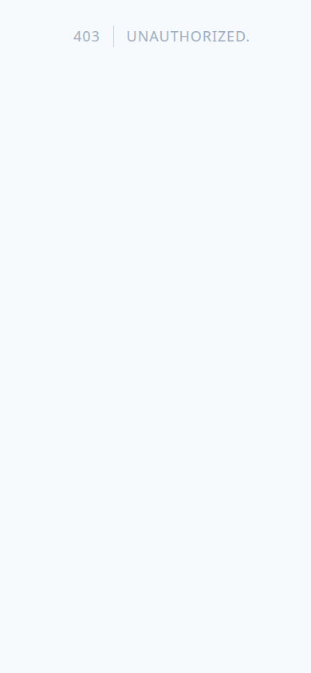 | 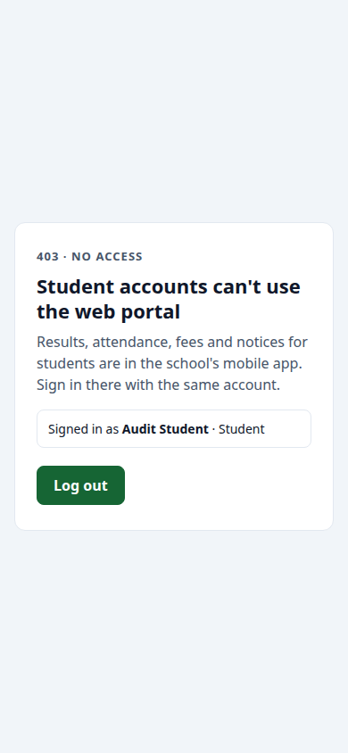 |

| Before (1440) | After (1440) |
|---|---|
| 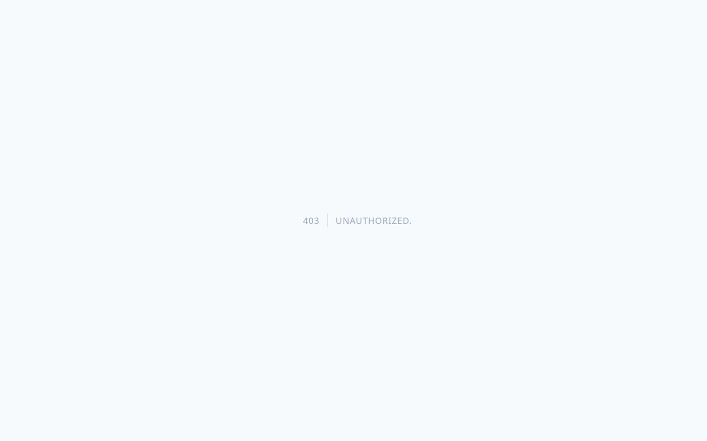 | 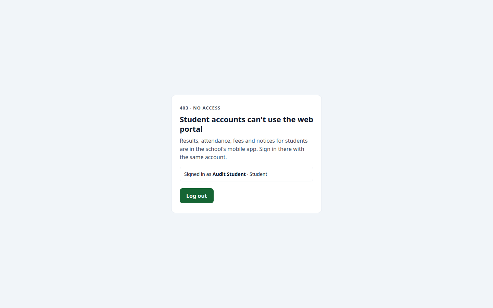 |

---

## F-08 · "New chat" can't be tapped on phones

**Problem.** At 390px, tapping "New chat" on `/chat` did nothing.

**Root cause.** The audit spec guessed a z-index or margin overlap in the hero. The real cause: on phones, when no conversation is open, the **Inbox drawer opens automatically** (`position: fixed`, `z-index: 1085`) and covers the page hero, where the only "New chat" button lives. The drawer background was 90% opaque (`rgba(255,255,255,.9)`), so the button showed through and looked tappable. Separately, the drawer sits above Bootstrap's modal layer (1050), so a modal opened from inside it would appear underneath.

**Files changed**
- `resources/views/pages/chat/index.blade.php`
  - Adds a **New chat** button to the Inbox drawer header (phones only, `d-lg-none`)
  - Makes the drawer opaque on phones
  - Tags both New chat buttons with `data-chat-new-conversation`
- `resources/js/app.js`: closes the mobile drawers when a New chat button is pressed, so the modal is on top

```blade
{{-- after: Inbox drawer header --}}
<button type="button" class="btn btn-sm btn-primary rounded-pill text-nowrap d-lg-none"
        data-toggle="modal" data-target="#newConversationModal" data-chat-new-conversation>
    <i class="fas fa-plus mr-1"></i> {{ __('New chat') }}
</button>
<button type="button" class="btn btn-sm btn-outline-secondary rounded-pill d-lg-none" data-chat-mobile-inbox-close>
    {{ __('Close') }}
</button>
```

```js
// after (resources/js/app.js, initCommunicationsPage)
page.querySelectorAll('[data-chat-new-conversation]').forEach((button) => {
    button.addEventListener('click', () => {
        closeMobileInbox();
        closeMobilePeople();
    });
});
```

| Before (390) | After (390) | After: tapped |
|---|---|---|
| 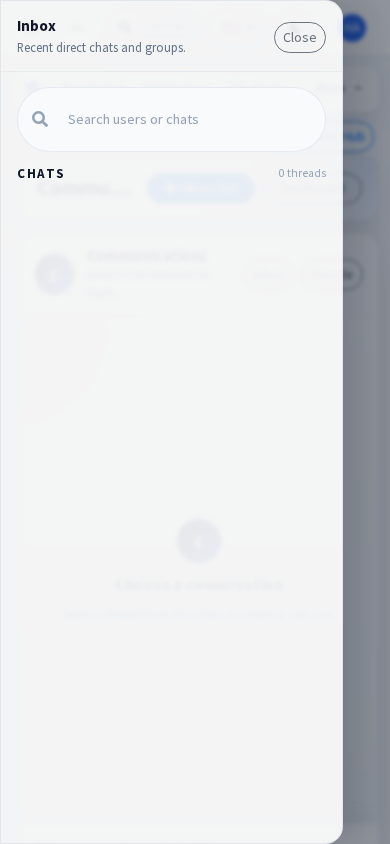 | 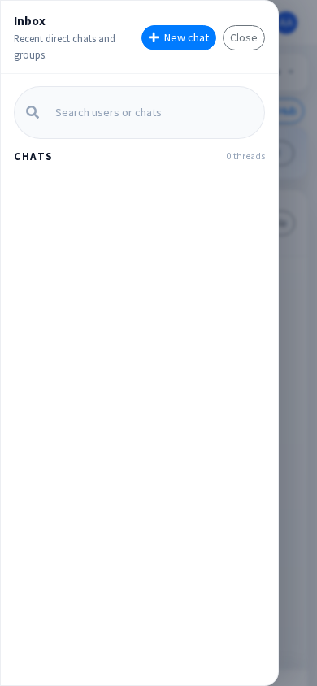 | 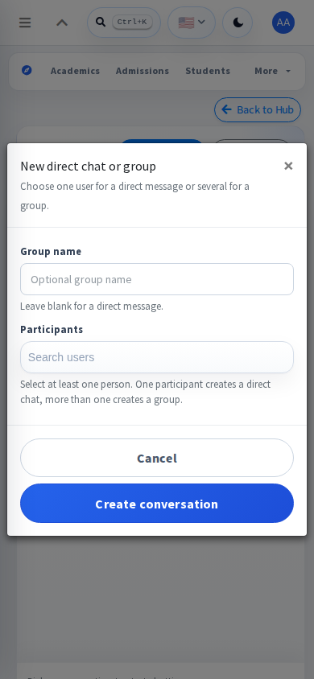 |

---

## Follow-ups (not in this change)

- **Result-check page styling:** `/website/result` now loads, but its form uses Bootstrap classes (`form-select`, `mb-3`) that the Tailwind-based website doesn't include, so it looks plain.
- **Orphaned subject assignments:** see F-05. Deactivate the 8 rows, and deactivate assignments when a subject is deleted.
- **Journal entries:** there's no create flow. Either build `create`/`store`, or delete the unused `create.blade.php`.
- **Tracked build files:** `git rm --cached public/build/manifest.json public/build/assets/website-5gAqzfJk.css` so the repo matches `.gitignore`.
