# Changelog: P1 fixes (F-09 to F-21)

**Date:** 2026-11-22 · **Branch:** `fix/p1-F09-F21` (from `dev` @ `57b78d52`)

These fixes cover the thirteen P1 findings from the UI audit (`audit/UI-SPEC.md`, kept locally and gitignored). P1s are friction rather than crashes. Each section lists the problem, the cause, the change (before → after), and screenshots at the same viewport before and after.

This branch is independent of the P0 branch (`fix/p0-F01-F08`, PR #103). Both branch from `dev`.

| ID | Problem | Status |
|---|---|---|
| [F-09](#f-09--dashboard-shows-0-attendance-when-it-hasnt-been-taken) | Dashboard shows "0% attendance" when attendance hasn't been taken | Fixed |
| [F-10](#f-10--payments-list-unpaginated-wrong-cta-broken-cells) | Payments list loads all 1,164 rows, has the wrong CTA and broken cells | Fixed |
| [F-11](#f-11--student-list-pdf-panel-and-filters-push-students-below-the-fold) | Student list: PDF panel and filters push students below the fold | Fixed |
| [F-12](#f-12--validation-shows-raw-field-keys-errors-hidden-on-other-tabs) | Validation shows raw field keys, and errors are hidden on other tabs | Fixed |
| [F-13](#f-13--empty-browser-tab-title-on-301-of-330-screens) | Empty browser-tab title on 301 of 330 screens | Fixed |
| [F-14](#f-14--breadcrumbs-leak-route-names-and-repeat-crumbs) | Breadcrumbs leak route names and repeat crumbs | Fixed |
| [F-15](#f-15--admission-review-cant-collect-the-form-fee) | Admission review blocks approval but can't collect the fee | Fixed |
| [F-16](#f-16--public-admission-required-parent-fields-hidden-on-a-tab) | Public admission: required parent fields hidden on a tab | Fixed |
| [F-17](#f-17--receipt-clipped-on-phones) | Receipt clipped on phones | Fixed |
| [F-18](#f-18--unlabelled-form-fields) | Unlabelled form fields | Mostly fixed (see remaining) |
| [F-19](#f-19--icon-only-controls-with-no-accessible-name) | Icon-only controls with no accessible name | Fixed |
| [F-20](#f-20--no-design-system) | No design system | Foundation done, first screen migrated |
| [F-21](#f-21--tap-targets-under-24px-on-phones) | Tap targets under 24px on phones | Fixed |

## How it was verified

All checks ran against the local app (`http://school.local`) with a temporary Super Admin. For F-15, two test applications were created through the public form. The fee was **not** collected. The user, both applications, their pending payment rows and the form drafts were all deleted afterwards.

**Every screen.** All 330 default admin and public screens from the audit were re-opened at 1440×900. Each was checked for its tab title, its breadcrumb and four axe-core rules.

| Check (330 screens) | Audit (before) | After |
|---|---|---|
| Empty `<title>` | 301 | **0** |
| Distinct titles | — | 285 of 330 (26 titles are shared by 71 screens, e.g. a hub and its index) |
| Breadcrumb containing `generated::` | yes (`/`) | **0** |
| Two equal adjacent crumbs | yes (e.g. "Students / Students") | **0** |
| axe `button-name` (nodes / screens) | 465 / 38 | **0 / 0** |
| axe `link-name` | 431 / 46 | **0 / 0** |
| axe `select-name` | 2 / 1 | **0 / 0** |
| axe `label` | 464 / 82 | **157 / 25** |
| HTTP status | — | 330 × 200 |

**Targeted checks** (the spec's Accept criteria):

| Fix | Check | Result |
|---|---|---|
| F-09 | No "0%" in the attendance cards when nothing was taken today; "Mark attendance" CTA shown | ✔ |
| F-10 | ≤ 25 rows with pagination · CTA reads "Collect payment" · no monospace in the table · page height at 390 ≤ 6×844 (5,064px) | 25 rows · ✔ · ✔ · **4,917px** (was 197,197px) |
| F-11 | First student row top at 1440 ≤ 520px · first card top at 390 ≤ 844px | **520px** · **473px** |
| F-12 | Empty submit shows "The Full name (English) field is required." · Basic Information tab has a badge, is active, focus in `full_name_en` | ✔ (admin form) · public form focuses the first errored field |
| F-13 | Titles like "Students · Green Chartered School & College" | ✔ |
| F-14 | `GET /` lands on `/dashboard` · students breadcrumb "Home / Students" | ✔ |
| F-15 | Unpaid application page has a "Collect form fee (৳200)" button that opens the payment modal in place · discount recalculates (৳50 → ৳150.00) | ✔ |
| F-16 | At 1440 on `/admission`, `[name=father_name]` is visible without clicking a tab · no Accordion/Tabbed toggle | ✔ |
| F-17 | At 390, `scrollWidth` = 390 and both copies' left edge ≥ 0 | 390 · [13, 13] |
| F-19 | Classes "Delete" is a real labelled submit button | ✔ |
| F-21 | Tiny tap targets at 390 (audit metric: < 24px in one dimension and < 44px in both) | students 29 → **0** · classes 15 → **0** · payments 0 → **0** · hr-employees 3 → 3\* · fees-collect 4 → 4\* |
| Tests | `php artisan test` | 456 passed, 31 failed. The same 31 fail on `dev`, so this branch adds no failures. |

\* The remaining hr-employees and fees-collect "targets" are the native `<select>`s that Select2 hides as 1×1px `select2-hidden-accessible` elements. Nobody can tap them: the visible Select2 widget is the target and it's full size. The audit's metric counts them, so the number is reported as measured.

---

## F-09 · Dashboard shows "0% attendance" when it hasn't been taken

**Problem.** With no attendance recorded today, the dashboard showed 0 Present, a red **0 Absent**, Attendance Rate **0%**, and 0% for every class. That reads as a school-wide absence.

**Causes.**
1. No "not taken" state existed.
2. The aggregate only read the **first** attendance record of the day (`Attendance::whereDate(...)->first()`), so once more than one class was marked, the card counted only one of them.

**Files changed**
- `app/Http/Controllers/DashboardController.php`
- `resources/views/dashboard.blade.php`

```php
// before
$todayAttendance = Attendance::whereDate('date', $today)->first();
$data['today_present'] = $todayAttendance ? AttendanceItem::where('attendance_id', $todayAttendance->id)->where('status', 'present')->count() : 0;
// … same for absent / leave

// after
$todayAttendanceIds = Attendance::whereDate('date', $today)->pluck('id');
$data['attendance_taken_today'] = $todayAttendanceIds->isNotEmpty();
$todayCounts = AttendanceItem::whereIn('attendance_id', $todayAttendanceIds)
    ->selectRaw('status, COUNT(*) as total')->groupBy('status')->pluck('total', 'status');
$data['today_present'] = (int) ($todayCounts['present'] ?? 0);
// … absent / leave
```

- **Today's Attendance card:** when nothing was taken, it shows "Attendance hasn't been taken today" with a **Mark attendance** button (only for users with `view_attendance` or `view_card_mark_attendance`).
- **Classwise table:** each class now has a `taken` flag, and untaken classes show "Not taken" with an empty bar instead of "0%".

| Before | After |
|---|---|
|  | 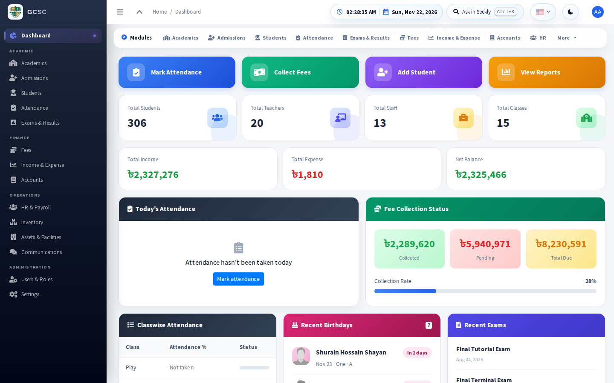 |

---

## F-10 · Payments list unpaginated, wrong CTA, broken cells

**Problem.**
- `/payments` loaded every payment ever made: 1,164 rows, 197,197px tall on a phone.
- The header button said **"Add Student"**, and **Export** downloaded the *students* list.
- Names were in `<code>` monospace and wrapped over 4 lines.
- Receipt numbers and "Print Receipt" broke mid-word.
- The filter's "Status" field did nothing, and its Reset went to the students page.

**Files changed**
- `app/Http/Controllers/PaymentController.php`: `->get()` → `->paginate(25)->withQueryString()`, plus a search on receipt number, CID or name
- `resources/views/pages/payments/index.blade.php`: rebuilt on the new design-system components (see F-20). The **Export** button was removed: it linked to `students.export`, and there is no payments export to point it at.
- `resources/views/pages/payments/filter.blade.php`: **removed**, replaced by `<x-filter-bar>` with search, from date and to date

```php
// before
$data['payments'] = $query->orderByDesc('payment_date')->orderByDesc('id')->get();

// after
if ($request->filled('q')) { /* receipt_no, student CID or name */ }
$data['payments'] = $query->orderByDesc('payment_date')->orderByDesc('id')
    ->paginate(25)
    ->withQueryString();
```

```blade
{{-- before --}}
<a href="{{ route('students.create') }}" class="btn btn-primary btn-sm text-bold w-100 w-sm-auto">
    <i class="fas fa-plus"></i> {{ __('Add Student') }}
</a>
…
<code style="font-size:14px;padding:3px 0px;color:#4338ca">
    {{ $student->student_cid }} - {{ $student->full_name_en }}<br> …
</code>

{{-- after --}}
<x-page-header :title="__('Payments')" :count="$payments->total()" :subtitle="__('Fee and inventory payments, newest first.')">
    <x-btn :href="route('fees.collect')" variant="primary" icon="fas fa-plus">{{ __('Collect payment') }}</x-btn>
</x-page-header>
…
<x-data-table :stack="true" :empty="$payments->isEmpty()" …>
    <td>
        <div class="font-weight-bold">{{ $student?->full_name_en }}</div>
        <div class="ds-muted">{{ $student?->student_cid }} · {{ class / section / group }}</div>
    </td>
    <td class="ds-nowrap" data-label="Receipt no">{{ $payment->receipt_no }}</td>
    …
    <x-slot:footer>{{ $payments->links() }}</x-slot:footer>
</x-data-table>
```

On phones the table becomes compact cards: name and amount on one line, then CID, class, receipt and date on a muted line, then item tags with the Receipt button beside them. Method and collector appear on the receipt itself.

| Before (1440) | After (1440) |
|---|---|
| 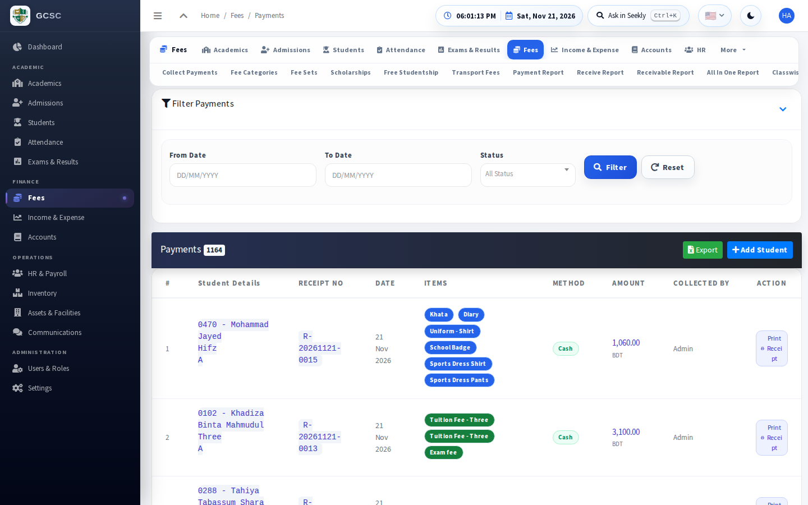 | 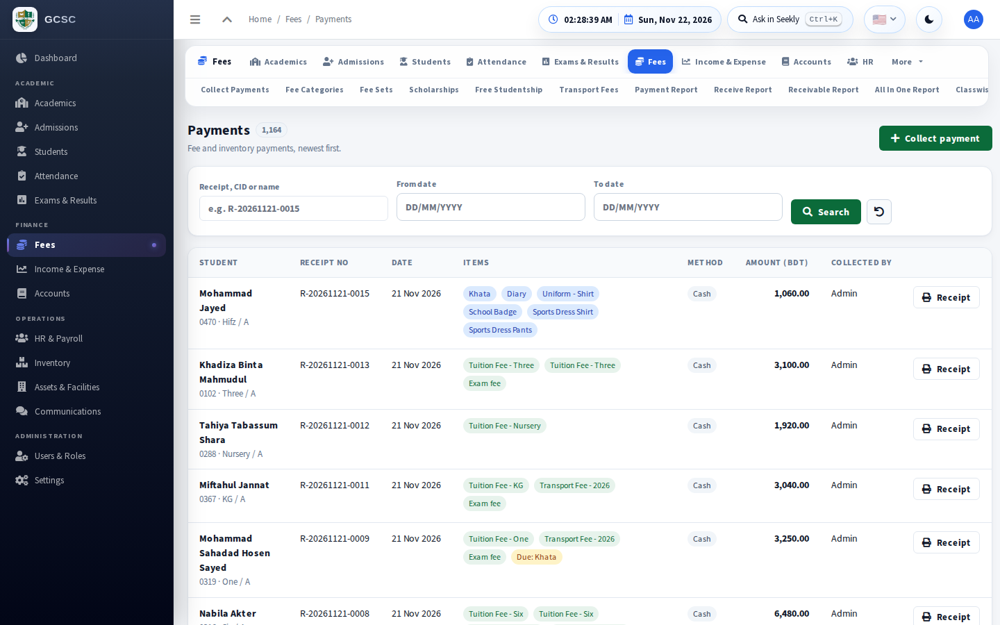 |

| Before (390) | After (390) |
|---|---|
| 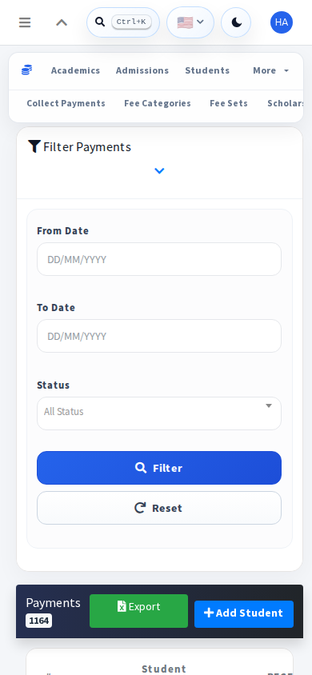 | 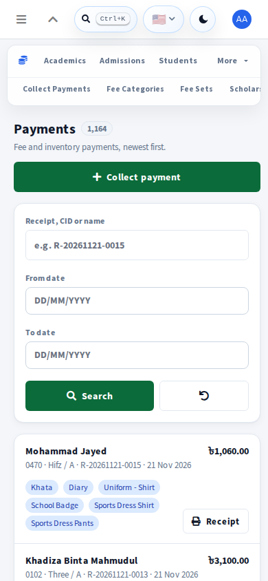 |

---

## F-11 · Student list: PDF panel and filters push students below the fold

**Problem.**
- A 20-checkbox "PDF Column Selection" panel sat permanently between the filters and the list. The advanced-filter area it lived in was open by default.
- On phones, nine stacked filter controls came before any student.

**Files changed**
- `resources/views/pages/students/filter.blade.php`
  - Removes the PDF panel.
  - The advanced filters start closed, and their name-free selects get `aria-label`s (F-18).
- `resources/views/pages/students/table.blade.php`
  - The PDF button opens a new modal with the column picker. It submits to `students.list-pdf` with the current filters, in a new tab.
  - The total count moves into the header.
- `resources/views/pages/students/index.blade.php`
  - The column selection is remembered in `localStorage` (`students-pdf-columns`).
  - On phones (< 768px), the selects collapse behind the existing Filters button, including Select2 widgets.
- `resources/views/scripts/student/filter_scripts.blade.php`: the advanced panel opens automatically only when an *advanced* filter (group, phone, gender) is in use.

```blade
{{-- before: always rendered inside the filter form --}}
<div class="students-pdf-panel"> … 20 checkboxes … </div>
<a href="{{ route('students.list-pdf', request()->all()) }}" class="btn btn-sm students-pdf-action" target="_blank">…</a>

{{-- after --}}
<button type="button" class="btn btn-sm students-pdf-action" data-toggle="modal" data-target="#studentsPdfModal"
    title="{{ __('Download PDF list') }}" aria-label="{{ __('Download PDF list') }}">…</button>
<div class="modal fade" id="studentsPdfModal" …>
    <form method="GET" action="{{ route('students.list-pdf') }}" target="_blank"> current filters as hidden inputs + column checkboxes </form>
</div>
```

| Before (1440) | After (1440) |
|---|---|
| 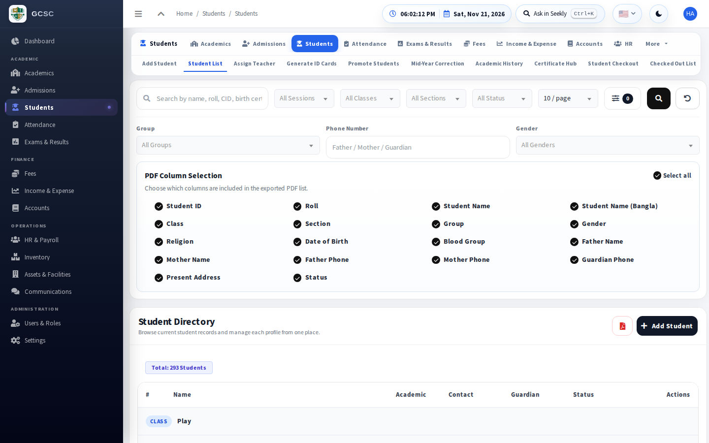 | 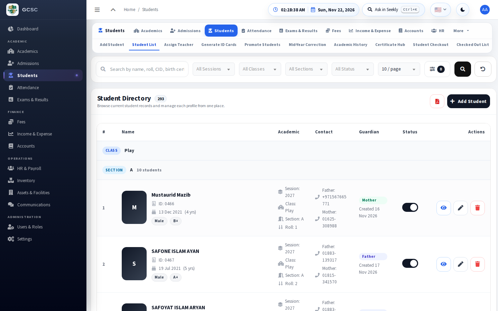 |

| Before (390) | After (390) | After: Filters tapped |
|---|---|---|
| 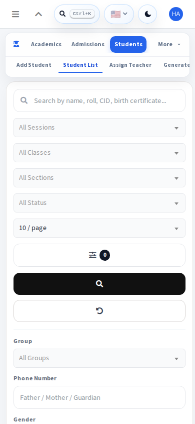 | 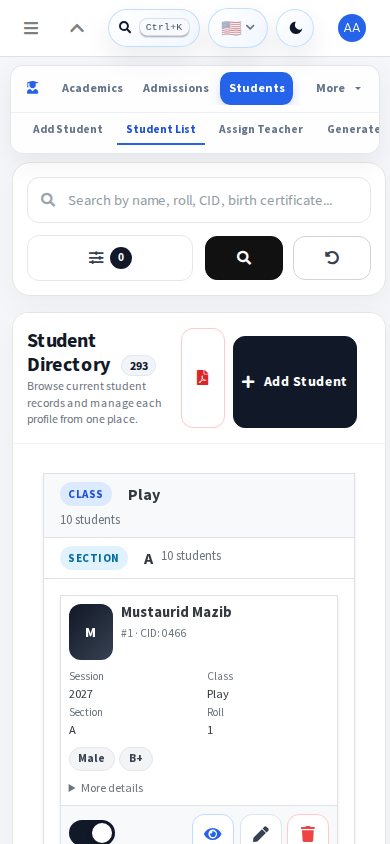 | 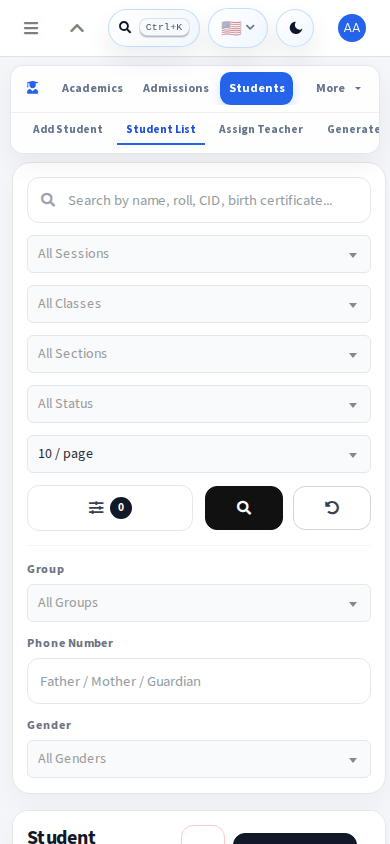 |

PDF column picker, now in a modal:

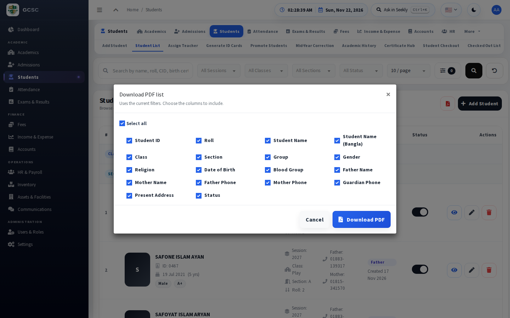

---

## F-12 · Validation shows raw field keys; errors hidden on other tabs

**Problem.** The error summary said "The full name en field is required.", but that field was on a tab that wasn't open. Nothing marked the tab, and the message didn't lead to the field.

**Files changed**
- `lang/en/validation.php` (**new**): an `attributes` map with readable names for about 80 field keys (student, admission, HR, payment, exam). Laravel merges this over the framework defaults, so all other messages are unchanged.
- `resources/views/pages/students/form.blade.php` (admin create/edit **and** public admission):
  - Each summary item is a link that opens the right section and focuses the field.
  - On load, errored fields get `is-invalid` and `aria-invalid`. Each tab and section containing errors gets a red count badge, the first one opens, and its first field gets focus.

```php
// lang/en/validation.php (excerpt)
'attributes' => [
    'full_name_en' => 'Full name (English)',
    'school_class_id' => 'Class',
    'father_phone' => "Father's phone",
    // …
],
```

```blade
{{-- before --}}
@foreach ($errors->all() as $error)
    <li>{{ $error }}</li>
@endforeach

{{-- after --}}
@foreach ($errors->getMessages() as $field => $messages)
    @foreach ($messages as $message)
        <li><a href="#" class="underline" data-error-field="{{ $field }}">{{ $message }}</a></li>
    @endforeach
@endforeach
```

> Bangla (`bn`) has no validation translations in the app, so messages fall back to English, attribute names included. Adding Bangla attribute names alone would produce mixed-language sentences. See follow-ups.

| Before: admin form | After: admin form |
|---|---|
| 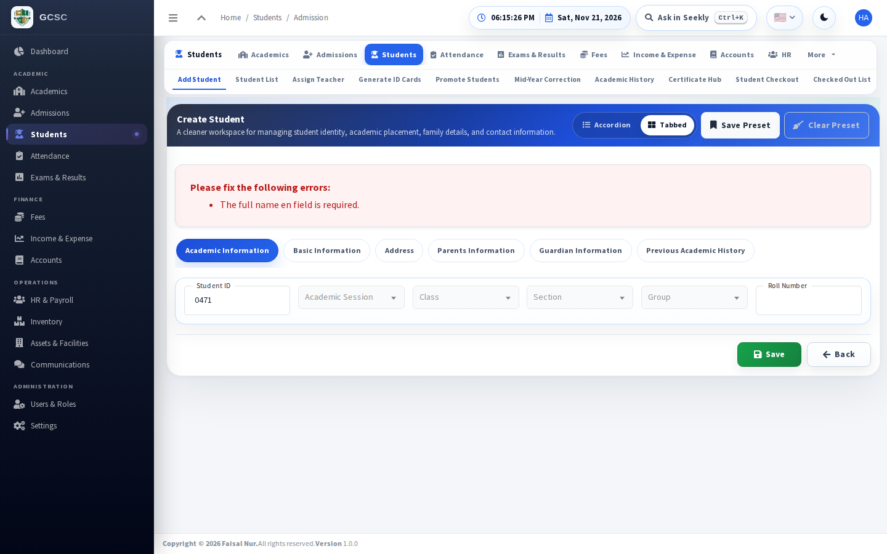 | 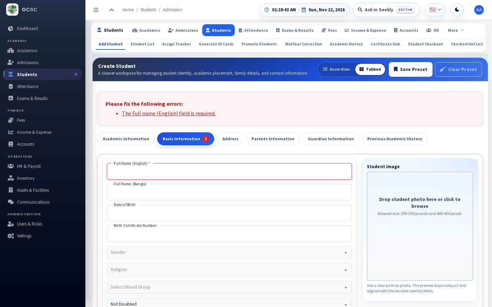 |

| Before: public form | After: public form |
|---|---|
| 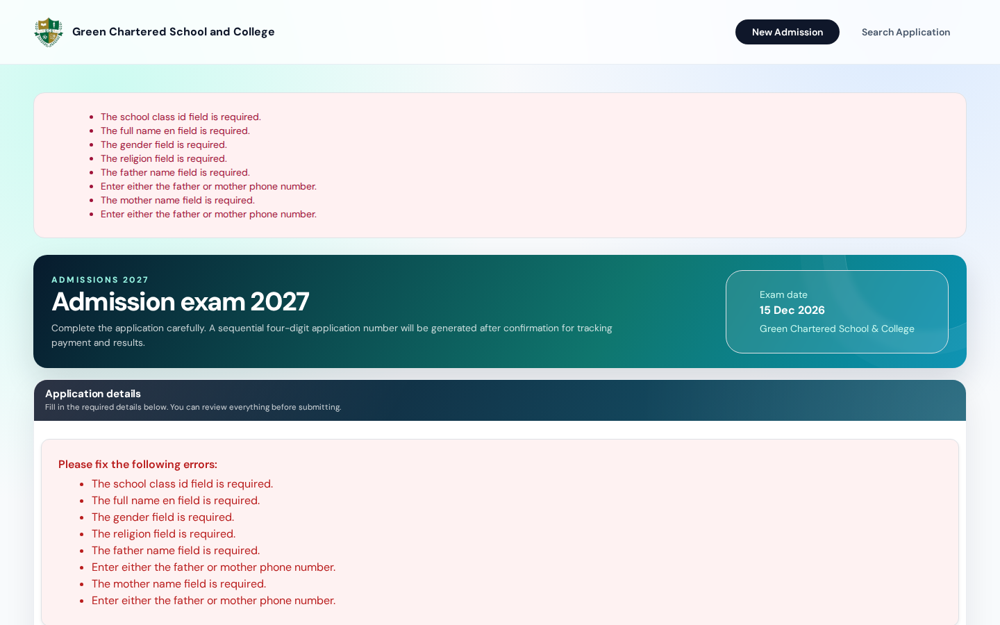 | 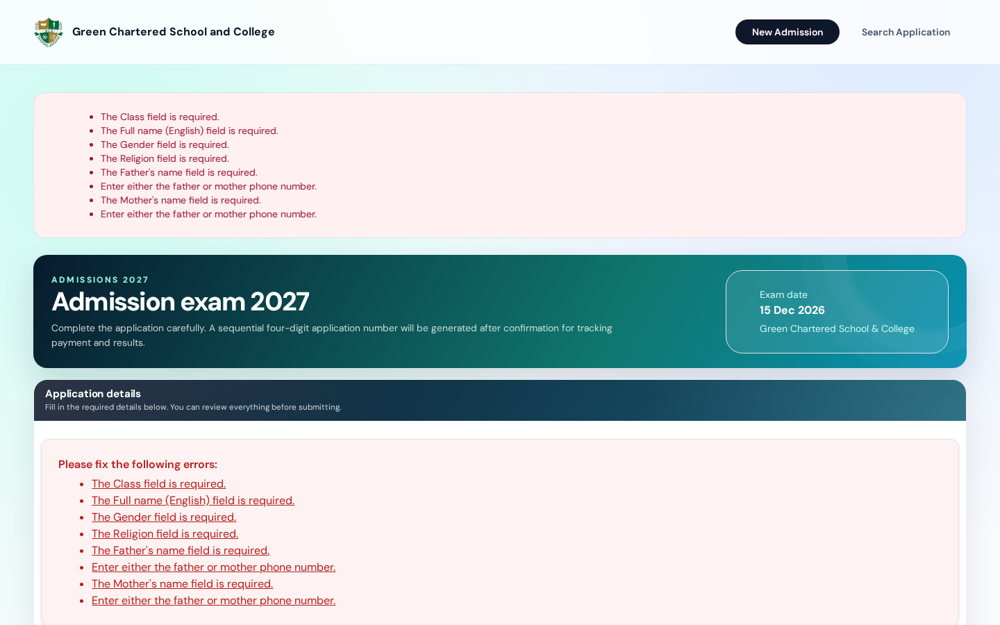 |

---

## F-13 · Empty browser-tab title on 301 of 330 screens

**Problem.** Almost every admin tab, history entry and bookmark showed only the URL. Hundreds of views never set `@section('title')`.

**Files changed**
- `resources/views/layouts/partials/_head.blade.php`
- `app/Providers/AppServiceProvider.php`: a view composer shares the current breadcrumb label with the head partial

```blade
{{-- before --}}
<title>@yield('title')</title>

{{-- after: explicit @section('title') → controller $title → breadcrumb label → "Dashboard" --}}
@php
    $tabTitle = trim($__env->yieldContent('title'))
        ?: (is_string($title ?? null) && trim($title) !== '' ? trim($title) : '')
        ?: (($headPageTitle ?? '') ?: __('Dashboard'));
    $tabSuffix = $schoolSetting->short_name ?? null ?: config('app.name');
@endphp
<title>{{ $tabTitle }} · {{ $tabSuffix }}</title>
```

Result: 0 of 330 screens have an empty title, for example "Students · Green Chartered School & College".

---

## F-14 · Breadcrumbs leak route names and repeat crumbs

**Problem.** The unnamed `/` route showed its framework name ("Home / Generated::w C8R…"). Hub pages repeated the hub label ("Home / Students / Students").

**Files changed**
- `routes/web.php`: `/` is now `Route::redirect('/', '/dashboard')`. The dashboard route already enforces `view_dashboard`.
- `app/Providers/AppServiceProvider.php`:
  - Route names starting with `generated::` are treated as unnamed.
  - On a hub page, the hub label appears once, as the current crumb.

```php
// before
if ($hubLabel && $hubRoute) {
    $breadcrumbs[] = ['label' => $hubLabel, 'url' => route($hubRoute)];
}
$breadcrumbs[] = ['label' => $pageTitle ?: $fallbackEntity, 'url' => null];

// after
$currentLabel = $pageTitle ?: $fallbackEntity;
if ($hubLabel && $hubRoute) {
    $isHubPage = $currentLabel === $hubLabel;
    $breadcrumbs[] = ['label' => $hubLabel, 'url' => $isHubPage ? null : route($hubRoute)];
    if (! $isHubPage) {
        $breadcrumbs[] = ['label' => $currentLabel, 'url' => null];
    }
} else {
    $breadcrumbs[] = ['label' => $currentLabel, 'url' => null];
}
```

| Before: `/` | After: `/` → `/dashboard` (see breadcrumb) |
|---|---|
| 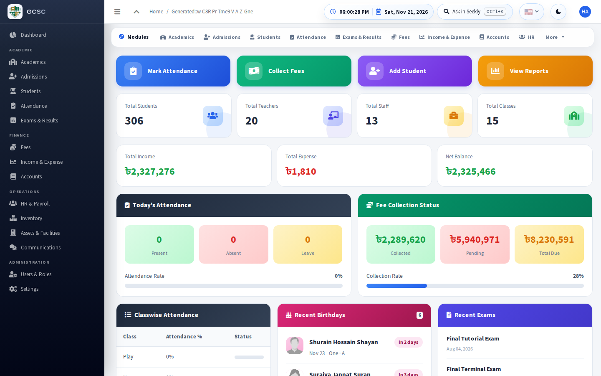 |  |

---

## F-15 · Admission review can't collect the form fee

**Problem.** The Review panel said "Payment not received. Collect the form fee before approving.", but the collect action only existed in a modal on the applications list. The reviewer had to go back and find the row.

**Files changed**
- `resources/views/pages/admissions/applications/_payment-modal.blade.php` (**new**): the payment modal extracted from the list page, unchanged in content. Its discount script is now delegated, so it works for any number of modals on a page.
- `resources/views/pages/admissions/applications/index.blade.php`: includes the partial
- `resources/views/pages/admissions/applications/show.blade.php`: adds **Collect form fee (৳200)** under the lock message and includes the modal

```blade
{{-- after (show.blade.php) --}}
@unless ($isPaid)
    <small class="form-text text-danger"><i class="fas fa-lock mr-1"></i>Payment not received. Collect the form fee before approving.</small>
    <button type="button" class="btn btn-success btn-sm mt-2" data-toggle="modal" data-target="#paymentModal{{ $application->id }}">
        <i class="fas fa-money-bill-wave mr-1" aria-hidden="true"></i>Collect form fee (৳{{ number_format((float) $application->exam?->form_fee, 0) }})
    </button>
@endunless
…
@unless ($isPaid)
    @include('pages.admissions.applications._payment-modal', ['application' => $application])
@endunless
```

It posts to the existing `admissions.applications.collect-payment` route. No controller change.

| Before | After | After: button pressed |
|---|---|---|
| 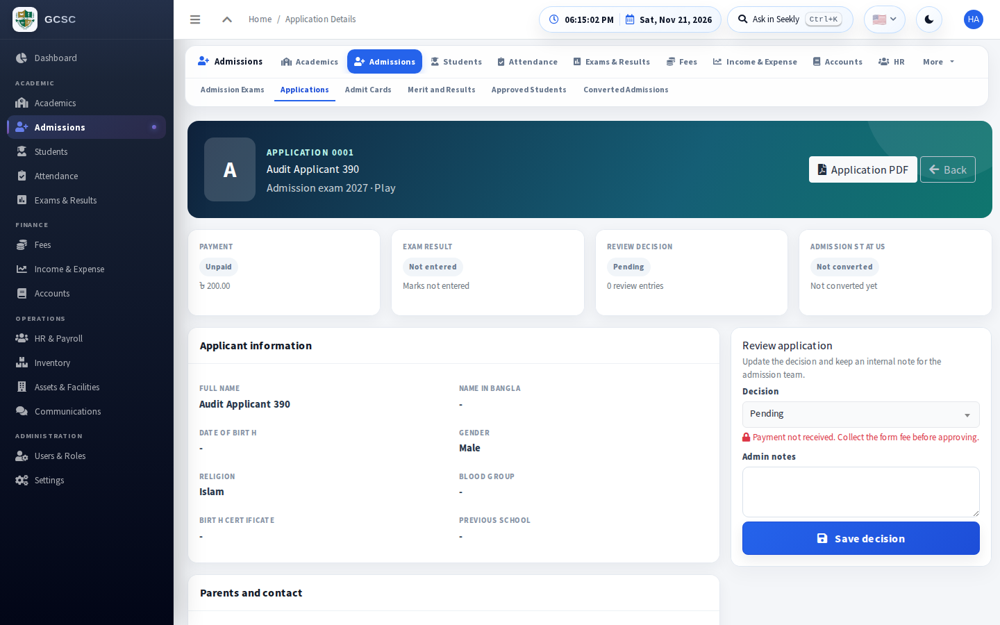 | 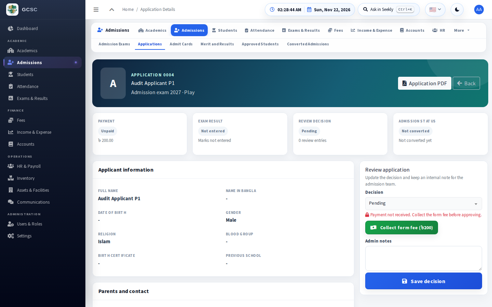 | 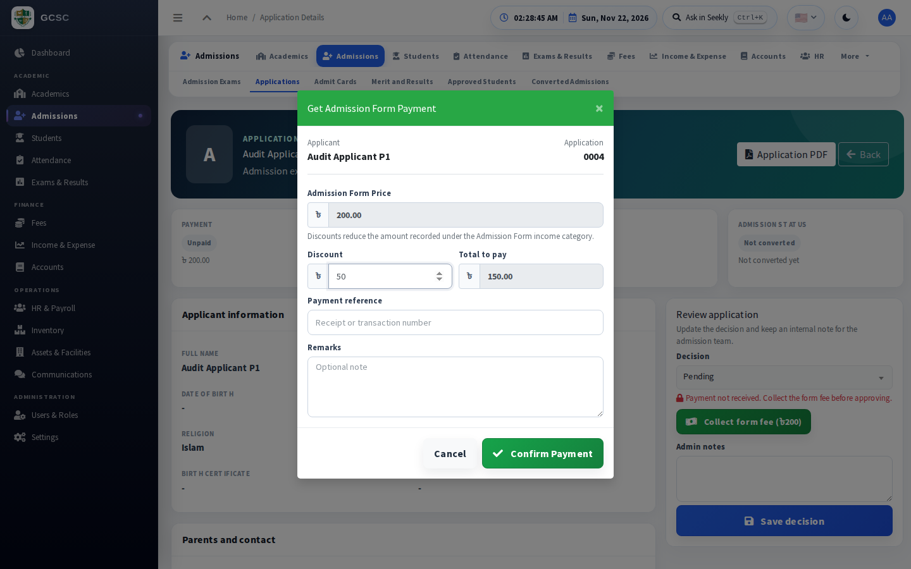 |

---

## F-16 · Public admission: required parent fields hidden on a tab

**Problem.** On desktop the public form switched to tabs. Father's name, mother's name and phone are required but sat on the Parents tab, which applicants could skip. The server then rejected the form.

**Files changed**
- `resources/views/pages/students/form.blade.php`:
  - In public admission mode, the Accordion/Tabbed toggle is hidden.
  - The form always uses the accordion with **every section open**, and opening one section no longer collapses the others.
  - Basic Information and Parents Information get the existing "Required" badge.

```js
// after
const isPublicAdmission = root.dataset.publicAdmission === '1';
const initialMode = isPublicAdmission ? 'accordion' : (savedMode || (isSmallScreen() ? 'accordion' : 'tabs'));
setView(initialMode, false);
if (isPublicAdmission) {
    panels.forEach((panel) => { panel.open = true; });
}
```

| Before (1440) | After (1440) |
|---|---|
| 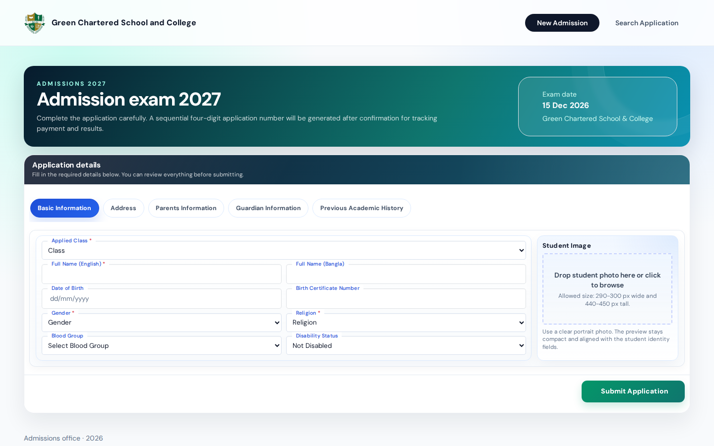 | 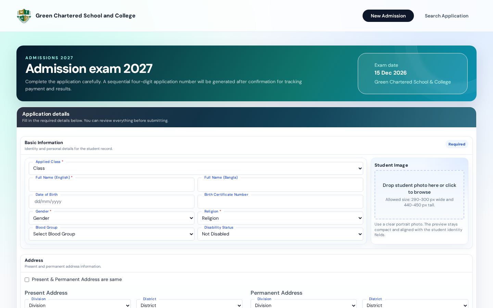 |

---

## F-17 · Receipt clipped on phones

**Problem.** The two-up receipt (institute and student copy) was wider than the phone, and its left edge sat off-screen where it couldn't be scrolled to.

**Causes.**
1. The receipt page had no `<meta name="viewport">`.
2. `align-items: center` on a fixed 784px row pushed the left edge negative.

**Files changed**
- `resources/views/pages/payments/receipt.blade.php`: adds the viewport meta and a **screen-only** phone layout that stacks the two copies vertically with a dashed divider. The print stylesheet is unchanged.

```css
/* after */
@media screen and (max-width: 767px) {
    body { padding: 16px 12px; align-items: stretch; }
    .slips-row { flex-direction: column; width: 100%; }
    .slip-col { width: 100%; }
    .slip-col + .v-perforation + .slip-col { border-top: 1px dashed var(--line-strong); }
    .v-perforation { display: none; }
}
```

| Before (390) | After (390) |
|---|---|
| 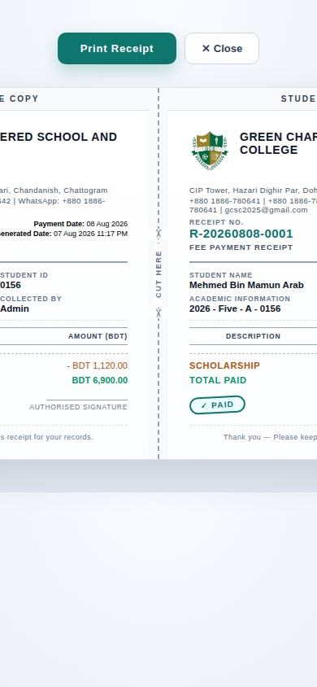 | 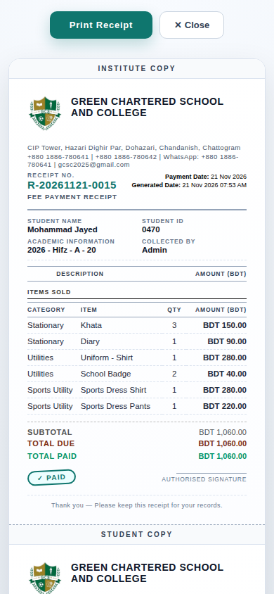 |

---

## F-18 · Unlabelled form fields

**Problem.** Many fields had a visible `<label>` that wasn't connected to the field (no `for`/`id`), or had only a placeholder. Screen readers announced nothing, and clicking the label didn't focus the field.

**What changed**
1. **Codemod: connect labels.** **597** label/field pairs in 131 views now have matching `for`/`id`. IDs are scoped to the view (e.g. `classes-create-name-en`) so two views on one page can't collide. It skipped fields inside `@foreach`/`@for` loops and partials included inside loops, to avoid duplicate IDs, and skipped array names (`items[0][qty]`).
2. **Labels pointing at missing IDs.** Where a `for="x"` pointed at a field with `name="x"` but no `id`, the `id` was added.
3. **Hand-labelled.**
   - Student form: blood group, disability, all 8 address selects.
   - Students list: filter selects and status switches.
   - Inventory opening stock: "Opening quantity for {product}" and "Unit cost for {product}".
   - School settings: the five file inputs and the two colour pickers with their hex fields.

```blade
{{-- before (example: classes/create.blade.php) --}}
<label>Name (English)</label>
<input type="text" name="name_en" class="form-control" required>

{{-- after --}}
<label for="classes-create-name-en">Name (English)</label>
<input id="classes-create-name-en" type="text" name="name_en" class="form-control" required>
```

**Result:** axe `label` went from 464 to 157 nodes and `select-name` from 2 to 0. The spec's four Accept screens are now clean: students-admission, inventory-opening-stock, school-settings and fees-collect.

**Remaining (157 nodes on 25 screens):**
- Array inputs inside dynamic rows, such as asset-purchase items and fee-set amounts.
- Read-only display boxes ("Auto-generated on save" and similar).
- A few file inputs and settings sliders.

Each needs a per-screen decision, so they're listed as a follow-up.

---

## F-19 · Icon-only controls with no accessible name

**Problem.** Every CRUD table used icon-only edit and delete buttons. The collapsed sidebar's links lost their text, and the website's social icons had no names. Screen readers announced "button" or "link" with nothing else.

**Also found: 13 Delete buttons that did nothing.** On classes, sections, fee categories, roles, permissions, permission categories, bank accounts, mobile banking, hand cash, incomes, expenses, income categories and expense categories, Delete was a `<form class="btn btn-danger">` with only an icon inside:
- In six of them there was no submit button at all, so clicking did nothing.
- In the other seven, only the bare icon (an unstyled `<button>`) was clickable.

**What changed**
1. **Codemod: name icon-only controls.** 108 `<a>`/`<button>` elements whose only content is an icon now get `aria-label` + `title` mapped from the icon (Edit, Delete, View, Print, Download PDF, Reset …), and the icon gets `aria-hidden="true"`. Controls that already had a name were left alone (223). Three unmapped ones were labelled by hand: "Toggle side panel", "Salary slip" and "More actions".
2. **Empty switch labels.** 12 `custom-control-label`s now include `<span class="sr-only">Active</span>`.
3. **Sidebar.** All 20 links get `aria-label` + `title` from their own text, so they keep a name and show a tooltip when the sidebar is collapsed.
4. **Website.** The footer and contact-page social links get names.
5. **The 13 Delete forms.** Each is now a plain form with a real `<button type="submit" class="btn btn-sm btn-danger" aria-label="Delete">`.
6. **Progress-report toolbar.** At ≥1200px the five buttons show their names (Subject settings · Print · PDF · Back · Template).

```blade
{{-- before (classes/table.blade.php): clicking did nothing --}}
<form action="{{ route('classes.delete', $class->id) }}" method="POST"
    class="btn btn-sm btn-danger d-inline m-0" onsubmit="return confirm('Delete this class?')">
    @csrf @method('DELETE')
    <i class="fas fa-trash"></i>
</form>

{{-- after --}}
<form action="{{ route('classes.delete', $class->id) }}" method="POST"
    class="d-inline m-0" onsubmit="return confirm('Delete this class?')">
    @csrf @method('DELETE')
    <button type="submit" class="btn btn-sm btn-danger" aria-label="{{ __('Delete') }}" title="{{ __('Delete') }}"><i class="fas fa-trash" aria-hidden="true"></i></button>
</form>
```

**Result:** axe `button-name` went from 465 to **0** and `link-name` from 431 to **0** across all 330 screens.

| Before: progress toolbar | After: progress toolbar (≥1200px) |
|---|---|
| 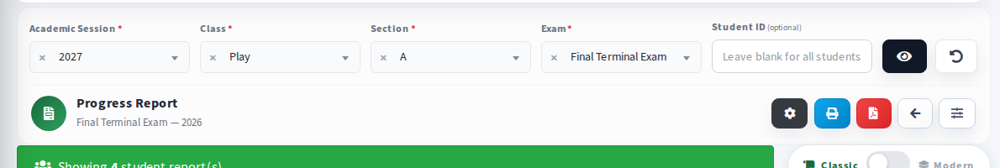 | 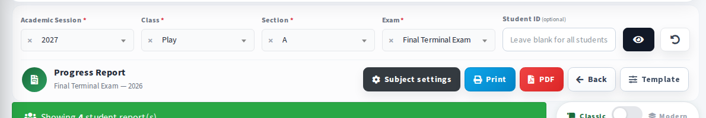 |

---

## F-20 · No design system

**Problem.** Every module invented its own type, spacing, colour and card styles: 128 font sizes, 437 colours, 22 corner radii and 401 gradients. Most pages carried their own `<style>` blocks, which is the main reason the app looks generated and inconsistent.

**What this change does: the foundation, plus the first migrated screen.**

1. **Tokens** in `resources/css/admin.css` (`:root`, with dark overrides under `html[data-theme='dark']`):
   - **Type:** `--fs-xs 12px · --fs-sm 13 · --fs-md 14 · --fs-lg 16 · --fs-xl 20 · --fs-2xl 24 · --fs-3xl 30`. Nothing below 12px.
   - **Space:** `--sp-1 4px … --sp-8 32px`.
   - **Radius:** `--r-sm 6px` (buttons and inputs) · `--r-md 10px` · `--r-lg 14px` (cards).
   - **Colour:** brand `--c-primary #0b6b3a` (crest green) and `--c-accent #b08d2b` (crest gold). Slate 50–900 neutrals, semantic success/warning/danger/info, and surface, border and text tokens.
2. **Six Blade components** in `resources/views/components/`, styled by `.ds-*` classes built only from the tokens:

| Component | Use |
|---|---|
| `<x-page-header title count subtitle>` | Page title with count chip, subtitle and an actions slot |
| `<x-card title :flush>` | Card with optional header actions and footer |
| `<x-btn variant=primary\|secondary\|danger\|ghost size=sm icon label href>` | Buttons and links. `label` gives icon-only buttons their `aria-label` and `title` |
| `<x-data-table :empty :stack>` | Table with empty state, footer slot (pagination) and a stacked phone layout (`data-label` per cell) |
| `<x-filter-bar action reset>` | GET filter form with labelled fields, Search and Reset |
| `<x-kpi label value tone hint>` | KPI tile |

3. **First screen migrated: Payments** (F-10). It uses all components except `<x-kpi>`, and its view no longer has inline styles.

**Accept status.** The spec's targets (≤ 8 font sizes per screen on five screens, ≤ 3 card radii app-wide, button colours limited to tokens) need the other screens moved onto the components. Payments went from 18 to 14 distinct font sizes. Most of the remaining ones come from the shared top bar and hub navigation, which aren't migrated yet. Migrating each screen is small follow-up work. The fee-collection page alone is 5,900 lines of inline CSS.

---

## F-21 · Tap targets under 24px on phones

**Problem.** On phones, status toggles, pagination numbers and table icon buttons were below 24px in at least one dimension, with little space between them.

**Files changed**
- `resources/css/admin.css`, phone block (≤ 767px):
  - `.btn-sm`, `.btn-xs`, Bootstrap and Laravel pagination links: at least 44 × 44px.
  - An 8px gap between neighbouring action buttons and forms in table cells.
  - Bootstrap custom switches: the label and the hidden input become 44px targets, with the track re-centred.
  - Native checkboxes and radios: at least 24px.
  - The design-system buttons and inputs also use `--tap-min: 44px` on phones.

| Before (390) | After (390) |
|---|---|
|  | 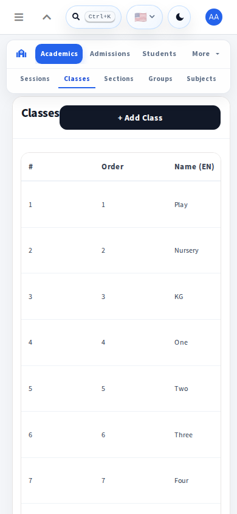 |

---

## Follow-ups (not in this change)

- **Move screens onto the design system (F-20).** Start with the spec's five measured screens (dashboard, students, fees-collect-payment, classes; payments is done), then the worst inline-CSS offenders: fees `collect_fee`, routines, admit-seat-cards, generate-id-cards. Delete each view's `<style>` block as it moves.
- **Remaining `label` violations (F-18).** 157 nodes on 25 screens: array inputs in dynamic rows, read-only display fields, settings sliders and some file inputs.
- **Bangla validation messages.** `lang/bn/validation.php` doesn't exist, so Bangla users see English validation text.
- **`/website` redirects to `/dashboard`** (`routes/web.php`, public website group). Visitors to the bare `/website` URL are sent to the admin login.
- **Duplicate titles.** 71 screens share one of 26 titles (e.g. a hub and its index). Adding a specific `@section('title')` on those views would make every title unique.
