# Changelog: P2 fixes (F-22 to F-31)

**Date:** 2026-11-22 · **Branch:** `fix/p2-F22-F31`

These fixes cover the ten P2 findings from the UI audit (`audit/UI-SPEC.md`, kept locally and gitignored). P2s are visual craft: nothing was broken, but the screens looked unfinished or were hard to read. Each section lists the problem, the change (before → after), and screenshots taken at the same viewport before and after.

**Stacked branch.** P2 builds on the design tokens and components added in P1 (F-20), so this branch starts from `fix/p1-F09-F21` with `fix/p0-F01-F08` merged in. All three changelogs and their screenshots are on this branch (`changelog/P0-FIXES.md`, `changelog/P1-FIXES.md`, this file). Once #103 and #104 are merged, this PR's diff shrinks to the P2 changes only.

| ID | Problem | Status |
|---|---|---|
| [F-22](#f-22--dashboard-rainbow-tiles-and-8-hues) | Dashboard: four rainbow gradient tiles and 8+ hues, no focal point | Fixed |
| [F-23](#f-23--wide-tables-on-phones) | Lists on phones: Employees' names off-screen | Fixed (3 screens) |
| [F-24](#f-24--module-row-duplicates-the-sidebar) | Module row duplicates the sidebar | Fixed |
| [F-25](#f-25--emoji-used-as-icons-on-fee-collection) | Emoji used as icons on fee collection | Fixed |
| [F-26](#f-26--dashboard-numbers-without-context) | Dashboard numbers have no period or comparison | Fixed |
| [F-27](#f-27--english-leaks-into-the-bangla-ui) | English text leaks into the Bangla UI | Fixed (dashboard, fee collection, shell) |
| [F-28](#f-28--text-below-451-contrast) | Text below 4.5:1 contrast | Fixed on the 5 spec screens; 1,180 nodes remain elsewhere |
| [F-29](#f-29--delete-as-loud-as-edit-browser-okcancel-confirms) | Delete as loud as Edit; browser OK/Cancel confirms | Fixed |
| [F-30](#f-30--no-main-landmark-no-skip-link) | No `<main>`, duplicate landmarks, no skip link | Fixed |
| [F-31](#f-31--report-filters-misaligned-pdf-buttons-in-red) | Report filters misaligned; PDF buttons in red | Fixed |

## How it was verified

All checks ran against the local app (`http://school.local`) with a temporary Super Admin, which was deleted afterwards. No data was changed: on the delete dialog the probe clicked **Keep class**.

**Every screen.** The 330 default admin and public screens from the audit were re-opened at 1440×900 and checked with axe-core.

| Check (330 screens) | Audit (before) | After |
|---|---|---|
| HTTP status | — | 330 × 200 |
| axe `landmark-one-main` (screens) | 365 of 400 scans | **0** |
| axe `landmark-unique` | 363 of 400 scans | **0** |
| axe `region` (nodes) | on 377 scans | **0** |
| axe `color-contrast` (nodes / screens) | 5,124 / 377 scans | **1,180 / 117** |
| axe `button-name` / `link-name` (P1 regression check) | 0 / 0 after P1 | **0 / 0** |

**Targeted checks** (the spec's Accept criteria):

| Fix | Accept criterion | Before | After |
|---|---|---|---|
| F-22 | Dashboard at 1440: ≤ 5 non-neutral hues, 0 `linear-gradient` backgrounds in `.content-wrapper` | 5 hues · **24 gradients** | **2 hues · 0 gradients** |
| F-23 | hr-employees at 390: first employee's name visible, no horizontal scroll | name off-screen · table scrolls | **name visible · no scroll** (also classes, fee categories) |
| F-24 | Hub pages at 1440: content starts ≤ 120px from the top | 158px | **111px** |
| F-25 | No `\p{Extended_Pictographic}` in fee collection's `.content-wrapper` text | 18 emoji | **0** |
| F-26 | Each money KPI shows a period and a comparison; student count matches the list | none · 306 vs 293 | **"Nov 2026" + "▲ 2% vs Oct"** · **293 active (13 inactive)** |
| F-27 | Bangla dashboard and fee collection contain none of the audit's English words | 5 · 5 words | **0 · 0** |
| F-28 | ≤ 10 axe contrast nodes on dashboard, students, fee collection, payments, classes | 11 · 9 · 18 · 7 · 5 | **0 · 0 · 0 · 0 · 0** |
| F-29 | No `onsubmit="return confirm(` in students, classes or sections, and confirm buttons name the outcome | 73 native confirms app-wide | **0** · "Delete class" / "Keep class" |
| F-30 | `landmark-one-main` = 0 and `landmark-unique` = 0 on all default screens | 365 · 363 | **0 · 0** |
| F-31 | Trial balance: Filter and PDF share the Year input's top; no export button with a danger background | tops 357/292/348 · 1 red | **all at 272px · 0 red** (36 buttons recoloured app-wide) |
| Tests | `php artisan test` | 31 failed on `dev` | 31 failed, the same 31. Two source-text tests that pinned the old design (the emoji tab labels and the top-bar toggle) were updated to assert the new behaviour. |

---

## F-22 · Dashboard rainbow tiles and 8+ hues

**Problem.**
- Mark Attendance (blue), Collect Fees (green), Add Student (purple) and View Reports (orange) were equal-weight gradient tiles. They were the heaviest things on the page and carried no information.
- The card headers below added navy, emerald, magenta and indigo.
- The KPI tiles had pastel blobs and decorative circles.
- In dark mode all of it stayed at full saturation.

**Files changed**
- `resources/views/dashboard.blade.php`: quick actions, KPI tiles, CSS

```blade
{{-- before: four gradient tiles --}}
<div class="col-6 col-lg-3">
    <a href="{{ route('attendance.index') }}" class="quick-action-card attendance">
        <div class="action-icon"><i class="fas fa-clipboard-check"></i></div>
        <span class="action-text">{{ __('Mark Attendance') }}</span>
    </a>
</div>
…
.quick-action-card.attendance { background: linear-gradient(135deg, #3b82f6 0%, #1d4ed8 100%); }

{{-- after: one row of buttons; only the main task is primary --}}
<div class="dashboard-quick-actions mb-4" role="group" aria-label="{{ __('Quick actions') }}">
    <x-btn variant="primary" icon="fas fa-money-bill-wave" :href="route('fees.collect')">{{ __('Collect Fees') }}</x-btn>
    <x-btn variant="secondary" icon="fas fa-clipboard-check" :href="route('attendance.index')">{{ __('Mark Attendance') }}</x-btn>
    …
</div>
```

- **Card headers** are neutral (surface background, `--fs-lg` title, hairline border) in both themes.
- **Removed decoration:** the KPI icon circles, the "glow" blobs and the attendance/fee tile gradients. Every gradient on the page was removed; colour now appears only on semantic values (green collected/present, red pending/absent, amber leave/due).
- **Progress bars:** the classwise attendance bars and the progress bars use flat colours.

| Before | After |
|---|---|
| 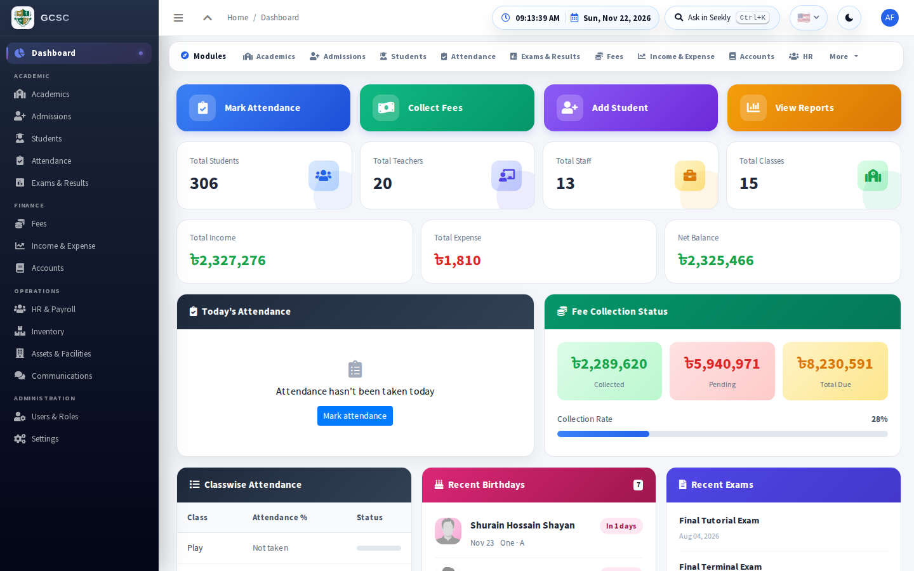 | 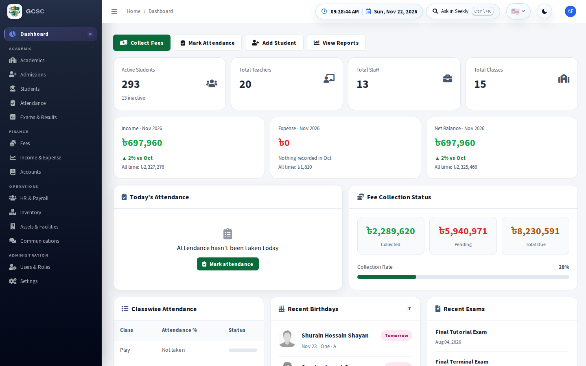 |
| 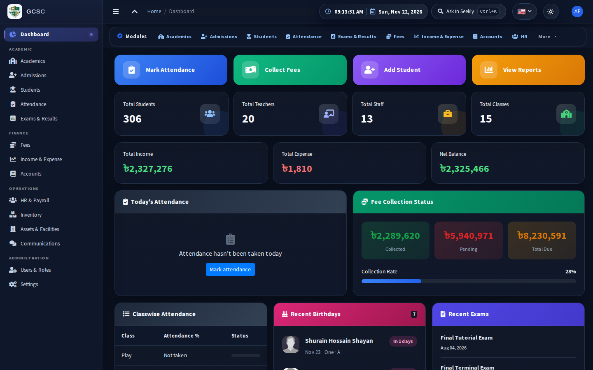 | 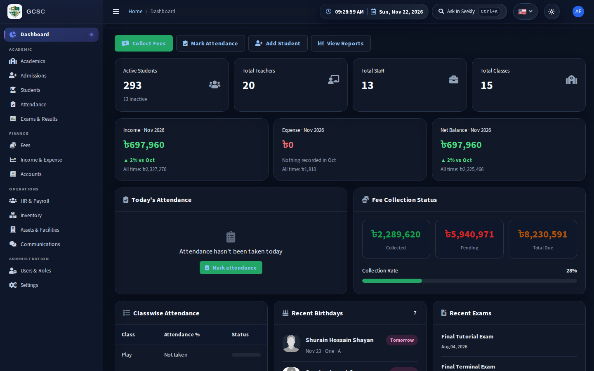 |

Full page: [before](p2-fixes/before-f22-dashboard-1440-full.png) · [after](p2-fixes/after-f22-dashboard-1440-full.png)

---

## F-23 · Wide tables on phones

**Problem.** Students and Payments became cards on phones, but Employees, Classes and Fee categories stayed wide tables. On Employees only #, Photo and ID fit on screen; the name was off to the right.

**Files changed**
- `resources/css/admin.css`: the stacked layout from `<x-data-table stack>` (F-20) now works on any `.table` with `ds-table--stack`, plus `.ds-stack-title` and `.ds-stack-actions` helpers
- `resources/views/hr/employees/index.blade.php`
- `resources/views/pages/classes/table.blade.php`
- `resources/views/pages/fee_categories/table.blade.php`

```blade
{{-- before --}}
<table class="table table-bordered table-hover table-sm">
  … <td>{{ $employees->firstItem() + $loop->index }}</td>
    <td>photo_url }}" …></td>
    <td><code>{{ $emp->employee_id }}</code></td>
    <td class="font-weight-bold"><a …>{{ $emp->name }}</a></td>

{{-- after: at ≤767px each row is a card, name as title --}}
<table class="table table-bordered table-hover table-sm ds-table--stack">
  … <td class="ds-hide-sm">{{ $employees->firstItem() + $loop->index }}</td>
    <td class="ds-hide-sm">photo_url }}" alt="" …></td>
    <td class="font-weight-bold ds-stack-title"><a …>{{ $emp->name }}</a></td>
    <td data-label="{{ __('Employee ID') }}"><code>{{ $emp->employee_id }}</code></td>
```

On phones the card shows the name as its title, 2–4 labelled fields and the actions in a row at 40px tap size. The desktop table is unchanged apart from the Name column moving before Employee ID.

**Not done:** the spec suggested a kebab menu for row actions. With only 2–3 actions per row, a visible button row is quicker to use and needs no extra script, so actions stay as buttons.

| Before | After |
|---|---|
| 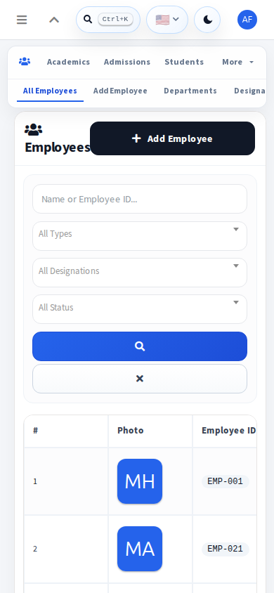 | 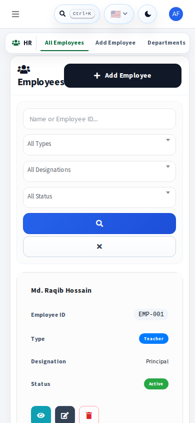 |
| 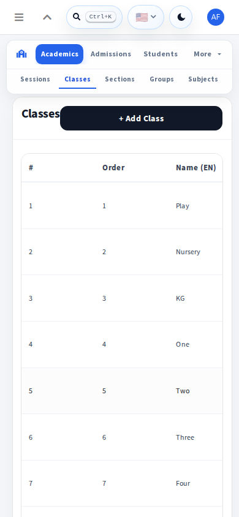 | 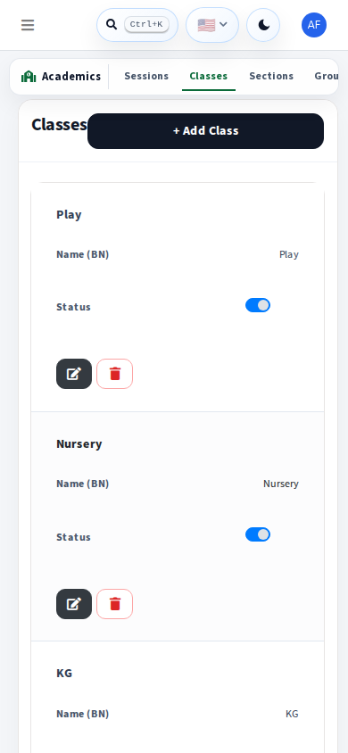 |
| 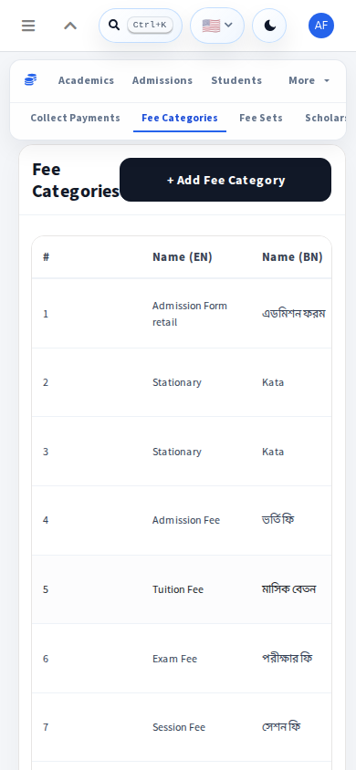 | 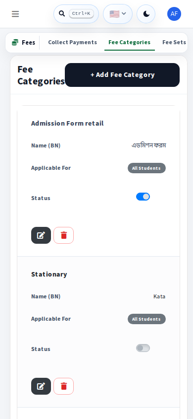 |

---

## F-24 · Module row duplicates the sidebar

**Problem.** The top row listed Academics … HR plus "More": the same places as the sidebar. It cost about 45px on every page, 90px with the sub-tabs, and pushed content further down on phones.

**Files changed**
- `resources/views/components/hub-switcher.blade.php`
- `resources/views/layouts/partials/_top-nav.blade.php`: "collapse module navigation" button removed

```blade
{{-- before: two rows --}}
<div class="hub-switcher__primary">
    <span class="hub-switcher__current">…</span>
    <div class="hub-switcher__links" role="navigation" aria-label="{{ __('Modules') }}">
        @foreach ($visibleModules as $module) … @endforeach   {{-- 9 modules --}}
    </div>
    … "More" dropdown …
</div>
<div class="hub-switcher__context" role="navigation">…sub-tabs…</div>

{{-- after: one row, only when the current module has sub-pages --}}
@if ($currentModule && $currentContextLinks->isNotEmpty())
<nav class="hub-switcher" id="hubSwitcher" aria-label="{{ __(':module navigation', ['module' => $currentModule['label']]) }}">
    <div class="hub-switcher__context">
        <a href="{{ route($currentModule['route']) }}" class="hub-switcher__current">…{{ $currentModule['label'] }}</a>
        @foreach ($currentContextLinks as $link)
            <a … @if (request()->routeIs(...$link['match'])) aria-current="page" @endif>{{ $link['label'] }}</a>
        @endforeach
    </div>
</nav>
@endif
```

- **Current page:** the active sub-tab carries `aria-current="page"` and uses the crest green instead of the old blue.
- **Hiding the row:** the "Show module navigation" switch in School Settings still hides it.
- **Pages without sub-pages:** the dashboard, for example, no longer shows an empty bar.

| Before | After |
|---|---|
| 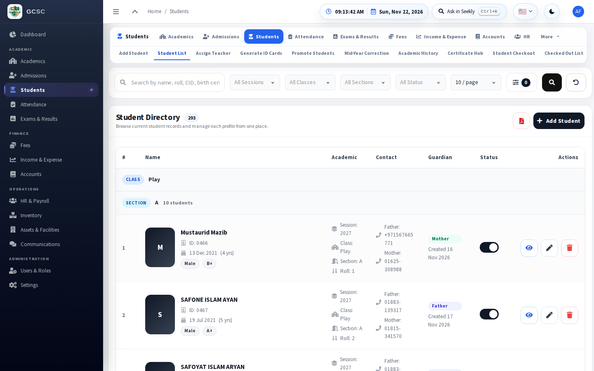 | 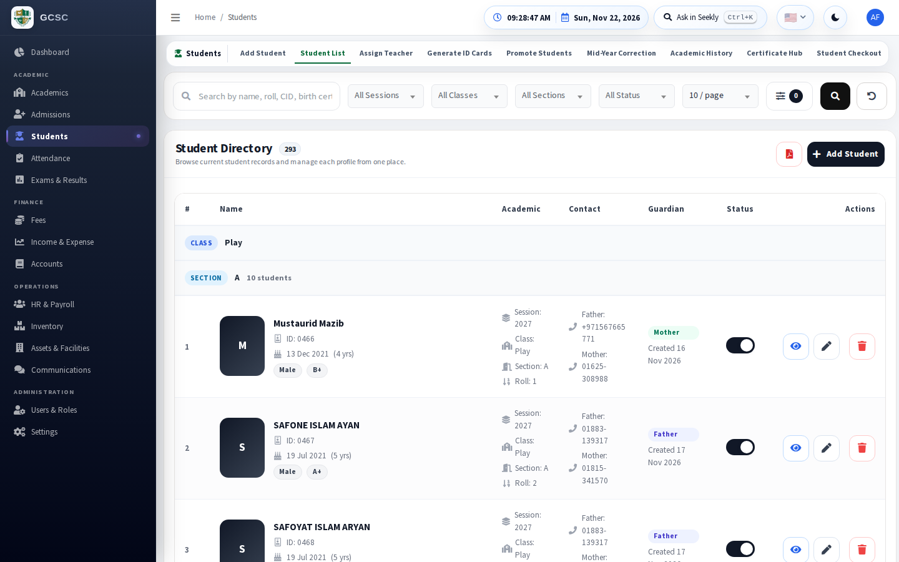 |
| 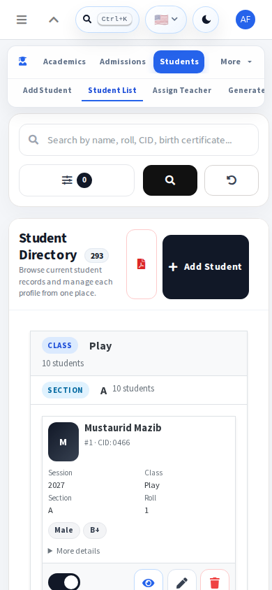 | 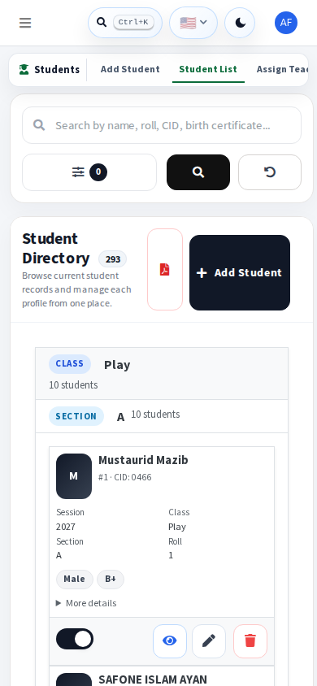 |

---

## F-25 · Emoji used as icons on fee collection

**Problem.**
- The most-used finance screen mixed OS emoji (💳 🧾 🗂️ 📦 ⏳ 📋 👈 🎓 🚌 🛒 📑 🔎 ✕) with the app's Font Awesome icons.
- The submit button switched between "⏳ Processing...", "✓ COLLECT PAYMENT" and "✓ Collect payment".

**Files changed**
- `resources/views/pages/fees/collect_fee.blade.php`: 24 targeted replacements. The file is 5,900 lines, so as the spec advised it was not restructured.

```blade
{{-- before --}}
<a class="nav-link active fw-semibold" href="#tabCollect">💳 Collect</a>
<span class="fs-5">📦</span>
$btn.prop('disabled', true).html('⏳ &nbsp;Processing...');
$btn.prop('disabled', false).html('✓ &nbsp;COLLECT PAYMENT');
<button … class="remove-btn …">✕</button>

{{-- after --}}
<a class="nav-link active fw-semibold" href="#tabCollect"><i class="fas fa-credit-card mr-1" aria-hidden="true"></i> {{ __('Collect') }}</a>
<span class="fs-5"><i class="fas fa-box" aria-hidden="true"></i></span>
const COLLECT_LABEL = '<i class="fas fa-check mr-1" aria-hidden="true"></i>{{ __('Collect payment') }}';
$btn.prop('disabled', true).html('<span class="spinner-border spinner-border-sm mr-2" role="status" aria-hidden="true"></span>{{ __('Collecting…') }}');
$btn.prop('disabled', false).html(COLLECT_LABEL);
<button … class="remove-btn …" aria-label="{{ __('Remove') }}" title="{{ __('Remove') }}"><i class="fas fa-times" aria-hidden="true"></i></button>
```

Icon mapping (Font Awesome 5, which the app ships): 💳 `fa-credit-card` · 🧾 `fa-receipt` · History `fa-history` · 🗂️ `fa-folder` · 📦 `fa-box` · ⏳ `fa-hourglass-half` · 📋 `fa-clipboard-list` · 👈 `fa-hand-point-left` · 🎓 `fa-graduation-cap` · 🚌 `fa-bus` · 🛒 `fa-shopping-cart` · 📑 `fa-file-alt` · 🔎 `fa-search` · ✕ `fa-times`.

| Before | After |
|---|---|
| 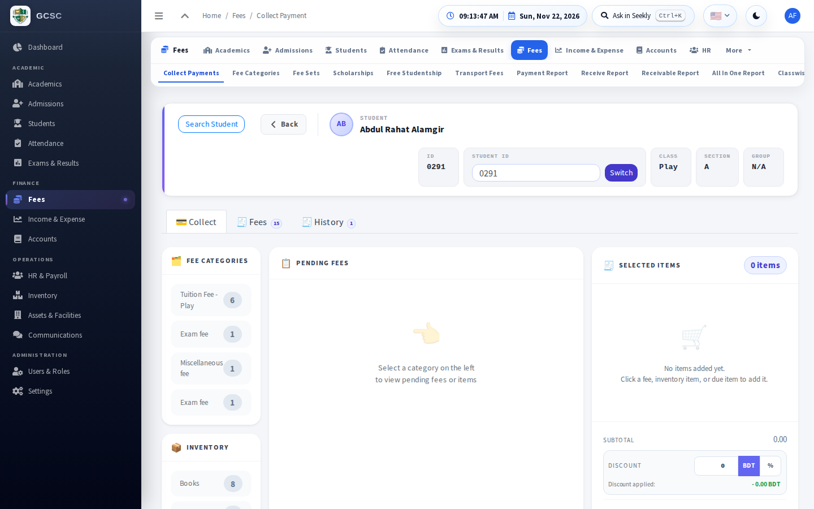 | 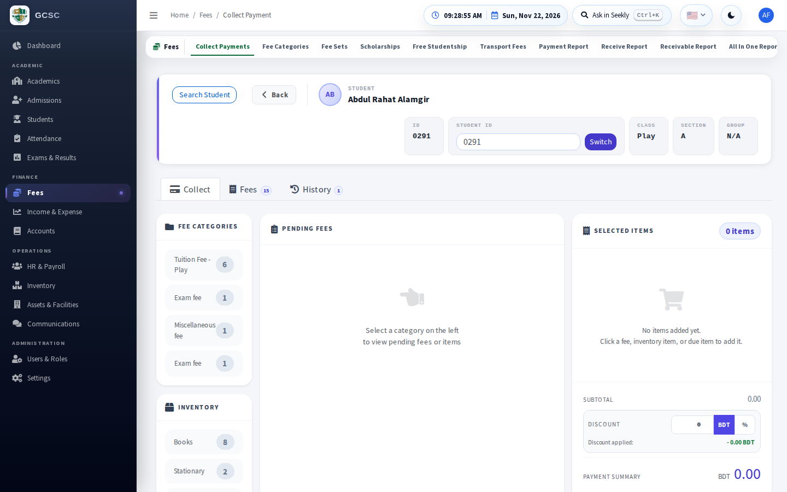 |

---

## F-26 · Dashboard numbers without context

**Problem.**
- "Total Income ৳2,327,276" didn't say over what period and had no comparison.
- "Total Students 306" disagreed with "Total: 293 Students" on the student list. The dashboard counted inactive students; the list doesn't.

**Files changed**
- `app/Http/Controllers/DashboardController.php`
- `resources/views/dashboard.blade.php`

```php
// before
$data['total_students'] = Student::count();
$data['total_income'] = Income::sum('amount');
$data['total_expense'] = Expense::sum('amount');

// after
$data['total_students'] = Student::where('status', 1)->count();      // matches the list's default
$data['inactive_students'] = Student::where('status', '!=', 1)->count();
$data['total_income'] = $sumBetween(Income::class, 'income_date', $monthStart, $today);   // this month
$data['prev_income']  = $sumBetween(Income::class, 'income_date', $prevStart, $prevEnd);  // last month
$data['alltime_income'] = (float) Income::sum('amount');                                  // the old figure
// … same for expense; net balance derived
```

- **Money cards:** each card reads "Income · Nov 2026", then the amount, then "▲ 2% vs Oct" (green when good, red when bad; for Expense, up is bad), then "All time: ৳2,327,276". The old all-time number is still shown, now labelled.
- **No comparison available:** when the previous month has nothing recorded, the card says "Nothing recorded in Oct" instead of a misleading percentage.
- **Student count:** the tile now reads "Active Students 293 · 13 inactive".

Screenshots: see F-22 (same screen).

---

## F-27 · English leaks into the Bangla UI

**Problem.** In Bangla these stayed English:
- Dashboard: "Modules", "More", "Classwise Attendance", "Recent Birthdays", "In 2 days".
- Fee collection: "Payment Report", "Receive Report", "Receivable Report", "Student ID", "Student List", the filter labels and the table headers.

**Files changed**
- `lang/bn.json`: 28 keys appended, existing lines untouched (the file has some duplicate keys, so it was appended to rather than rewritten)
- `resources/views/pages/fees/partials/_student_filter_for_payment.blade.php`: labels wrapped in `__()`. The Class/Section/Group labels also gained `for=`, which was a leftover from F-18.
- `resources/views/pages/fees/collect.blade.php`: card title and table headers wrapped
- `resources/views/layouts/partials/_header.blade.php`: page `<h1>` passed through `__()`
- `app/Http/Controllers/DashboardController.php`: "In 1 days" → "Tomorrow"

```blade
{{-- before --}}
<label for="partials--student-filter-for-payment-student-id">Student ID</label>
<label>Class</label> … <option value="">All</option>
<h1 class="m-0 text-truncate">{{ $pageTitle ?? __('Dashboard') }}</h1>

{{-- after --}}
<label for="partials--student-filter-for-payment-student-id">{{ __('Student ID') }}</label>
<label for="classSelect">{{ __('Class') }}</label> … <option value="">{{ __('All') }}</option>
<h1 class="m-0 text-truncate">{{ __($pageTitle ?? 'Dashboard') }}</h1>
```

The new dashboard strings from F-22, F-26, F-29 and F-30 ("Active Students", "All time", "vs :month", "Skip to content", …) also have Bangla keys. "Modules" and "More" are translated too, though F-24 removed the row that showed them.

| Before | After |
|---|---|
| 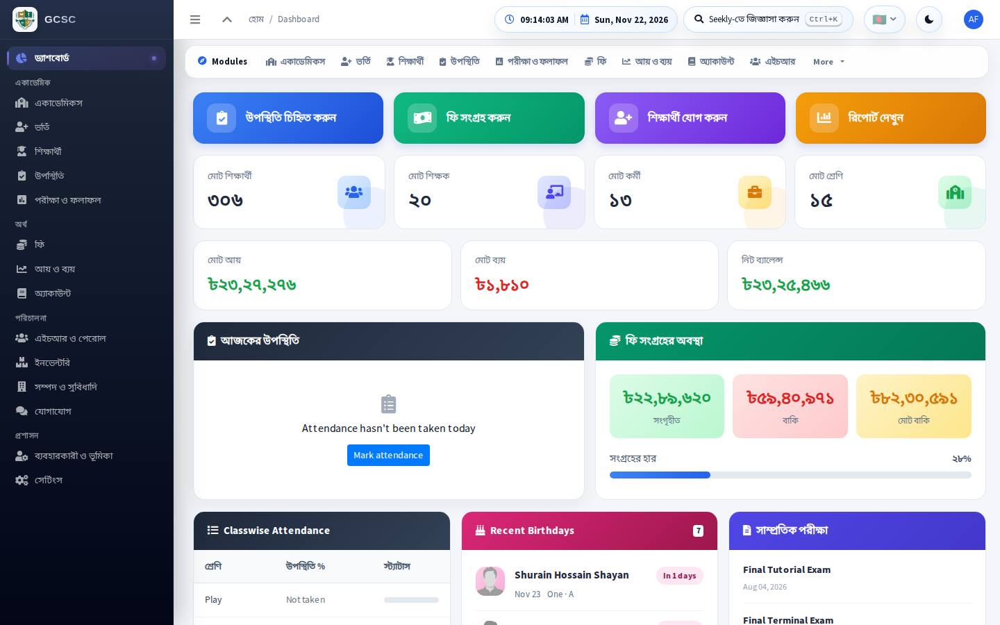 | 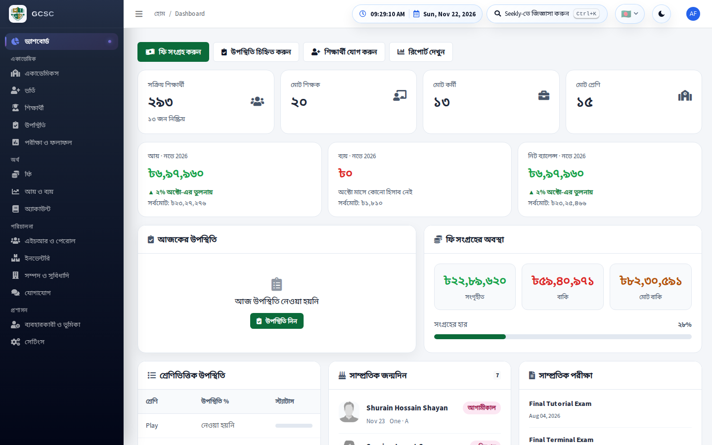 |
| 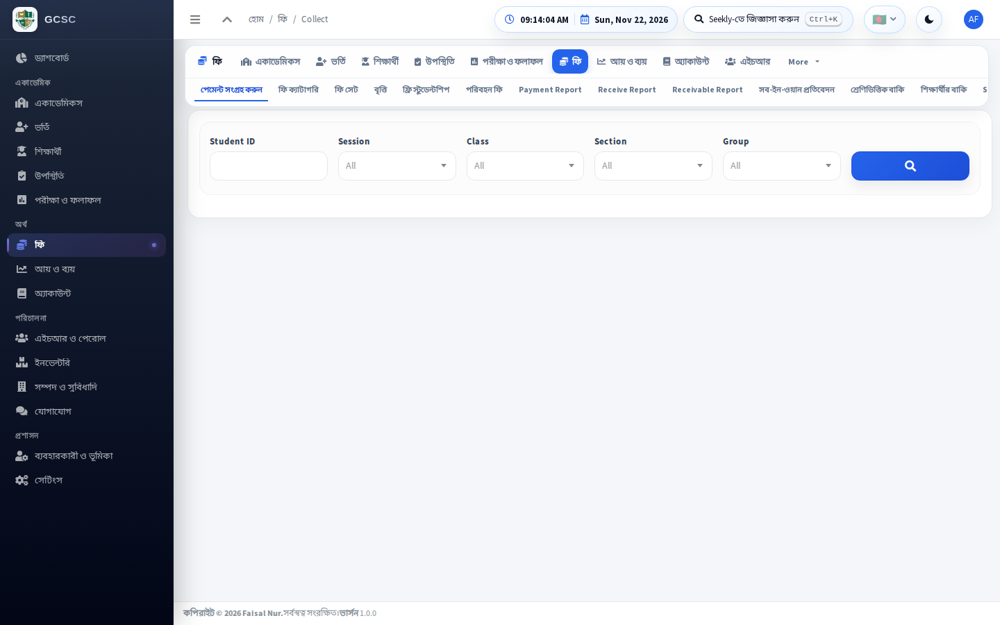 | 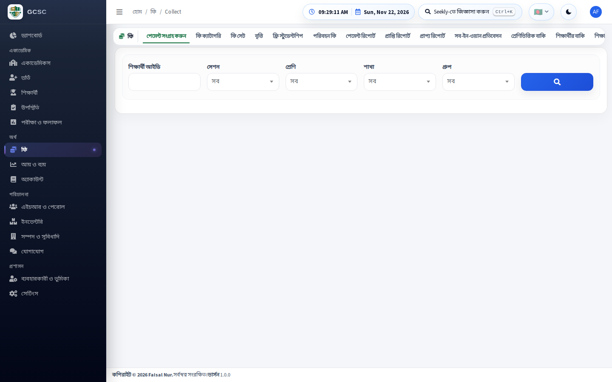 |

**Remaining:** class names (Play, Nursery, One…), exam names and dates come from the database, not the code. Other screens weren't swept for Bangla.

---

## F-28 · Text below 4.5:1 contrast

**Problem.** Axe found 5,124 text nodes below WCAG AA contrast across 377 scans. On the five spec screens the main offenders were:
- Bootstrap's grey `#6c757d` on the app's `#f8fafc` panels (4.48:1).
- The footer's `#869099` (3.24:1).
- The outline-primary blue `#007bff` (3.97:1).
- The dashboard's exam dates in `#94a3b8` (2.56:1).
- Select2 placeholders in `#999` (2.72:1).

**Files changed**
- `resources/css/admin.css`: `--c-text-muted` moved from slate-500 to slate-600 `#475569`, as the spec asked, plus one contrast floor block:

```css
/* after */
.text-muted, .text-secondary { color: #5c636a !important; }          /* was #6c757d */
.main-footer, .main-footer a, .main-footer b, .main-footer strong { color: #475569; }  /* was #869099 */
.btn-outline-primary { color: #0062cc; border-color: #0062cc; }       /* was #007bff */
.select2-container--default .select2-selection__placeholder { color: #5c636a; }        /* was #999 */
/* + dark-theme equivalents */
```

- `resources/views/dashboard.blade.php`: exam dates use `--c-text-muted`
- `resources/views/pages/fees/collect_fee.blade.php`: discount toggle `#6366f1` → `#4f46e5`; "Discount applied" line `#16a34a` → `#15803d`
- The F-22 gradient removal took out the white-on-gradient text the spec mentions.

**Result:** 0 contrast nodes on all five spec screens (the target was ≤ 10). App-wide it went from 5,124 nodes on 377 scans to 1,180 nodes on 117 screens. The rest are per-view inline colours (mostly report tables and hub cards) and need fixing screen by screen.

---

## F-29 · Delete as loud as Edit; browser OK/Cancel confirms

**Problem.**
- Delete was a solid red button next to a solid Edit button.
- 73 actions used the browser's `confirm()` box ("Delete this student?" with OK / Cancel). Its buttons don't say what happens, and it can't be styled or translated.

**Files changed**
- `resources/views/components/confirm-dialog.blade.php` (**new**): one shared, accessible Bootstrap dialog, included once in `layouts/master.blade.php`
- 73 confirms in 71 views: `onsubmit/onclick="return confirm(…)"` → `data-confirm` attributes. 65 were converted by script; the 8 with dynamic text were converted by hand.
- 27 views: icon-only Delete buttons `btn-danger` → `btn-outline-danger`, 8px after Edit
- `resources/views/hr/employees/index.blade.php`, `pages/students/index.blade.php`: delete buttons outlined and spaced

```blade
{{-- before --}}
<form action="{{ route('classes.delete', $class->id) }}" method="POST" class="d-inline m-0"
    onsubmit="return confirm('Delete this class?')">
    <button type="submit" class="btn btn-sm btn-danger" …><i class="fas fa-trash"></i></button>

{{-- after --}}
<form action="{{ route('classes.delete', $class->id) }}" method="POST" class="d-inline m-0"
    data-confirm="{{ __('Delete class “:name”?', ['name' => $class->name_en]) }}"
    data-confirm-action="{{ __('Delete class') }}" data-confirm-cancel="{{ __('Keep class') }}">
    <button type="submit" class="btn btn-sm btn-outline-danger" …><i class="fas fa-trash"></i></button>
```

**How the dialog works**
- **Interception:** it catches the submit (or click) in the capture phase and shows the dialog. The title names the item, the buttons name the outcome, and focus starts on the safe button.
- **Confirming:** re-submits with `form.requestSubmit()`, so any other submit handlers on the form still run.
- **Options:** `data-confirm-text` adds a detail line (e.g. "This cannot be undone." when closing an accounting period). `data-confirm-tone="primary"` gives non-destructive actions, like "Generate payroll", a non-red button.
- **Names in titles:** students, classes, sections, fee categories and employees name the item ("Delete student “Abdul Rahat Alamgir”?").

**Left as is:** two exam actions in `pages/exams/index.blade.php` use `onclick="if(confirm(…)) {…}"` with extra logic, and 11 `confirm()` calls sit inside page scripts. They still use the browser box.

| Before | After |
|---|---|
| 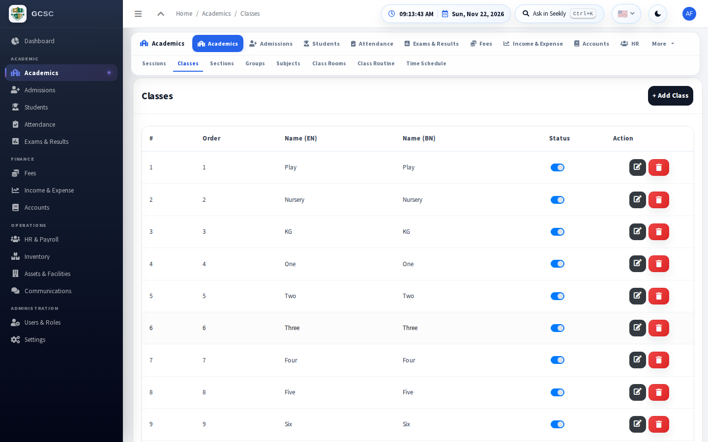 | 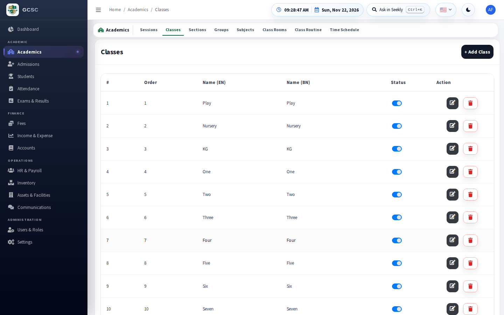 |
| *(browser `confirm()`: "Delete this class?" · OK / Cancel; can't be screenshotted)* | 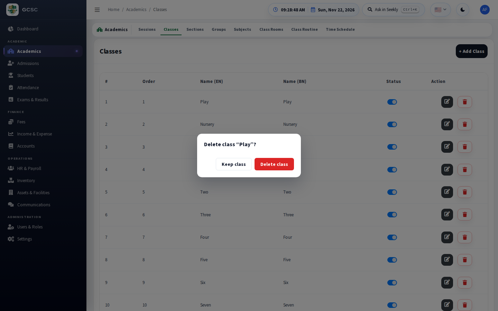 |

---

## F-30 · No `<main>` landmark, no skip link

**Problem.** Axe reported, out of 400 scans:
- No `<main>` landmark on 365.
- Duplicate unnamed landmarks on 363.
- Content outside any landmark on 377.
- No skip link anywhere.

**Files changed**
- `resources/views/layouts/master.blade.php`: skip link; content wrapper is `<main id="main">`
- `resources/views/layouts/partials/_top-nav.blade.php`: `<nav>` → `<header>` (banner); breadcrumb `aria-label="Breadcrumb"`
- `resources/views/layouts/partials/_side-nav.blade.php`: `aria-label="Primary"`
- `resources/views/components/hub-switcher.blade.php`: sub-tabs `<nav aria-label="Fees navigation">` etc.
- `pages/payments/receipt.blade.php`, `pages/vouchers/print.blade.php`, `pages/students/birthday-card-preview.blade.php`: standalone print pages wrapped in `<main>` with `display: contents`, so their layout and print output are unchanged
- `resources/css/admin.css`: `.skip-link`, visible on keyboard focus only

```blade
{{-- before --}}
<body …>
    <div class="wrapper">
        <nav class="main-header navbar …">…</nav>
        …
        <div class="content-wrapper">

{{-- after --}}
<body …>
    <a href="#main" class="skip-link">{{ __('Skip to content') }}</a>
    <div class="wrapper">
        <header class="main-header navbar …">…</header>
        …
        <main id="main" class="content-wrapper" tabindex="-1">
```

**Result:** `landmark-one-main` 0, `landmark-unique` 0 and `region` 0 across all 330 screens. `<x-page-header>` was already the only `<h1>` where it's used. A few `heading-order` warnings remain (students and classes jump from `<h1>` to `<h3>` in card titles).

---

## F-31 · Report filters misaligned; PDF buttons in red

**Problem.**
- On the accounting reports, the Filter, Reset and PDF buttons wrapped onto two rows next to a one-row input. Each button had a 108px minimum width inside a narrow column.
- PDF and export buttons across the app were red (`btn-danger`), the colour that should mean delete.

**Files changed**
- `resources/views/pages/reports/partials/filter-style.blade.php`: shared by 10 accounting reports. Fields and buttons now align on one baseline and the button group never wraps.
- 36 export/PDF buttons in 35 views: `btn-danger` → `btn-outline-secondary`, keeping the `fa-file-pdf` icon

```css
/* before */
.supplier-dues-filters .btn { min-width: 108px; }

/* after */
.supplier-dues-filters .row { align-items: flex-end; }
.supplier-dues-filters .row > .d-flex { flex: 0 0 auto; width: auto; max-width: none; flex-wrap: nowrap; align-items: flex-end; gap: .5rem; }
.supplier-dues-filters .btn { min-width: 0; height: calc(1.5em + .75rem + 2px); display: inline-flex; align-items: center; gap: .35rem; white-space: nowrap; }
```

```blade
{{-- before --}}
<a href="{{ route('reports.trial-balance.pdf', request()->query()) }}" class="btn btn-danger"><i class="fas fa-file-pdf"></i> PDF</a>
{{-- after --}}
<a href="{{ route('reports.trial-balance.pdf', request()->query()) }}" class="btn btn-outline-secondary"><i class="fas fa-file-pdf"></i> PDF</a>
```

| Before | After |
|---|---|
| 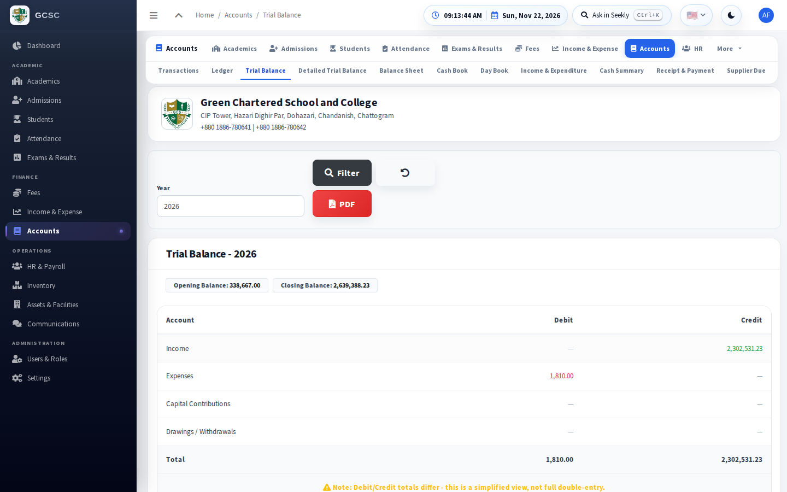 | 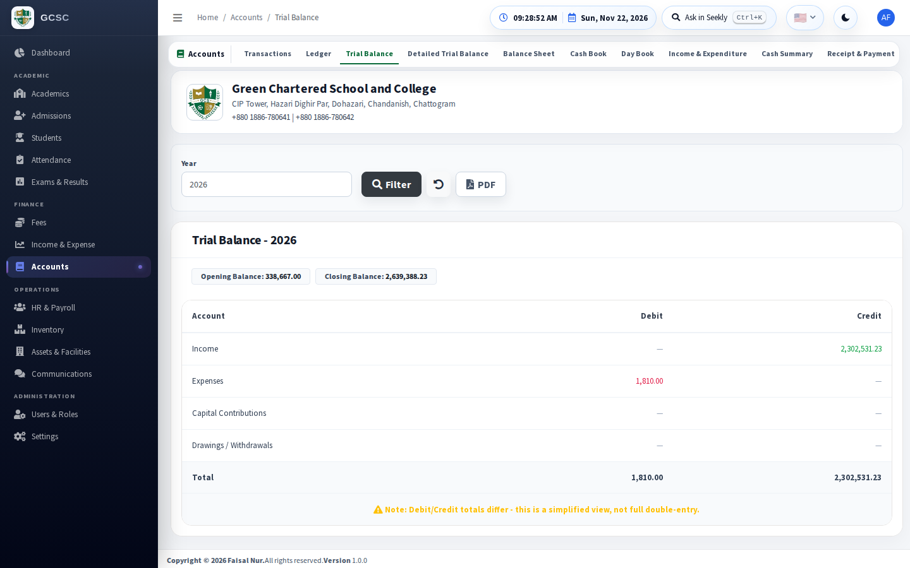 |
| 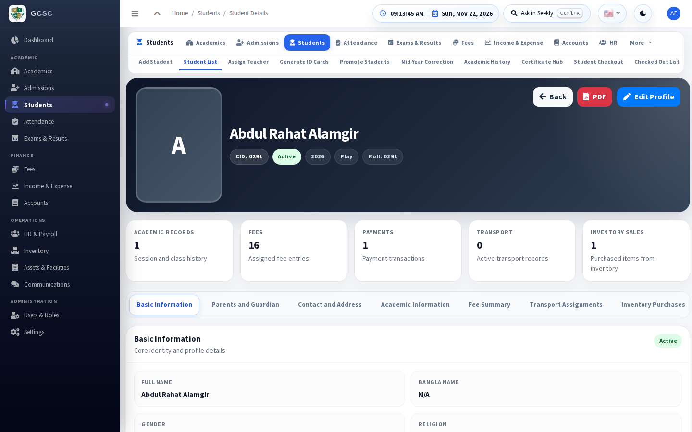 | 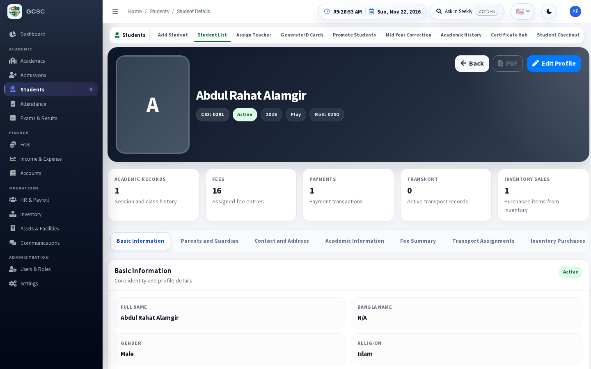 |

**Not done:** the spec suggested moving these forms onto `<x-filter-bar>`. Fixing the shared partial aligned all 10 reports with one change, so the component migration can wait until those screens are redesigned.

---

## Deploying

- Run `npm run build`, because `admin.css` changed.
- No migrations, config or routes changed.
