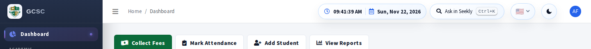
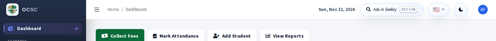
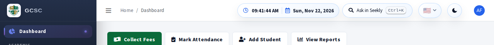
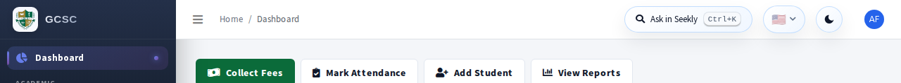
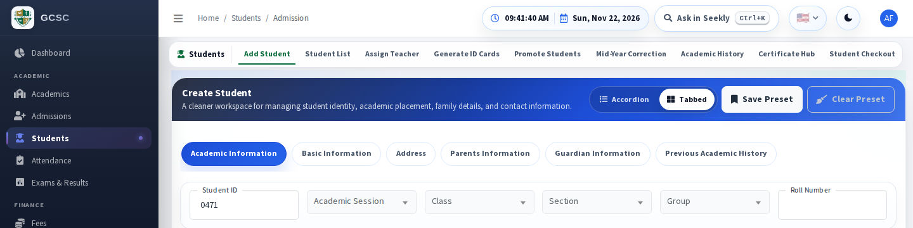
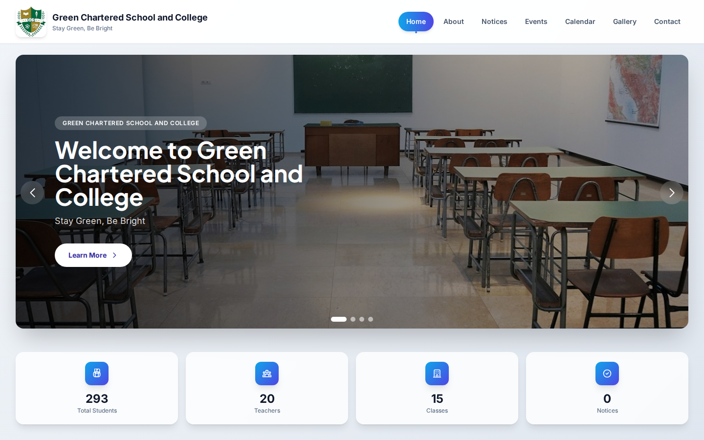
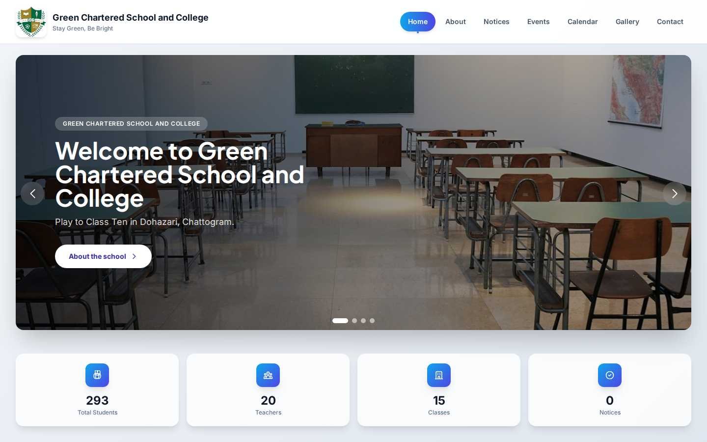
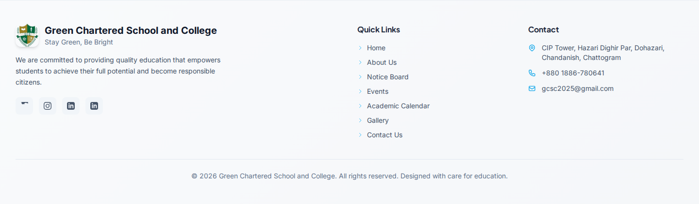
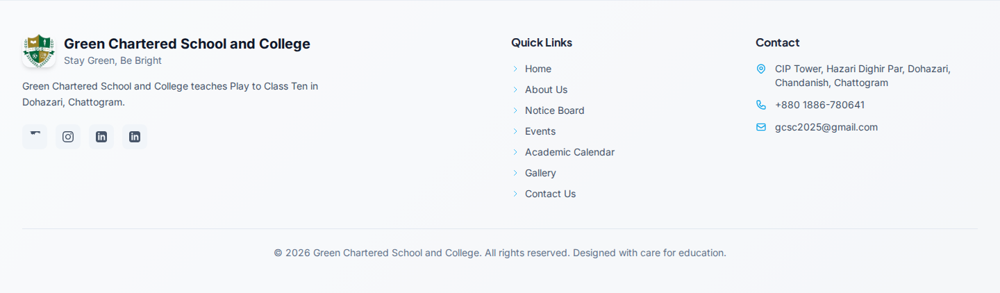

# Changelog: P3 fixes (F-32 to F-33)

**Date:** 2026-11-22 · **Branch:** `fix/p3-F32-F33` (stacked on `fix/p2-F22-F31`)

These fixes cover the two P3 findings from the UI audit (`audit/UI-SPEC.md`, kept locally and gitignored). P3s are delight and polish. The branch is stacked on the P2 branch, which carries P0 and P1, so all four changelogs and their screenshots are here: `P0-FIXES.md`, `P1-FIXES.md`, `P2-FIXES.md` and this file. Once #103, #104 and #105 are merged, this PR's diff is the P3 commit only.

| ID | Problem | Status |
|---|---|---|
| [F-32](#f-32--live-clock-with-seconds-in-the-header) | Live clock with seconds takes prime header space | Fixed |
| [F-33](#f-33--generated-sounding-product-copy) | Generated-sounding product copy | Fixed |

## How it was verified

The checks ran against the local app with a temporary Super Admin, which was deleted afterwards.

| Fix | Check | Before | After |
|---|---|---|---|
| F-32 | Clock visible in the header at 1440 / 1280 | yes (`09:41:38 AM`) / yes | **no / no** |
| F-32 | Date shown | 1440 and 1280, in a 264px pill | **1440 only**, plain text, in the UI language |
| F-33 | Create Student subtitle | "A cleaner workspace for managing student identity, academic placement, family details, and contact information." | **"Add a student to the current session."** |
| F-33 | Public home hero, slide 1 | "Stay Green, Be Bright" + three generic slides ("A nurturing environment where every student thrives." …) | **"Play to Class Ten in Dohazari, Chattogram."** + Admissions / Exam results / Academic calendar |
| F-33 | Public footer | "We are committed to providing quality education that empowers students to achieve their full potential and become responsible citizens." | **"Green Chartered School and College teaches Play to Class Ten in Dohazari, Chattogram."** |
| Regression | 330 screens: HTTP status / empty titles / axe `landmark-one-main`, `button-name`, `link-name` | — | 330 × 200 / 0 / 0, 0, 0 |
| Tests | `php artisan test` | 31 failed on `dev` | 31 failed, the same 31 |

---

## F-32 · Live clock with seconds in the header

**Problem.** Every admin page showed a ticking "05:58:51 PM · Sat, Nov 21, 2026" pill: 264px of prime header space at ≥992px, redrawn every second. The operating system already shows the time. The script also rewrote the date in English, so the Bangla UI showed "Sun, Nov 22" after the first tick.

**Files changed**
- `resources/views/layouts/partials/_top-nav.blade.php`: markup, CSS and the timer script

```blade
{{-- before --}}
<div class="admin-topnav-datetime d-none d-lg-flex align-items-center mr-2">
    <div class="d-flex align-items-center text-right admin-topnav-datetime__inner">
        <span class="admin-topnav-datetime__icon"><i class="far fa-clock"></i></span>
        <span id="topNavClock" class="font-weight-bold small admin-topnav-datetime__clock">{{ now($timezone)->format('h:i:s A') }}</span>
        <span class="admin-topnav-datetime__separator"></span>
        <span class="admin-topnav-datetime__icon"><i class="far fa-calendar-alt"></i></span>
        <span id="topNavDate" class="admin-topnav-datetime__date">{{ now($timezone)->format('D, M d, Y') }}</span>
    </div>
</div>
…
window.__schoolTopNavClockTimer = window.setInterval(updateTopNavClock, 1000);

{{-- after: date only, on wide screens, in the UI language --}}
<time id="topNavDate" class="admin-topnav-date mr-3" datetime="{{ now($timezone)->toDateString() }}">
    {{ now($timezone)->translatedFormat('D, M j, Y') }}
</time>
…
@media (min-width: 1440px) { .admin-topnav-date { display: block; } }
…
window.__schoolTopNavClockTimer = window.setInterval(updateTopNavClock, 60000);
```

- **Script:** once a minute it checks whether the day has changed (for pages left open past midnight). Only then does it rewrite the date, using the page's language, so Bangla stays Bangla.
- **Removed:** the pill's gradient, border, shadow and its dark-mode rules.

| Before | After |
|---|---|
|  |  |
|  |  |

---

## F-33 · Generated-sounding product copy

**Problem.** Some copy read like filler:
- A triadic list on the Create Student form.
- Mission-statement slides on the public home page: "A nurturing environment where every student thrives.", "Fostering curiosity, creativity, and lifelong learning.".
- A generic footer: "empowers students to achieve their full potential".

**Files changed**
- `app/Http/Controllers/Website/PublicWebsiteController.php`: builds a fact line from School Settings
- `resources/views/website/pages/home.blade.php`: default hero slides, used when no banners are uploaded (there are none now)
- `resources/views/website/layouts/app.blade.php`: footer fallback
- `resources/views/pages/students/form.blade.php`: create/edit subtitle
- `lang/bn.json`: the two new subtitle strings

```php
// after — PublicWebsiteController::shared()
// from_class / to_class (Play, Ten) and the last parts of the address (Dohazari … Chattogram)
$classRange = $fromClass && $toClass ? $fromClass . ' to Class ' . $toClass : null;   // "Play to Class Ten"
$locality   = $addressParts[count($addressParts) - 3] . ', ' . end($addressParts);     // "Dohazari, Chattogram"
$site['fact_line'] = "Play to Class Ten in Dohazari, Chattogram.";
$site['footer_about'] = $settings['footer_about'] ?? $schoolName . ' teaches ' . $factLine . '.';
```

```blade
{{-- before (home.blade.php default slides) --}}
['title' => 'Excellence in Education', 'subtitle' => 'A nurturing environment where every student thrives.', …],
['title' => "Building Tomorrow's Leaders", 'subtitle' => 'Quality education with modern facilities and dedicated staff.', …],
['title' => 'A Community of Learners', 'subtitle' => 'Fostering curiosity, creativity, and lifelong learning.', …],

{{-- after: each slide says what the site does, with a matching button --}}
['title' => 'Welcome to …', 'subtitle' => $site['fact_line'] ?? ($site['tagline'] ?? ''), 'cta_text' => 'About the school', …],
['title' => 'Admissions', 'subtitle' => 'Apply online, then check your application status with your application number.', 'cta_text' => 'Apply now', 'cta_url' => route('public.admission.form')],
['title' => 'Exam results', 'subtitle' => 'Look up a published result with the student ID.', 'cta_text' => 'Find a result', 'cta_url' => route('website.result.check')],
['title' => 'Academic calendar', 'subtitle' => 'Term dates, exams and holidays for this session.', 'cta_text' => 'View calendar', …],
```

```blade
{{-- before (students/form.blade.php) --}}
'A cleaner workspace for managing student identity, academic placement, family details, and contact information.'
{{-- after --}}
(isset($student) ? __('Update this student\'s details.') : __('Add a student to the current session.'))
```

- **Built from settings:** the fact line comes from School Settings (class range and address). It updates if those change, and falls back to the school's slogan when they're empty.
- **Footer override:** a `footer_about` value set in Website Settings still takes priority over the generated line.
- **Founding year:** the spec's example included "since <year>". The school's founding year isn't stored anywhere, so it was left out rather than guessed. Add it to the footer text in Website Settings if you want it shown.

| Before | After |
|---|---|
|  |  |
|  |  |
|  |  |

---

## Also in this branch

- **Breadcrumb in Bangla (F-27 follow-up):** labels now pass through `__()`. Before, the last crumb showed the raw page title ("Dashboard") in the Bangla UI.

## Deploying

- No build step, migrations or config changes are needed for P3 alone. If P2 isn't deployed yet, run `npm run build` for it.
