# Changelog: Stretched buttons on tablet and phone

**Date:** 2026-11-22 · **Branch:** `fix/stretched-buttons` (stacked on `fix/p3-F32-F33`)

On screens narrower than 992px, buttons in page and card headers grew to the full height of the title block beside them. Many also stretched to full width. The PDF button on Student Directory became a 44×100px empty box, and the Back button on Create Subject a 607×94px black bar. This wasn't one of the audit findings. It was reported from a screenshot after the P3 round. The branch is stacked on the P3 branch, so the P0–P3 changelogs and screenshots are here too. Once #103 to #106 are merged, this PR's diff is this commit only.

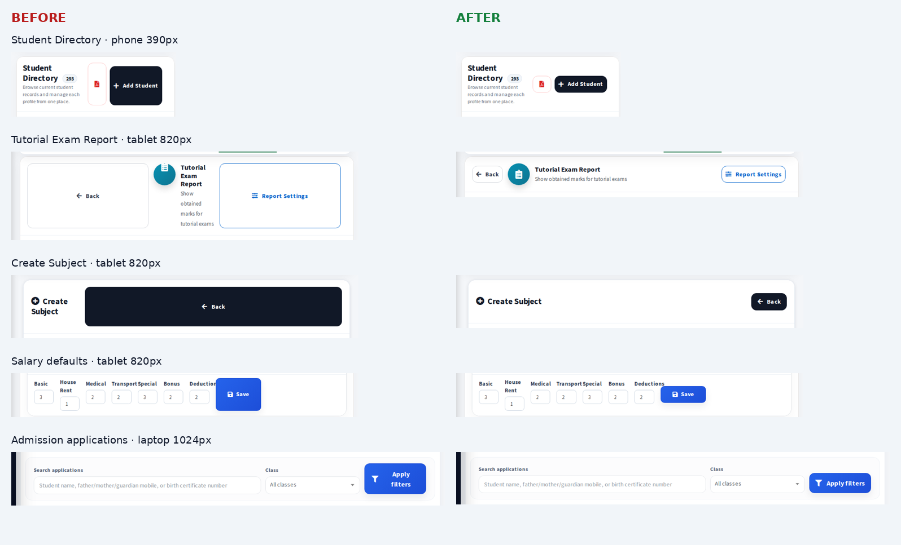

## How it was verified

The checks ran against the local app with a temporary Super Admin, which was deleted afterwards. Every admin screen from the audit was opened at 1440, 1024, 820 and 390px. A button counts as stretched if it is taller than 56px while its text fits on one line (a normal button is 31–44px).

| Check | Before | After |
|---|---|---|
| Screens with a stretched button | **50** (7 at 1024, 25 at 820, 31 at 390, 0 at 1440) | **1**: View Attachment on Edit expense, 62px from its own padding. It looks normal, so it was left alone. |
| Student Directory, phone | PDF 44×100, Add Student 124×92 | 44×40, 124×40 |
| Tutorial Exam Report, tablet | Back and Report Settings 286×154 each | 72×40 and natural width |
| Create Subject, tablet | Back 607×94 | 84×41 |
| Marks entry, tablet | Back 540×80 | 76×40 |
| Pages that scroll sideways, at all three narrow widths | — | none new. `admission` at 390px overflows by 5px, the same as with the old build. |
| `ResponsiveAdminViewsTest` | — | 82 passed |
| `php artisan test` | 31 failed on `dev` | 31 failed, the same 31 |

<details>
<summary>All 50 affected screens (with the widths where the button was stretched)</summary>

`accounting-periods` (390) · `admissions/applications` (1024) · `admissions/approved` (1024) · `admissions/converted` (1024) · `admissions/results` (1024) · `asset-purchases/1` (390) · `attendance/settings` (820, 1024) · `bank-accounts/1/edit` (390) · `certificates/1/edit` (390, 820) · `district/list` (820) · `educational-qualifications` (390, 820) · `exams/1/marks-entry` (390, 820) · `exams/1/preview` (390, 820) · `exams/1/terminal-result` (390, 820) · `expense-categories/create` (390) · `expense-categories/1/edit` (390) · `expenses/create` (820) · `expenses/4/edit` (820, 1024) · `facility-bookings/create` (390) · `fee-sets` (820) · `fees/payment-requests` (390) · `hand-cash` (390) · `hr/leave/create` (390) · `hr/reports/payroll-summary` (390) · `hr/salary/defaults` (820) · `income-categories/create` (390) · `income-categories/1/edit` (390) · `incomes/create` (820) · `incomes/1/edit` (820) · `journal-entries/1` (390) · `mobile-banking-accounts` (390) · `mobile-banking-accounts/create` (390) · `police-station/edit/1` (390) · `police-station/list` (820) · `post-office/list` (820) · `result/progress-report` (390, 820) · `result/tutorial-report` (390, 820) · `result/yearly-final-report` (390, 820) · `results/result-sheets` (390, 820) · `sessions/1/edit` (390) · `shareholder-transactions/create` (820) · `shareholder-transactions/1/edit` (820) · `students` (390) · `students/checkout` (820, 1024) · `subjects/create` (390, 820) · `transactions/create` (820) · `transactions/1/edit` (820) · `transport` (390) · `transports` (390) · `transports/edit/3` (390)

</details>

---

## Cause 1 · A shared rule stretched every header button (45 screens)

**Problem.** A blanket rule in `admin.css`, from the older "Role permission layout change" commit, applied below 992px to every flex box in card headers and every `.d-flex` with common utility classes:
- `align-items: stretch !important` overrode each page's own `align-items-center` or `align-items-end`. Button groups grew to the height of the title and subtitle, and the buttons inside grew with them.
- `width: 100%` on every header button made buttons fill the row. A lone Back button became a full-width bar.
- `margin-top: 0.5rem` between buttons (meant for a stacked layout) pushed the second button out of line.

**Files changed**
- `resources/css/admin.css`

```css
/* before */
@media (max-width: 991.98px) {
    .content-wrapper .card-header .d-flex, … , .content-wrapper .d-flex.flex-wrap {
        flex-direction: row !important;
        align-items: stretch !important;
    }

    .content-wrapper .card-header .btn, .content-wrapper .card-footer .btn, … {
        width: 100%;
    }

    .content-wrapper .card-header .btn + .btn,
    .content-wrapper .card-footer .btn + .btn {
        margin-top: 0.5rem;
        margin-left: 0 !important;
    }
}

/* after */
@media (max-width: 991.98px) {
    .content-wrapper .card-header .d-flex, … , .content-wrapper .d-flex.flex-wrap {
        flex-direction: row !important;
    }

    /* Buttons keep their natural size: never stretched to the height of the
       title block next to them, never forced to full width. */
    .content-wrapper .card-header .btn,
    .content-wrapper .card-footer .btn,
    .content-wrapper .d-flex > .btn,
    .content-wrapper .d-flex > form > .btn {
        width: auto;
        height: auto;
        align-self: center;
        white-space: nowrap;
    }

    .content-wrapper .card-header .btn + .btn,
    .content-wrapper .card-footer .btn + .btn {
        margin-top: 0;
    }
}
```

| Before | After |
|---|---|
| 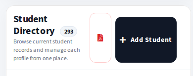 | 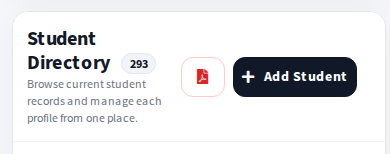 |
| 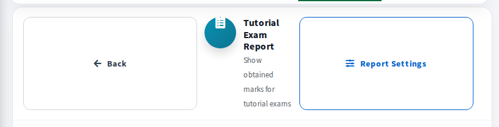 | 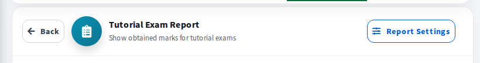 |
| 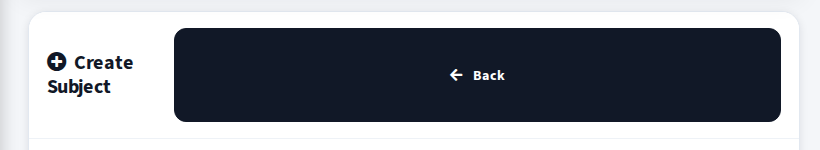 | 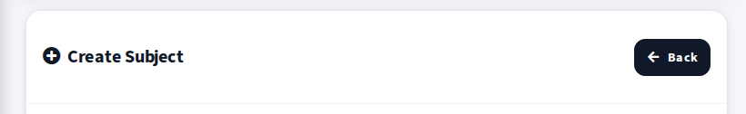 |
| 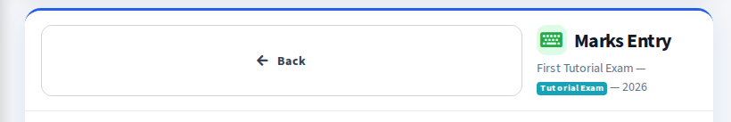 | 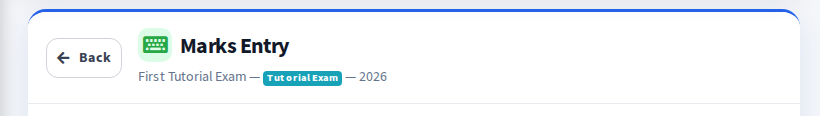 |
| 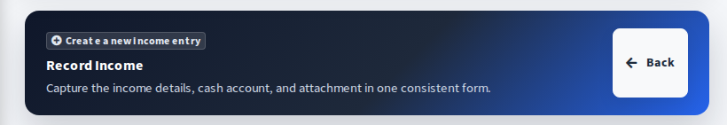 | 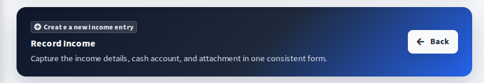 |
| 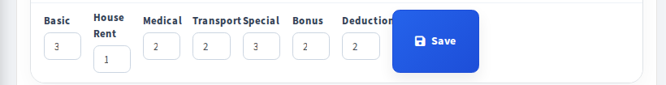 | 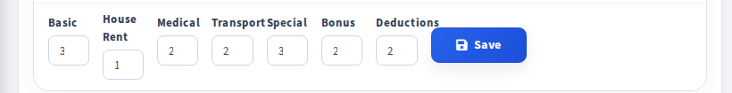 |
|  |  |

---

## Cause 2 · Button labels wrapping in narrow columns (5 screens)

**Problem.** Filter buttons in a narrow grid column (`col-lg-2`) wrapped their label onto two lines ("Apply / filters", "Add / Holiday"), doubling the button height. This also happens at 1024px, above the range of the shared rule.

**Files changed**
- `resources/views/pages/admissions/applications/index.blade.php`, `approved.blade.php`, `converted.blade.php` and `resources/views/pages/admissions/results/index.blade.php`: Apply filters
- `resources/views/pages/attendance/settings.blade.php`: Add Holiday
- `resources/views/pages/students/lifecycle/checkout.blade.php`: Load Students

```blade
{{-- before --}}
<button class="btn btn-primary btn-block" type="submit"><i class="fas fa-filter mr-1"></i> Apply filters</button>
{{-- after --}}
<button class="btn btn-primary btn-block text-nowrap" type="submit"><i class="fas fa-filter mr-1"></i> Apply filters</button>
```

| Button | Before | After |
|---|---|---|
| Apply filters (Admissions, 1024px) | 105×72 | 105×48 |
| Add Holiday (Attendance settings, 820 / 1024px) | 113×62 / 106×62 | 113×41 / 106×41 |
| Load Students (Student checkout, 820 / 1024px) | 161×64 / 150×64 | 161×40 / 150×40 |

| Before | After |
|---|---|
|  | 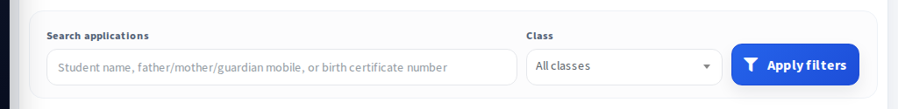 |

---

## Known follow-ups

- **Salary defaults:** the Save button is now centred against the label and input together, so it sits slightly above the inputs. Bottom-aligning it would be a one-line change on that page.

## Deploying

- Run `npm run build`, because `admin.css` changed. No migrations or config changes.
